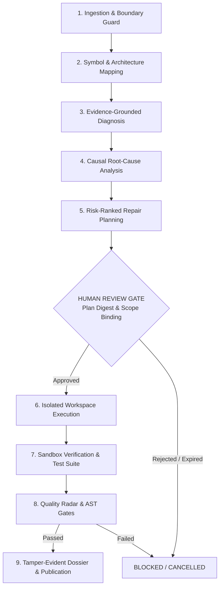

# FORGE: Autonomous Software Engineering Agent

[](https://github.com/thisisanimesh01/FORGE/actions)
[](https://www.python.org/)
[](LICENSE)
[](docs/SECURITY_THREAT_MODEL.md)

FORGE (**F**ind bugs, **O**bserve and understand code, **R**epair defects, **G**enerate and verify tests, **E**ngineer pull requests) is an enterprise-grade autonomous software engineering agent. Unlike conversational coding assistants, FORGE coordinates end-to-end defect investigation, causal root-cause analysis, supervised repair synthesis, and container-isolated regression verification under strict human governance.

---

## Architecture & Lifecycle

FORGE enforces an explicit, deterministic state machine with non-negotiable approval barriers:



---

## Core Capabilities

- **Repository Intelligence**: Cross-file symbol resolution, call-graph construction, module dependency cycle detection, and Git change-impact analysis (`forge.repository`).
- **Evidence-Grounded Diagnosis**: Suspicion scoring backed by AST validation, static checks, and reproduction traces. Raw repository contents are treated as untrusted inputs (`forge.diagnosis`).
- **Causal Root-Cause Analysis**: Multi-hop fault trees and hypothesis validation preventing superficial symptom masking (`forge.causality`).
- **Controlled Repair Planning**: Minimal AST/diff-anchored candidate synthesis with explicit risk scoring, blast-radius estimation, and rollback strategies (`forge.repair_planning`).
- **Container-Isolated Execution**: Repairs execute strictly in isolated scratch environments. Dynamic verification runs within non-root Docker sandboxes (`forge.sandbox`, `forge.repair_execution`).
- **Verification & Quality Gates**: Differential test execution, regression detection, syntax verification, and multi-metric quality scoring (`forge.repair_verification`, `forge.repair_quality`).
- **Tamper-Evident Governance**: Non-negotiable human approvals bound to SHA-256 plan digests and strict file scopes, recorded in append-only SQLite hash-chained ledgers (`forge.orchestration`).

---

## Security by Design

- **Mandatory Human Approval**: Autonomous execution halts after repair planning. Operators must explicitly inspect and authorize the plan digest, repair strategy, and exact file paths before patches are applied.
- **Fail-Secure Sandboxing**: Dynamic checks require Docker. If the daemon is unreachable, runtime checks cleanly fail closed with `SKIPPED_SANDBOX_UNAVAILABLE`; FORGE strictly refuses to execute repository-controlled code on the host.
- **Protected File Boundaries**: Centralized acquisition guards prevent reading or modifying sensitive infrastructure (`.git`, CI workflows, Docker sockets, credentials, environment variables).
- **Local-Only LLM Inference**: Built exclusively for local Ollama endpoints (`http://localhost:11434`, e.g., `deepseek-r1:8b`, `qwen2.5-coder:7b`). Public cloud LLM fallback is disabled by default to eliminate external data leakage.
- **Cryptographic Audit Trail**: All state transitions and tool invocations generate append-only SHA-256 hash-chained event logs with automated secret redaction.

---

## Technology Stack

| Component | Technology | Role |
| :--- | :--- | :--- |
| **Runtime** | Python 3.11 / 3.12 / 3.13 | Core agent execution platform |
| **Data Validation** | Pydantic v2 & Pydantic-Settings | Strict typing and external schema validation |
| **CLI Framework** | Typer & Rich | Operator command-line interface |
| **Persistence** | SQLite (WAL mode) | Durable approval ledger, run states, and hash-chained events |
| **Inference Engine**| Local Ollama (`localhost:11434`)| Local LLM model execution (`deepseek-r1`, `qwen2.5-coder`) |
| **Sandbox Isolation**| Docker (drop-caps, non-root) | Hermetic defect reproduction and test execution |

---

## Quick Start

### 1. Prerequisites
- Python `>=3.11`
- Docker Engine (for sandboxed test verification)
- Local [Ollama](https://ollama.ai) daemon

### 2. Setup
```bash
git clone https://github.com/thisisanimesh01/FORGE.git
cd forge
python3 -m venv .venv
source .venv/bin/activate
pip install -e .
```

### 3. Start Local Inference
```bash
ollama serve
ollama pull deepseek-r1:8b
```

### 4. Verify System Health
```bash
forge doctor
```

---

## Command-Line Usage

### Diagnostic Inspection
Audit local dependencies, Docker socket availability, SQLite schema status, and local Ollama connectivity:
```bash
forge doctor
```

Inspect an untrusted repository's architecture, dependencies, and symbols in read-only mode:
```bash
forge inspect https://github.com/example/repo.git --branch main
```

### End-to-End Orchestration Workflow
Initiate an autonomous defect investigation:
```bash
forge orchestrate run \
  --repo https://github.com/example/repo.git \
  --desc "Fix IndexError when parsing empty input payload" \
  --file src/parser.py
```

Inspect workflow progression and generated repair plans:
```bash
forge orchestrate status <WORKFLOW_ID>
forge orchestrate inspect <WORKFLOW_ID>
```

Authorize an execution plan through the non-negotiable human review boundary:
```bash
forge orchestrate approve <WORKFLOW_ID> \
  --approver "operator@domain.com" \
  --plan-id <PLAN_ID> \
  --plan-digest <SHA256_HEX> \
  --strategy candidate_1 \
  --file src/parser.py
```

Synthesize a comprehensive audit dossier upon completion:
```bash
forge orchestrate report <WORKFLOW_ID> --format markdown
```

---

## Verification & Test Suite

FORGE is backed by a comprehensive regression and security test suite passing on all supported Python versions (3.11, 3.12, and 3.13):

```bash
# Run unit and core orchestration test suite
pytest tests/unit/

# Run complete security boundary and isolation suite
pytest tests/security/

# Run end-to-end full regression suite
pytest
```

*Status: 2,169 tests passed, 2 skipped across Python 3.11–3.13 matrix.*

---

## Documentation Index

- [Operator Guide](docs/OPERATOR_GUIDE.md): Complete operations handbook, workflow lifecycle, and CLI reference.
- [Security Threat Model](docs/SECURITY_THREAT_MODEL.md): Fail-secure guarantees, sandbox boundaries, and SSRF protections.
- [Beta Contract & Guarantees](docs/BETA_CONTRACT.md): Operational invariants and service contract.
- [Known Limitations](docs/BETA_KNOWN_ISSUES.md): Current operational boundaries and environment constraints.
- [Phase 13 Release Report](docs/phase13/FORGE_FINAL_RELEASE_REPORT.md): Final production readiness and system release verification.
- [Phase 13 Acceptance Report](docs/phase13/PHASE13_M5_ACCEPTANCE_REPORT.md): Comprehensive gate results and test metrics.
- [Phase 13 Performance Benchmark](docs/phase13/PHASE13_M4_PERFORMANCE_BENCHMARK_REPORT.md): Cache efficiency, latency, and scalability profiles.

---

## Project Status & Roadmap

The development roadmap of FORGE is **100% complete**:
- **Phase 11**: Intelligent Repository Understanding (Architecture, Symbol Graphs, Impact Analysis)
- **Phase 12**: Advanced Intelligence & Autonomous Defect Repair (Diagnosis, Planning, Patch Synthesis, Quality Gates)
- **Phase 13**: Autonomous Engineering Orchestration & Production Readiness (M1–M5 Final Release)

*There are no subsequent development phases (Phases 14+).*

---

## License

FORGE is licensed under the [Apache 2.0 License](LICENSE).
