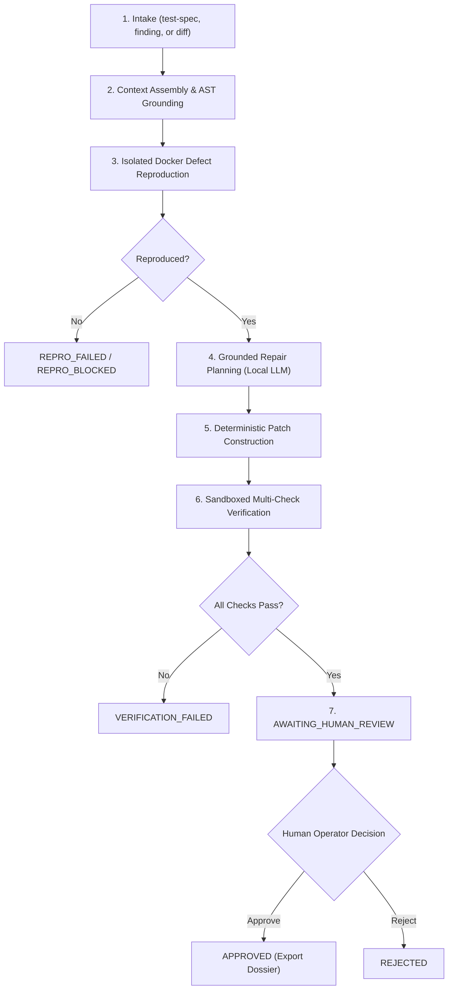

# FORGE Operator Quickstart & Administration Guide

**Document Version:** 1.0.0-beta.1
**Phase:** Phase 6 (Supervised Beta Packaging & Operational Readiness)

---

## 1. Installation

### System Prerequisites
- Python 3.11 or higher
- Git 2.30+
- Docker Engine 20.10+ (required for sandboxed reproduction and verification)
- Local Ollama server (running `http://localhost:11434` with `qwen2.5-coder:1.5b` or stronger)

### Installing via Standalone Distribution Wheel (.whl)
For standard operator workstations without requiring a git source checkout:
```bash
python3 -m venv ~/forge-venv
source ~/forge-venv/bin/activate
pip install forge_core-0.1.0b1-py3-none-any.whl
```

### Installing from Source Distribution (.tar.gz)
```bash
python3 -m venv ~/forge-venv
source ~/forge-venv/bin/activate
pip install forge_core-0.1.0b1.tar.gz
```

### Developer / Editable Installation
For development and debugging:
```bash
git clone https://github.com/thisisanimesh01/FORGE.git
cd FORGE
python3 -m venv .venv
source .venv/bin/activate
pip install -e ".[dev]"
```

### Verification & Shell Completion
Verify that the CLI is accessible:
```bash
forge version
# FORGE version: 0.1.0b1
```

Set up shell tab completion for your preferred shell (`bash`, `zsh`, `fish`, or `powershell`):
```bash
# Automatically install completion into your shell profile:
forge --install-completion zsh

# Or inspect the completion script directly:
forge --show-completion zsh
```

### Upgrading & Uninstallation
To upgrade to a newer beta distribution:
```bash
pip install --upgrade forge_core-<version>-py3-none-any.whl
```

To cleanly uninstall FORGE:
```bash
pip uninstall forge-core
```

---

## 2. Configuration & Diagnostics

Copy the sample configuration file and initialize the local SQLite database:
```bash
cp .env.example .env
forge db init
```

### System Health Diagnostic (`forge doctor`)
Run the unified system health diagnostic to verify dependencies across all execution tiers:
```bash
forge doctor
```

Sample output when dependencies are healthy:
```
FORGE System Health Diagnostic
------------------------------
Python Version: 3.13.6 (/path/to/venv/bin/python)
  [OK] Static repository inspection: available
  [OK] Git executable found: /usr/bin/git (git version 2.50.1)
  [OK] Sandbox interface: available (fail-secure policy active)
  [OK] Docker runtime: Docker daemon reachable (Version: 29.9.2, Image: python:3.11-slim cached locally)
  [OK] SQLite target path: /path/to/FORGE/forge.sqlite3
  [OK] Database file exists (249856 bytes, Schema Version: 2)
  [OK] Secret redaction active (Provider: ollama)
  [OK] LLM Provider 'ollama' credentials: configured
         Status: Ollama server reachable at http://localhost:11434 (Model 'qwen2.5-coder:1.5b' verified in local inventory).
         Model: qwen2.5-coder:1.5b
         API Base: http://localhost:11434
         Network required: no (local)
         Cloud fallback: DISABLED (policy enforced)

Supervised Beta Operational Readiness
-------------------------------------
  Static Inspection: [READY]
  Docker Sandboxing: [READY]
  Local Inference:   [READY]
  Overall Status:    [FULLY_READY]
  System is fully ready for live Supervised Beta operations.
```

If Docker is not running or socket permissions are restricted, FORGE reports:
```
Supervised Beta Operational Readiness
-------------------------------------
  Static Inspection: [READY]
  Docker Sandboxing: [NOT READY - SKIPPED]
  Local Inference:   [READY]
  Overall Status:    [READY_FOR_STATIC_INSPECTION_ONLY]
  System is ready for static repository inspection ONLY. Live execution capabilities disabled (Docker container execution unavailable). FORGE fail-secure policy is active (host execution strictly refused).
```

### Sandbox Diagnostics & Troubleshooting (`forge sandbox doctor`)
Inspect container isolation policies, daemon connectivity, and local image caching:
```bash
forge sandbox doctor
```

Output:
```
FORGE Sandbox Diagnostics
-------------------------
Configured image: python:3.11-slim
Network policy:   disabled (enforced --network none)
Filesystem:       read-only workspace mount with isolated 64MB tmpfs
Process user:     1000:1000 (non-root)
Privileges:       no-new-privileges, cap-drop ALL
Runtime Status:   [AVAILABLE] Docker daemon reachable (Version: 29.9.2, Image: python:3.11-slim cached locally)
Security notice:  FORGE strictly refuses to run repository code directly on host.
```

**Common Sandbox Troubleshooting:**
- **Docker socket permission denied on macOS (`~/.docker/run/docker.sock`):** Ensure Docker Desktop is active and "Allow the default Docker socket to be used" is enabled in Docker Desktop Settings > Advanced.
- **Docker socket permission denied on Linux (`/var/run/docker.sock`):** Add your user to the docker group: `sudo usermod -aG docker $USER`.
- **Image not cached locally:** Pull the required image before running sandboxed workflows: `docker pull python:3.11-slim`.

### LLM Provider Diagnostics (`forge provider doctor`)
Validate provider endpoint availability, local model presence, and safety invariants:
```bash
forge provider doctor
```

Output:
```
FORGE LLM Provider Diagnostics
------------------------------
Configured Provider: ollama
Configured Model:    qwen2.5-coder:1.5b
API Endpoint Base:   http://localhost:11434
Network Required:    no (local)
Cloud Fallback:      DISABLED (enforced)
Status:              [OK] Ollama server reachable at http://localhost:11434 (Model 'qwen2.5-coder:1.5b' verified in local inventory).
```

**Common Provider Troubleshooting:**
- **Connection refused:** Start the local Ollama server: `ollama serve`.
- **Model not in inventory (`[MISCONFIGURED]`):** Pull the configured coding model: `ollama pull qwen2.5-coder:1.5b`.
- **Unsafe cloud fallback (`[UNSAFE]`):** Cloud fallback is forbidden. Ensure `FORGE_ALLOW_CLOUD_FALLBACK=false` in your `.env`.

---

## 3. Supervised Engineering Workflow Lifecycle

FORGE executes workflows through a deterministic state machine:



---

## 4. Step-by-Step Operator Usage

### Step 1: Create a Task Intake
Register a defect using a failing test specification against a local target repository:
```bash
forge workflow intake test-spec \
    --repo /path/to/target_repository \
    --test-file tests/test_backoff.py \
    --command "python3 -m unittest -v tests/test_backoff.py" \
    --affected-file src/backoff.py \
    --pattern "AssertionError"
```

### Step 2: Initialize the Workflow
Start the engineering workflow:
```bash
forge workflow start --intake-id <INTAKE_ID>
```

### Step 3: Reproduce the Defect in Docker
Execute isolated reproduction inside the Docker sandbox:
```bash
forge workflow reproduce <WORKFLOW_ID>
```

### Step 4: Generate a Grounded Repair Plan
Generate an evidence-grounded repair proposal using local Ollama:
```bash
forge workflow plan-repair <WORKFLOW_ID> --provider ollama --model qwen2.5-coder:1.5b
```

### Step 5: Multi-Check Verification
Verify the patch candidate across reproduction, regression, AST invariants, and linters:
```bash
forge workflow verify <WORKFLOW_ID>
```

### Step 6: Inspect Candidate Patch & Audit Ledger
List all workflows or inspect a specific workflow dashboard:
```bash
# List all active and historical workflows:
forge workflow list

# Inspect full workflow dashboard (or use 'forge workflow status'):
forge workflow show <WORKFLOW_ID>
```

The workflow inspection dashboard displays:
- **Operational Status:** Current lifecycle state with human-readable operational category (`[AWAITING OPERATOR REVIEW]`, `[PENDING]`, `[BLOCKED]`, `[APPROVED]`, `[REJECTED]`, or `[FAILED]`).
- **Next Permitted Action:** Concrete guidance and exact command syntax required to advance or recover the workflow.
- **Candidate Repair Patch:** Target file path, lines added/removed, SHA-256 digest, and syntax-highlighted unified diff codeblock.
- **Multi-Check Verification Results:** Comprehensive table detailing check type, name, status (`PASSED`, `FAILED`, `BLOCKED`, `SKIPPED`), execution duration, and diagnostic message.
- **Audit Ledger Timeline:** Monotonic sequential events, timestamps, and transition metadata.

### Step 7: Human Review & Decision Gate
Submit your review decision (`approve` or `reject`). Optionally pass `--repo` to verify that the target repository has not drifted:
```bash
# To approve with target repository revision check:
forge workflow review <WORKFLOW_ID> \
    --decision approve \
    --notes "Verified minimal 1-line backoff delay repair." \
    --repo /path/to/target_repository

# To reject:
forge workflow review <WORKFLOW_ID> \
    --decision reject \
    --notes "Inverts condition but omits required sentinel return."
```

Approval strictly validates:
1. The candidate patch SHA-256 digest matches the stored unified diff.
2. The verification aggregate outcome is `PASSED` with zero regressions detected.
3. The target repository HEAD matches the pinned `base_commit_sha`.

### Step 8: Export the Certified Engineering Dossier
Export the final patch diff, verification certificates, and audit record:
```bash
forge workflow export <WORKFLOW_ID> --out-dir ./dossiers
```

---

## 5. Troubleshooting & FAQ

### Interrupted Workflows & Safe Recovery
- **Interrupted Reproduction:** If reproduction fails or was cancelled, the workflow enters `REPRO_BLOCKED`. Run `forge workflow resume <WORKFLOW_ID>` to transition back to `REPRODUCTION_PENDING` and re-run reproduction.
- **Interrupted Repair Planning:** If the process was interrupted while generating a plan (`REPAIR_PENDING` without a validated plan), run `forge workflow plan-repair <WORKFLOW_ID>` to cleanly resume planning without state corruption.
- **Interrupted Human Review:** If an operator disconnects while the workflow is in `AWAITING_HUMAN_REVIEW`, run `forge workflow show <WORKFLOW_ID>` or `forge workflow resume <WORKFLOW_ID>` to inspect the candidate and submit a decision.
- **Terminal States Are Immutable:** Workflows in `APPROVED` or `REJECTED` cannot be resumed or modified.

### Docker Sandbox Shows `[WARN] Docker runtime unavailable`
- Ensure the Docker daemon is running (`docker info`).
- If running under restricted user permissions, ensure your user has access to `unix:///var/run/docker.sock` or `~/.docker/run/docker.sock`.
- FORGE will safely refuse to run target code on your host if Docker is unavailable.

### Model Times Out or Generates Malformed Syntax
- FORGE enforces a bounded retry budget (default: 2 retries) with structured syntax feedback.
- If the model exhausts its retry budget, the workflow transitions safely to `repair_failed`.
- Ensure Ollama is responsive by testing `curl http://localhost:11434/api/tags`.

### Target Repository Modified Between Stages (Revision Drift)
- If the target repository HEAD diverges from the finding's pinned `base_commit_sha`, FORGE intercepts this as `RevisionDriftError` and halts approval to protect evidence integrity.
- To recover, ensure the target repository is at the pinned commit SHA before approving, or restart from intake if working against a new base revision.
