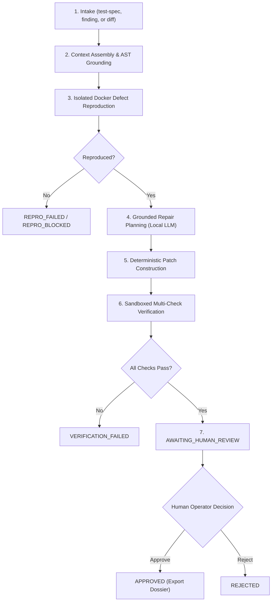

# FORGE Operator Quickstart & Administration Guide

**Document Version:** 1.0.0-beta.1
**Phase:** Phase 6 (Supervised Beta Packaging & Operational Readiness)

---

## 1. Installation

### System Prerequisites
- Python 3.11 or higher
- Git 2.30+
- Docker Engine 20.10+ (required for sandboxed reproduction and verification)
- Local Ollama server (running `http://localhost:11434` with `qwen2.5-coder:1.5b` or stronger)

### Installing FORGE
Clone the repository and install in an isolated Python virtual environment:
```bash
git clone https://github.com/thisisanimesh01/FORGE.git
cd FORGE
python3 -m venv .venv
source .venv/bin/activate
pip install -e ".[dev]"
```

Verify that the CLI is accessible:
```bash
forge version
# FORGE version: 0.1.0b1
```

---

## 2. Configuration & Diagnostics

Copy the sample configuration file and initialize the local SQLite database:
```bash
cp .env.example .env
forge db init
```

Run the system diagnostics tool to verify environment readiness:
```bash
forge doctor
```

Sample expected output:
```
FORGE System Health Diagnostic
------------------------------
Python Version: 3.13.x (/path/to/venv/bin/python)
  [OK] Static repository inspection: available
  [OK] Git executable found: /usr/bin/git
  [OK] Sandbox interface: available (fail-secure policy active)
  [OK] Docker runtime: Docker daemon reachable (Version: 29.9.2, Image: python:3.11-slim)
  [OK] SQLite target path: /path/to/FORGE/forge.sqlite3
  [OK] Database file exists (630784 bytes)
  [OK] Secret redaction active (Provider: ollama)
  [OK] LLM Provider 'ollama' credentials: configured
         Model: qwen2.5-coder:1.5b
         API Base: http://localhost:11434
         Network required: no (local)
         Cloud fallback: DISABLED (policy enforced)
System is ready for Supervised Beta operations.
```

---

## 3. Supervised Engineering Workflow Lifecycle

FORGE executes workflows through a deterministic state machine:



---

## 4. Step-by-Step Operator Usage

### Step 1: Create a Task Intake
Register a defect using a failing test specification against a local target repository:
```bash
forge workflow intake test-spec \
    --repo /path/to/target_repository \
    --test-file tests/test_backoff.py \
    --command "python3 -m unittest -v tests/test_backoff.py" \
    --affected-file src/backoff.py \
    --pattern "AssertionError"
```

### Step 2: Initialize the Workflow
Start the engineering workflow:
```bash
forge workflow start --intake-id <INTAKE_ID>
```

### Step 3: Reproduce the Defect in Docker
Execute isolated reproduction inside the Docker sandbox:
```bash
forge workflow reproduce <WORKFLOW_ID>
```

### Step 4: Generate a Grounded Repair Plan
Generate an evidence-grounded repair proposal using local Ollama:
```bash
forge workflow plan-repair <WORKFLOW_ID> --provider ollama --model qwen2.5-coder:1.5b
```

### Step 5: Multi-Check Verification
Verify the patch candidate across reproduction, regression, AST invariants, and linters:
```bash
forge workflow verify <WORKFLOW_ID>
```

### Step 6: Inspect Candidate Patch & Audit Ledger
View the workflow status, candidate unified diff, and event trail:
```bash
forge workflow show <WORKFLOW_ID>
```

### Step 7: Human Review & Decision Gate
Submit your review decision (`approve` or `reject`):
```bash
# To approve:
forge workflow review <WORKFLOW_ID> --decision approve --notes "Verified minimal 1-line backoff delay repair."

# To reject:
forge workflow review <WORKFLOW_ID> --decision reject --notes "Inverts condition but omits required sentinel return."
```

### Step 8: Export the Certified Engineering Dossier
Export the final patch diff, verification certificates, and audit record:
```bash
forge workflow export <WORKFLOW_ID> --out-dir ./dossiers
```

---

## 5. Troubleshooting & FAQ

### Docker Sandbox Shows `[WARN] Docker runtime unavailable`
- Ensure the Docker daemon is running (`docker info`).
- If running under restricted user permissions, ensure your user has access to `unix:///var/run/docker.sock` or `~/.docker/run/docker.sock`.
- FORGE will safely refuse to run target code on your host if Docker is unavailable.

### Model Times Out or Generates Malformed Syntax
- FORGE enforces a bounded retry budget (default: 2 retries) with structured syntax feedback.
- If the model exhausts its retry budget, the workflow transitions safely to `repair_failed`.
- Ensure Ollama is responsive by testing `curl http://localhost:11434/api/tags`.

### Target Repository Modified Between Stages
- If someone edits the target repository while a workflow is in flight, FORGE intercepts this as `RevisionDriftError` and halts to protect evidence integrity.
- To recover, reset the target repository to the pinned base commit SHA and resume the workflow:
```bash
forge workflow resume <WORKFLOW_ID>
```
