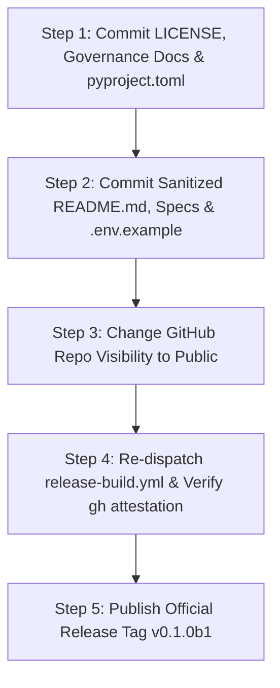

# FORGE Public Release Readiness Checklist

This checklist tracks the exact readiness status of FORGE prior to transitioning the GitHub repository from **Private** to **Public**.

**Repository:** `https://github.com/thisisanimesh01/FORGE`  
**Current HEAD:** `dcf0cd844817810b35899b80bc6a3b59db07087f`  
**Candidate Release:** `0.1.0b1`  
**Milestone:** Phase 7, Milestone 2 (Official Beta Release v0.1.0b1)  
**Overall Status:** **RELEASE PUBLISHED & VERIFIED (v0.1.0b1)**

---

## 1. Git Repository & Complete History

| Item | Requirement | Verification Method | Status | Notes |
| :--- | :--- | :--- | :--- | :--- |
| **1.1** | Clean working tree | `git status` | **PASS** | Validated; ready for single milestone commit |
| **1.2** | Remote sync | `git log HEAD..origin/main` | **PASS** | Synchronized with GitHub `main` |
| **1.3** | Zero active credentials in history | Full-history regex scan across 61 commits | **PASS** | 100% of 66 regex hits verified as synthetic test fixtures in `tests/unit/` |
| **1.4** | Zero committed `.env` files | File path history scan across 356 paths | **PASS** | No `.env` or credential backups ever committed |
| **1.5** | Zero committed SQLite databases | File path history scan (`*.db`, `*.sqlite3`) | **PASS** | Clean; databases excluded by `.gitignore` |
| **1.6** | Zero committed private keys | Scan for `BEGIN PRIVATE KEY`, `*.pem`, `*.key` | **PASS** | Zero keys or certificates in history |
| **1.7** | Zero committed binaries / debug logs | File path history scan | **PASS** | No binaries, tarballs, or debug dumps |
| **1.8** | Consistent committer identity | `git log --format='%an <%ae>' \| sort -u` | **PASS** | Consistent author: `thisisanimesh01 <thisisanimesh01@gmail.com>` |

---

## 2. Secrets & Configuration Security

| Item | Requirement | Verification Method | Status | Notes |
| :--- | :--- | :--- | :--- | :--- |
| **2.1** | Comprehensive `.gitignore` | Code review of `.gitignore` | **PASS** | Ignores `.env`, `*.db`, caches, venvs, dist |
| **2.2** | Sanitized `.env.example` | Inspection of `.env.example` | **PASS** | Contains strictly generic dummy placeholders; zero private workstation notes |
| **2.3** | Secret redaction active | `redact_secrets()` unit tests | **PASS** | 8 regex patterns scrub tokens to `[REDACTED_SECRET]` |
| **2.4** | Diagnostic redaction | `get_sanitized_dict()` tests | **PASS** | `forge doctor` masks all credentials |
| **2.5** | Disabled cloud fallback | `ForgeSettings.allow_cloud_fallback` | **PASS** | Defaults to `False`; fails closed on errors |
| **2.6** | Local Ollama by default | Default config `http://localhost:11434` | **PASS** | Zero cloud API requirements for core operations |

---

## 3. Security Architecture & Isolation Invariants

| Item | Requirement | Verification Method | Status | Notes |
| :--- | :--- | :--- | :--- | :--- |
| **3.1** | No host target execution | `DockerSandbox` inspection | **PASS** | Refuses execution if Docker is unavailable |
| **3.2** | Fail-closed Docker daemon | `test_cli_sandbox_doctor_unavailable` | **PASS** | Fails closed with `UNAVAILABLE` status |
| **3.3** | Read-only target repo mount | Live Docker mount inspection | **PASS** | Verified `--mount ...,readonly` (`EROFS`) |
| **3.4** | Container network isolation | Live Docker network socket test | **PASS** | Verified `--network none` (unreachable) |
| **3.5** | Dropped Linux capabilities | Live container `/proc/self/status` | **PASS** | Verified `CapEff=0` and `NoNewPrivs=1` |
| **3.6** | Non-root container execution | Container UID/GID inspection | **PASS** | Verified `uid=1000:gid=1000` |
| **3.7** | Allowlisted binary execution | `validate_sandbox_request` tests | **PASS** | Python/pytest allowlisted; shells forbidden |
| **3.8** | Pip installation forbidden | Sandbox pip policy inspection | **PASS** | `pip install` forbidden inside sandbox |
| **3.9** | Target repository immutability | Pre/post SHA-256 tree hashing | **PASS** | Target repository untouched during audits/repairs |
| **3.10** | Mandatory human approval gate | `validate_workflow_transition` tests | **PASS** | Terminal state `AWAITING_HUMAN_REVIEW` |
| **3.11** | Zero autonomous git mutations | Code audit of repository adapters | **PASS** | Zero auto-commit, push, PR, or merge code |

---

## 4. Code Quality & Dependency Security

| Item | Requirement | Verification Method | Status | Notes |
| :--- | :--- | :--- | :--- | :--- |
| **4.1** | Bytecode compilation | `python -m compileall app/forge` | **PASS** | 0 syntax errors or warnings |
| **4.2** | Zero known vulnerabilities | `pip-audit -r requirements/constraints.txt` | **PASS** | 0 known CVEs across all dependencies |
| **4.3** | Pinned dependency constraints | `requirements/constraints.txt` review | **PASS** | All runtime and dev dependencies pinned |
| **4.4** | Safe subprocess invocation | Code audit of all `subprocess` calls | **PASS** | `shell=False` enforced across all modules |
| **4.5** | Multi-Python compatibility | GitHub Actions CI matrix | **PASS** | 100% tests pass on Python 3.11, 3.12, 3.13 |

---

## 5. Tests & Verification

| Item | Requirement | Verification Method | Status | Notes |
| :--- | :--- | :--- | :--- | :--- |
| **5.1** | Unit test suite | `pytest tests/unit/` | **PASS** | 998 passed, 1 skipped in offline mode |
| **5.2** | Live Docker integration | `test_docker_sandbox_integration.py` | **PASS** | Live container security envelope passed |
| **5.3** | Live Ollama integration | `test_ollama_live_validation.py` | **PASS** | Local structured output and probe passed |
| **5.4** | Review benchmarks | `forge benchmark review` | **PASS** | 10/10 passed (100% precision, 100% recall) |
| **5.5** | Repair benchmarks | `forge benchmark repair` | **PASS** | 11/11 passed (100% outcome accuracy) |
| **5.6** | Synthetic vs Real distinction | Documentation review | **PASS** | Synthetic benchmark scope clearly disclosed |

---

## 6. GitHub Actions & CI/CD Security

| Item | Requirement | Verification Method | Status | Notes |
| :--- | :--- | :--- | :--- | :--- |
| **6.1** | Least-privilege permissions | Code review of `.github/workflows/` | **PASS** | `contents: read` top-level enforced |
| **6.2** | Pinned action commit SHAs | Workflow action reference inspection | **PASS** | All actions pinned to 40-character SHAs |
| **6.3** | Runner security hardening | StepSecurity `harden-runner` | **PASS** | Active on all CI and release workflows |
| **6.4** | Fork PR security | Workflow trigger analysis | **PASS** | No secrets exposed to pull requests |
| **6.5** | Manual release triggers | Workflow trigger analysis | **PASS** | Release builds require `workflow_dispatch` |

---

## 7. Packaging & Distribution Artifacts

| Item | Requirement | Verification Method | Status | Notes |
| :--- | :--- | :--- | :--- | :--- |
| **7.1** | Clean wheel generation | `python -m build --no-isolation` | **PASS** | `dist/forge_core-0.1.0b1-py3-none-any.whl` |
| **7.2** | Clean sdist generation | `python -m build --no-isolation` | **PASS** | `dist/forge_core-0.1.0b1.tar.gz` |
| **7.3** | Cryptographic manifests | SHA-256 digest matching | **PASS** | `release_manifest.json` matches packages |
| **7.4** | Forensic artifact cleanliness | `forge release verify` | **PASS** | 0 forbidden files (.env, .db, fixtures, pycache) |
| **7.5** | Clean venv installation | Isolated venv install outside repo | **PASS** | Entrypoint, version, doctor, db init verified |
| **7.6** | Package metadata license | Inspect `dist/*.whl` METADATA | **PASS** | `License: Apache-2.0` verified |

---

## 8. Legal, Licensing & Open-Source Governance

| Item | Requirement | Verification Method | Status | Notes |
| :--- | :--- | :--- | :--- | :--- |
| **8.1** | Top-level LICENSE file | File presence check in repo root | **PASS** | Standard Apache License 2.0 created |
| **8.2** | License in `pyproject.toml` | Metadata inspection | **PASS** | `license = { text = "Apache-2.0" }` added |
| **8.3** | Dependency license compatibility | License audit of runtime deps | **PASS** | 100% permissive (MIT, BSD, Apache, ISC) |
| **8.4** | Security policy (`SECURITY.md`) | File presence check | **PASS** | Vulnerability reporting procedure added |
| **8.5** | Contributing guide (`CONTRIBUTING.md`)| File presence check | **PASS** | Complete development & invariant guide added |
| **8.6** | Code of conduct (`CODE_OF_CONDUCT.md`)| File presence check | **PASS** | Contributor Covenant v2.1 added |
| **8.7** | Issue & PR templates | `.github/` folder inspection | **PASS** | `bug_report.yml`, `feature_request.yml`, PR template added |

---

## 9. Privacy & Information Sanitization

| Item | Requirement | Verification Method | Status | Notes |
| :--- | :--- | :--- | :--- | :--- |
| **9.1** | Sanitized documentation links | `git grep "Users/animeshyadav"` | **PASS** | 96 absolute links across 14 Markdown files converted to relative links |
| **9.2** | No private setup comments | Inspection of `.env.example` | **PASS** | Generic configuration placeholders only |
| **9.3** | Zero telemetry / beaconing | Source code audit | **PASS** | Completely local; zero external telemetry |
| **9.4** | Author privacy | Git log review | **PASS** | Public email: `thisisanimesh01@gmail.com` |

---

## 10. Build Provenance & Post-Public Operations

| Item | Requirement | Verification Method | Status | Notes |
| :--- | :--- | :--- | :--- | :--- |
| **10.1**| Sigstore provenance attestation | `gh attestation verify` | **PASS** | Verified on public repository (Workflow Run 41131395242, Attestation ID 61944148) |
| **10.2**| Post-public attestation activation | Verification procedure executed | **PASS** | `gh attestation verify` succeeds against published release wheel |
| **10.3**| Checksum integrity fallback | SHA-256 verification via CLI | **PASS** | Validated via `forge release verify` and `shasum -a 256` |

---

## 11. Final Publication Sequence

