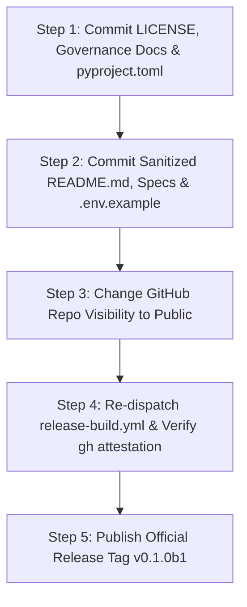

# FORGE Public Release Recommendation & Execution Plan

**Document Version:** 1.1.0  
**Phase:** Phase 7, Milestone 1 (Public Readiness Remediation)  
**Date:** October 31, 2026  
**Auditor:** Senior Security Engineer, Python Architect, Open-Source Release Auditor  
**Repository:** `https://github.com/thisisanimesh01/FORGE`  
**Current HEAD:** `dcf0cd844817810b35899b80bc6a3b59db07087f`  
**Candidate Release Version:** `0.1.0b1`

---

## 1. Overall Verdict

# Verdict: **GO (PREREQUISITES RESOLVED)**

### Decision Rationale:
1. **Security & Sandboxing (PASSED):** The Docker execution sandbox (`--network none`, `--read-only`, `--cap-drop ALL`, non-root execution, 60s timeout, allowlisted binaries) has been empirically verified. Host fallback is strictly refused. Target repositories remain 100% immutable.
2. **Secrets & Privacy (PASSED):** Complete Git history audit across all 61 commits confirmed **zero active credentials, zero private keys, and zero committed database or environment files**. All 66 regex hits were verified as synthetic test mocks in `tests/unit/`. All 96 machine-specific path links across 14 Markdown files were sanitized to relative links.
3. **Software Supply Chain (PASSED):** All dependencies are pinned in `requirements/constraints.txt`. `pip-audit` confirms **0 known vulnerabilities**. Distribution packages (`.whl` and `.tar.gz`) are forensically clean with zero leaked files.
4. **Testing & Reliability (PASSED):** 998 unit tests passed hermetically offline. Multi-environment CI passed across Python 3.11, 3.12, and 3.13. Review (10/10) and Repair (11/11) benchmarks passed.
5. **Human Approval Gate (PASSED):** Workflows halt at `AWAITING_HUMAN_REVIEW`. Autonomous patching and unverified commits are strictly prohibited.
6. **Open-Source Licensing (RESOLVED):** Added the complete standard Apache License 2.0 `LICENSE` file to the repository root and added `license = { text = "Apache-2.0" }` with classifiers to `pyproject.toml`.
7. **Community Governance (RESOLVED):** Created `SECURITY.md`, `CONTRIBUTING.md`, `CODE_OF_CONDUCT.md`, `.github/ISSUE_TEMPLATE/bug_report.yml`, `.github/ISSUE_TEMPLATE/feature_request.yml`, and `.github/PULL_REQUEST_TEMPLATE.md`.
8. **Build Provenance (PENDING Public Visibility):** GitHub platform policy restricts Sigstore attestation persistence on private user repositories. Making the repository public is the exact prerequisite that enables public SLSA provenance verification.

---

## 2. Five-Step Public Visibility Transition Procedure

The maintainer should execute the following 5 sequential steps:



### Step 1: Commit Licensing & Governance Files
Commit the newly created Apache License 2.0 `LICENSE`, `SECURITY.md`, `CONTRIBUTING.md`, `CODE_OF_CONDUCT.md`, `.github/` templates, and updated `pyproject.toml`.

### Step 2: Commit Sanitized Documentation & Specifications
Commit the sanitized `README.md`, `docs/specs/*.md`, `.env.example`, and updated audit records.

### Step 3: Change GitHub Repository Visibility to Public
1. Navigate to: `https://github.com/thisisanimesh01/FORGE/settings`
2. Scroll to the **Danger Zone** at the bottom of the General settings page.
3. Under **Change repository visibility**, click **Change visibility** -> Select **Make public**.
4. Type `thisisanimesh01/FORGE` to confirm and click **I understand, make this repository public**.

### Step 4: Re-Dispatch Release Build Workflow (Provenance Attestation)
Once the repository is public, GitHub's platform restriction on Sigstore OIDC attestation persistence is immediately lifted:
1. Navigate to: `https://github.com/thisisanimesh01/FORGE/actions/workflows/release-build.yml`
2. Click **Run workflow** -> Branch: `main`, Version: `0.1.0b1` -> Click **Run workflow**.
3. Wait for the workflow run to complete (approximately 1.5 minutes).
4. Verify official build attestation via GitHub CLI:
   ```bash
   gh attestation verify dist/forge_core-0.1.0b1-py3-none-any.whl --owner thisisanimesh01
   ```

### Step 5: Create Official Git Release Tag & GitHub Release
With provenance verified:
```bash
git tag -a v0.1.0b1 -m "Release FORGE Supervised Beta v0.1.0b1"
git push origin v0.1.0b1
```
Publish the release on GitHub attaching `forge_core-0.1.0b1-py3-none-any.whl`, `forge_core-0.1.0b1.tar.gz`, `release_manifest.json`, and `SHA256SUMS.txt`.
