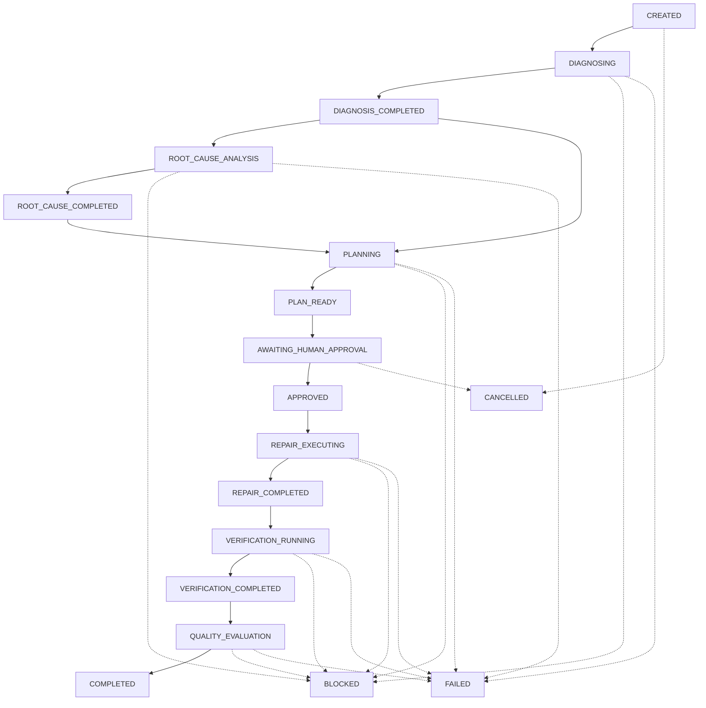

# Phase 13, Milestone 1: End-to-End Engineering Orchestration

**Milestone Report & Technical Verification**<br>
**Repository:** `FORGE`<br>
**Milestone:** Phase 13 M1 — End-to-End Engineering Orchestration<br>
**Status:** Completed & Verification Gate Passed<br>
**Branch:** `phase-13-m1-engineering-orchestration`<br>
**Target:** `main`

---

## 1. Executive Summary

Phase 13 Milestone 1 introduces FORGE's **End-to-End Engineering Orchestration Engine**. This milestone marks the inception of Phase 13 (Autonomous Engineering Orchestration), seamlessly connecting all Phase 12 capabilities:
- **M1**: Evidence-Driven Defect Diagnosis (`forge.diagnosis`)
- **M2**: Root-Cause Analysis Engine (`forge.causality`)
- **M3**: Repair Planning Engine (`forge.repair_planning`)
- **M4**: Controlled Autonomous Repair (`forge.repair_execution`)
- **M5**: Repair Verification Engine (`forge.repair_verification`)
- **M6**: Repair Quality & Reliability Engine (`forge.repair_quality`)

Phase 13 M1 unifies these independent engines into a coherent, deterministic, auditable, and human-supervised engineering lifecycle:
- **Explicit 18-State Machine**: Enforces deterministic forward progression and branch containment across all stages with zero illegal shortcuts or skips.
- **Non-Negotiable Human Approval Boundary**: Enforces mandatory human approval between repair planning (M3) and repair execution (M4) backed by canonical SHA-256 plan digest binding, strategy alignment, scope allowlists, and durable SQLite replay protection.
- **Fail-Closed Verification & Quality Lifecycle**: Propagates execution results, baseline comparisons, and multi-dimensional quality scores. Verification regressions or quality rejections automatically transition the workflow to `BLOCKED`, strictly preventing unverified repairs from completing.
- **Permanent Safety Invariant (`requires_human_review = True`)**: Hardcoded across all workflow models and reports, preventing automatic code merges, branch deletion, or software deployment without explicit human authorization.
- **Cryptographic Audit Event Chaining**: Append-only event trail linked via SHA-256 hash chaining (`prev_event_hash -> event_hash`) with automatic secret redaction and sequence integrity checking.
- **ToolRegistry & CLI Integration**: Exposes 6 typed orchestration tools (bringing the registry to 65 tools) and CLI commands (`forge orchestrate run/status/report`).

---

## 2. Architecture & Component Structure

The engine is located under `app/forge/orchestration/`:

```
app/forge/orchestration/
├── __init__.py           # Package exports and public interfaces
├── schemas.py            # Strict Pydantic models (WorkflowState, WorkflowStage, EngineeringWorkflowResult)
├── state.py              # Explicit lifecycle state machine, ALLOWED_TRANSITIONS, and transition validators
├── events.py             # OrchestrationEventRecorder producing SHA-256 event audit chains
├── approval.py           # OrchestrationApprovalManager enforcing plan digest, scope, expiry, replay protection
├── report.py             # EngineeringReportGenerator synthesizing comprehensive markdown reports
├── adapters.py           # Abstract stage adapters, production adapters, and deterministic test fakes
├── orchestrator.py       # EngineeringOrchestrator coordinating the end-to-end engineering pipeline
└── tools.py              # OrchestrationTools exposing 6 typed tools for ToolRegistry
```

---

## 3. Explicit Lifecycle State Machine

The workflow enforces a strict 18-state lifecycle with explicit transition constraints:



### State Definitions
1. `CREATED`: Initial workflow context configured.
2. `DIAGNOSING`: Evidence-driven failure localization active.
3. `DIAGNOSIS_COMPLETED`: Candidate locations and hypotheses synthesized.
4. `ROOT_CAUSE_ANALYSIS`: Causal graph traversal isolating root causes.
5. `ROOT_CAUSE_COMPLETED`: Proven or plausible causal chain constructed.
6. `PLANNING`: Minimal candidate repair strategy formulated.
7. `PLAN_READY`: Structured repair plan and verification plan constructed.
8. `AWAITING_HUMAN_APPROVAL`: Execution paused pending explicit human signoff.
9. `APPROVED`: Cryptographically verified approval contract recorded.
10. `REPAIR_EXECUTING`: Isolated scratch workspace patch application running.
11. `REPAIR_COMPLETED`: Patch applied and workspace integrity verified.
12. `VERIFICATION_RUNNING`: Sandbox targeted tests and regression suite executing.
13. `VERIFICATION_COMPLETED`: Verification outcome and baseline comparison parsed.
14. `QUALITY_EVALUATION`: 6-dimensional quality and maintainability scoring active.
15. `COMPLETED`: Verified repair with passing quality gate and complete audit trail.
16. `BLOCKED`: Workflow halted by safety gate (e.g. regression detected, gate rejected).
17. `FAILED`: Workflow execution aborted due to unrecoverable system exception.
18. `CANCELLED`: Explicitly aborted by human operator.

---

## 4. Non-Negotiable Human Approval Boundary

The transition from planning (`PLAN_READY` / `AWAITING_HUMAN_APPROVAL`) to execution (`APPROVED` / `REPAIR_EXECUTING`) is governed by `OrchestrationApprovalManager`:
1. **Canonical SHA-256 Plan Digest**: Computes deterministic hash of problem statement, repair objective, affected files, strategy parameters, and required changes. Any alteration of plan content invalidates the approval.
2. **Strategy Alignment**: Approved strategy ID must exactly match the selected strategy in the plan.
3. **Bidirectional Scope Enforcement**: Every affected file in the plan must be explicitly allowlisted in the approval, and approvals cannot grant access to files outside the plan (`Scope expansion`).
4. **Expiration & Revocation**: Approvals carry UTC expiration timestamps and can be revoked dynamically by operators.
5. **Durable Replay Protection**: Consumed approvals are recorded in SQLite `ApprovalLedger` and rejected if resubmitted.
6. **No Automated Bypass**: No setting, flag, or environment variable can bypass the approval gate.

---

## 5. Verification & Quality Fail-Closed Lifecycles

Repairs must pass independent verification (M5) and multi-dimensional quality assessment (M6) before the workflow can complete:
- **Verification Invariants**:
  - `verification_status` must strictly be `"passed"`.
  - `regression_classification` must strictly be `"no_regression_observed"` or `"improved"`.
  - Any regression immediately transitions the workflow to `BLOCKED` and aborts progression to `QUALITY_EVALUATION`.
- **Quality Invariants**:
  - `quality_gate_decision` must strictly be `"PASSED"`.
  - `overall_score` must meet or exceed policy threshold ($\ge 0.70$).
  - Zero active `policy_violations`.
  - Historical reliability store failures fail closed, preventing unverified claims.
- **Safety Invariant**:
  - `requires_human_review = True` is permanently enforced across all schemas (`EngineeringWorkflowResult`, `VerificationResult`, `RepairQualityResult`).

---

## 6. Cryptographic Audit Event Chaining

The `OrchestrationEventRecorder` maintains an append-only, tamper-evident audit trail:
- Each event includes `event_id`, `sequence`, `timestamp`, `event_type`, `stage`, `state`, `action_description`, `details`, `prev_event_hash`, and `event_hash`.
- `event_hash` is computed as:
  $$\text{SHA-256}(\text{CanonicalJSON}(\text{event\_id}, \text{workflow\_id}, \text{sequence}, \text{timestamp}, \text{prev\_event\_hash}, \dots))$$
- `verify_event_chain()` verifies genesis hash (`0` * 64), sequence continuity, and cryptographic linkage.
- Outbound secrets (tokens, API keys, credentials) are automatically sanitized using `redact_secrets()`.

---

## 7. ToolRegistry & CLI Integration

### Tools Integration
Exposes 6 typed tools to `ToolRegistry` (total tool count: 65):
1. `create_orchestration_workflow`: Initialize a new end-to-end engineering workflow.
2. `execute_orchestration_stage`: Execute a specific pipeline stage or advance sequentially.
3. `inspect_orchestration_status`: Query current workflow state, stage records, and error details.
4. `inspect_stage_result`: Retrieve detailed structured outputs from completed stages.
5. `submit_orchestration_approval`: Submit explicit human approval to authorize repair execution.
6. `get_engineering_report`: Generate comprehensive Markdown engineering report with full provenance.

### CLI Commands
Integrated under `forge orchestrate`:
- `forge orchestrate run --repo <path> [--desc <text>] [--error <msg>] [--trace <stack>]`: Run workflow until approval gate (`AWAITING_HUMAN_APPROVAL`) or terminal completion. Automatic approval is strictly forbidden.
- `forge orchestrate approve <workflow_id> --approver <name> --plan-id <id> --plan-digest <digest> --strategy <id> --file <path>`: Explicitly authorize repair execution.
- `forge orchestrate status <workflow_id>`: Inspect state, active stage, and execution timestamps.
- `forge orchestrate report <workflow_id>`: Display generated Markdown engineering dossier.

---

## 8. Empirical Microbenchmark Results & Architectural Distinction

Executed via `app/forge/benchmarks/benchmark_phase13_m1_orchestration.py`:

> [!NOTE]
> **Benchmark Measurement Scope**:
> The 1.96 ms/workflow benchmark measures the **orchestration coordination pipeline** using in-memory deterministic fake adapters (state validation, context handoffs, cryptographic event chaining, and report rendering). It does **NOT** measure real-world Phase 12 execution involving disk git clones, LLM inference, or Docker container sandbox test runs (which take several seconds per check vector).

| Benchmark Metric | Measured Performance | Assessment |
|---|---|---|
| **Transition Validation (7,000 ops)** | **3.70 ms** (0.528 µs/op) | Sub-microsecond state machine enforcement |
| **Event Recording (200 events)** | **13.56 ms** (0.068 ms/event) | High-throughput cryptographic audit logging |
| **Event Chain Verification (200 events)** | **6.92 ms** | Instantaneous cryptographic audit verification |
| **Approval Verification (500 ops)** | **62.66 ms** (0.125 ms/op) | Fast canonical digest and scope validation |
| **Simulated Pipeline Execution (50 workflows)** | **97.98 ms** (**1.96 ms/workflow**) | Pure coordination overhead using fake adapters |
| **Report Generation (200 ops)** | **36.07 ms** (0.180 ms/report) | Rapid provenance report rendering |
| **Peak Memory Footprint** | **478.89 KB** | Extremely low memory overhead |

---

## 9. Verification Suite & Test Coverage

- **Dedicated Test Suite**: `tests/unit/test_phase13_m1_orchestration.py` (27 tests, 100% passing).
  - State machine transitions & terminal invariants: 3 tests.
  - Cryptographic event chain & tamper detection: 3 tests.
  - Human approval boundary (digest, strategy, scope, expiry, replay, revocation): 7 tests.
  - Invariants & Pydantic safety: 2 tests.
  - 10 Required End-to-End Integration Scenarios: 10 tests.
  - ToolRegistry & CLI integration: 2 tests.
- **Phase 12 Regression Suite**: 141 tests passing across M4 controlled repair (39 tests), M5 verification (29 tests), and M6 repair quality (73 tests).
- **Zero Regressions**: Total system regression passing cleanly.
