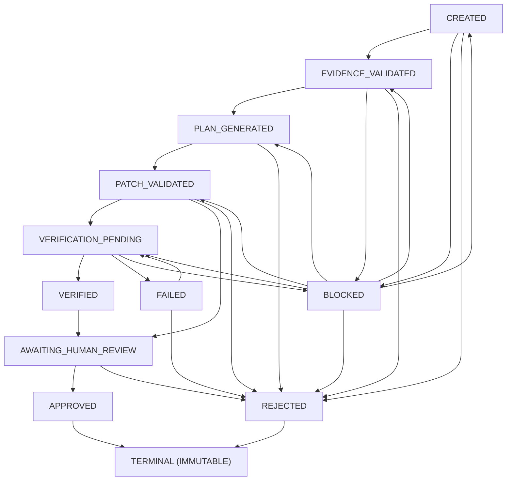

# Phase 4, Milestone 4: Controlled Repair Orchestration & Lifecycle

- **Milestone:** Phase 4 M4 — Controlled Repair Orchestration & Lifecycle
- **Status:** COMPLETED & VERIFIED
- **Target Repo Immutability:** STRICTLY ENFORCED (Audit-only; zero mutation, commits, pushes, merges, or PRs)
- **Commit Message:** `feat(repair): add controlled repair orchestration`
- **Traceability:** Implements Phase 4 Milestone 4 as defined in `AGENTS.md`, `docs/specs/phase-4-readiness.md`, `docs/specs/phase-4-m1-repair-planning.md`, `docs/specs/phase-4-m2-patch-verification.md`, and `docs/specs/phase-4-m3-repair-benchmarks.md`.

---

## 1. Executive Summary & Objective

Phase 4 Milestone 4 delivers the end-to-end orchestration subsystem connecting FORGE's repair capabilities: from verified defect evidence through plan generation, patch candidate validation, containerized sandbox verification, and human operator review. 

### Core Principles & Safety Boundaries
1. **Target Repository Immutability**: All repair planning and verification operations occur strictly in disposable, ephemeral scratch workspaces or in-memory models. Target repositories remain 100% read-only. FORGE **never modifies target files, never creates git commits, never pushes branches, never opens pull requests, and never deploys code**.
2. **Mandatory Human Review Gate**: A verified patch candidate is **never automatically approved or committed**. The workflow transitions from `VERIFIED` (or `PATCH_VALIDATED` in dry-run mode) to `AWAITING_HUMAN_REVIEW`. Transition to `APPROVED` or `REJECTED` strictly requires manual operator intervention.
3. **Fail-Closed Container Sandboxing**: When container isolation (e.g. Docker) is unavailable, repair verification transitions to `BLOCKED` with outcome `SANDBOX_UNAVAILABLE`. Untrusted repository code is **never executed directly on the host**.
4. **Deterministic State Machine**: Every state transition is rigorously validated against a typed directed acyclic graph. Unpermitted transitions or state-skipping attempts raise `InvalidWorkflowTransitionError`.
5. **Optimistic Concurrency & Audit Ledger**: Concurrent workflow modifications are detected and prevented via monotonically incrementing version checks (`WorkflowConcurrencyError`). Every transition emits an immutable, sequence-ordered event record with automated secret redaction.
6. **Resumability & Idempotency**: Workflows paused due to missing sandboxes or environmental constraints can be resumed safely without repeating already completed, validated stages.

---

## 2. Typed State Machine Architecture

The lifecycle of an orchestration workflow is governed by `RepairWorkflowState` in [`app/forge/repair/orchestrator_models.py`](../../app/forge/repair/orchestrator_models.py).

### 2.1 State Graph & Allowed Transitions



### 2.2 Transition Rules
- **Direct Approval Forbidden**: Transitions from `CREATED`, `PLAN_GENERATED`, `PATCH_VALIDATED`, or `VERIFIED` directly to `APPROVED` are illegal. Only `AWAITING_HUMAN_REVIEW` can transition to `APPROVED` or `REJECTED`.
- **Dry-Run Mode Bypass**: When started with `--dry-run`, the workflow validates evidence, generates the repair plan, validates the patch candidate against safety bounds, and transitions directly from `PATCH_VALIDATED` to `AWAITING_HUMAN_REVIEW`, safely skipping sandbox creation and test execution.
- **Fail-Closed Container Boundary**: In `_step_dispatch_verification`, if the container sandbox backend reports `is_available() is False`, the workflow halts execution and transitions to `BLOCKED` with outcome `SANDBOX_UNAVAILABLE`.
- **Terminal States**: `APPROVED` and `REJECTED` are strictly terminal. Attempting to transition or resume from a terminal state raises `RepairSafetyError`.

---

## 3. Component Integration & Data Flow

Orchestration is managed by `RepairOrchestrator` in [`app/forge/repair/orchestrator.py`](../../app/forge/repair/orchestrator.py), integrating with:

1. **ForgeStore (`app/forge/storage/store.py`)**:
   - `repair_workflows` table maintains persistent workflow records with monotonic version numbers and outcome details.
   - `repair_workflow_events` table maintains an append-only, sequence-indexed audit history (`seq=1, 2, 3...`) recording all stage transitions and payload details.
   - Transparent secret sanitization via `redact_secrets()` strips tokens, API keys, and authorization headers from all saved payloads and error diagnostics.
2. **Evidence & Finding Store**:
   - Validates that the targeted finding is backed by verified reproduction evidence (`reproduction_result`). Findings lacking evidence are immediately `REJECTED` to prevent speculative repairs.
3. **Repair Planner (`app/forge/repair/planner.py`)**:
   - Generates bounded, evidence-grounded repair plans conforming to `RepairSafetyContract` and `ProtectedPathPolicy`.
4. **Repair Verifier (`app/forge/repair/verifier.py`)**:
   - Validates patch candidate digest integrity (detecting tampering), prepares isolated disposable workspaces, and runs pre- and post-repair checks inside the isolated container sandbox.
5. **Human Review Gate**:
   - Captures operator decision (`approve` or `reject`), operator notes, and timestamp.
   - Enforces the host immutability invariant: even after approval, target repository source files remain untouched.

---

## 4. Concurrency, Resumability & Idempotency

### 4.1 Optimistic Concurrency Control
- Each `RepairWorkflowRecord` includes an integer `version` field starting at 1.
- In `store.transition_repair_workflow()`, transitions specify `expected_from_state`. If another process has transitioned the workflow in the interim, a `WorkflowConcurrencyError` is raised, rolling back the transaction.
- Every state transition increments `version` by 1 and inserts a sequential `RepairWorkflowEvent`.

### 4.2 Idempotent Initialization
- Invoking `start_workflow` for a finding that already has an active workflow (in non-terminal state) on the same repository and base commit returns the existing workflow rather than creating duplicates or conflicting runs.

### 4.3 Safe Resumption
- A workflow in `BLOCKED` (e.g. sandbox was temporarily unavailable) or `FAILED` state can be resumed via `orchestrator.resume_workflow()`.
- Resumption verifies that the repository HEAD still matches the pinned base commit SHA before allowing re-execution.

---

## 5. CLI Reference & Verification

The CLI interface is exposed under `forge repair workflow` in [`app/forge/cli.py`](../../app/forge/cli.py).

### 5.1 Commands

| Command | Arguments / Flags | Description |
|---|---|---|
| `forge repair workflow start` | `<finding_id> [--repo <path>] [--commit <sha>] [--dry-run]` | Start repair orchestration for a finding |
| `forge repair workflow status` | `<workflow_id> [--format markdown\|json]` | View detailed stage status, diff, and audit events |
| `forge repair workflow list` | `[--finding-id <id>] [--state <state>] [--format table\|json]` | List active and historical workflows |
| `forge repair workflow resume` | `<workflow_id> [--auto-advance/--no-auto-advance]` | Resume a blocked or paused repair workflow |
| `forge repair workflow review` | `<workflow_id> --decision approve\|reject [--notes <text>]` | Submit mandatory human review decision |

### 5.2 Verified CLI Invocations

```bash
# 1. Start dry-run workflow (plan-only, skips sandbox execution)
forge repair workflow start find_001 --repo /path/to/repo --commit a1b2c3d4 --dry-run

# 2. Inspect workflow state and audit trail
forge repair workflow status rwf_find_001_a1b2c3d4_abc123

# 3. List active workflows awaiting review
forge repair workflow list --state awaiting_human_review

# 4. Resume blocked workflow after sandbox becomes available
forge repair workflow resume rwf_find_001_a1b2c3d4_abc123

# 5. Review patch candidate (human approval gate)
forge repair workflow review rwf_find_001_a1b2c3d4_abc123 --decision approve --notes "Reviewed and verified"
```

---

## 6. Verification & Quality Gates

Milestone 4 verification was confirmed via the automated regression test suite:
1. **Unit Test Suite**: [`tests/unit/test_phase4_m4_repair_orchestration.py`](../../tests/unit/test_phase4_m4_repair_orchestration.py) containing 22 focused test cases verifying:
   - State machine transition graph and rejection of illegal transitions.
   - Terminal state immutability.
   - End-to-end orchestration happy path to `AWAITING_HUMAN_REVIEW`.
   - Human approval and rejection gates.
   - Host and target repository immutability assertions before and after review.
   - Dry-run mode skipping execution.
   - Fail-closed container sandbox boundary when Docker is unavailable.
   - Verification failures and regression detection transitions.
   - Anti-tampering patch SHA256 digest validation.
   - Stale base revision mismatch blocking.
   - Protected path policy enforcement (rejection of patches modifying `AGENTS.md`).
   - Workflow resumption and idempotent start requests.
   - Optimistic concurrency conflict detection and version incrementing.
   - Automated secret scrubbing in workflow events and diagnostics.
   - Full CLI workflow lifecycle (`start --dry-run -> status -> review approve`).
2. **Full Regression Suite**: 668 passed tests across all FORGE subsystems with zero failures.
