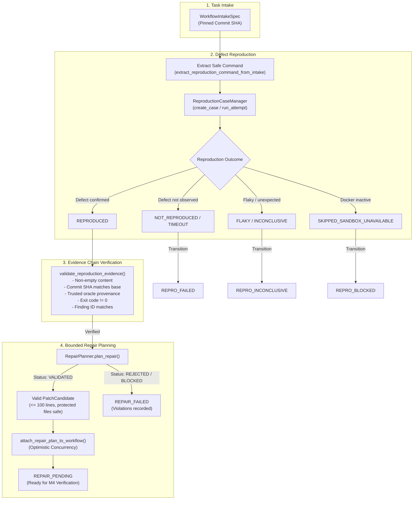

# Phase 5 — Milestone 3: Automated Evidence Chaining from Reproduction to Repair

**Document ID**: `docs/specs/phase-5-m3-evidence-chaining.md`  
**Status**: APPROVED & IMPLEMENTED  
**Date**: 2026-10-27  
**Author**: FORGE Engineering Team  
**Preceding Milestone**: [Phase 5, Milestone 2: Supervised Workflow State Machine & Transactional Ledger](file:///Users/animeshyadav/Desktop/project/forge/docs/specs/phase-5-m2-workflow-ledger.md)  
**Succeeding Milestone**: Phase 5, Milestone 4: Multi-Check Regression & Safety Verification  

---

## 1. Executive Summary

Milestone 3 establishes deterministic, evidence-grounded chaining connecting defect reproduction directly into repair planning within FORGE Phase 5. In supervised engineering workflows, repairs must never be planned from ungrounded prompts, free-form prose, or fabricated assertions. Instead, progression to repair planning strictly requires verified reproduction evidence grounded in a trusted test or execution oracle, cryptographically bound to the pinned target repository revision.

This milestone connects `WorkflowIntakeSpec`, `ReproductionCaseManager`, `ReproductionHarness`, `ForgeStore`, and `RepairPlanner` under explicit code-enforced transition gates. Non-reproduced defects (`NOT_REPRODUCED`), flakes (`FLAKY`), timeouts (`TIMEOUT`), and sandbox environment blocks (`SKIPPED_SANDBOX_UNAVAILABLE`) cleanly halt or block the workflow without fabricating repair plans or falling back to host execution.

---

## 2. Invariants & Safety Boundaries

1. **Target Repository Immutability**: All reproduction and repair planning checks operate strictly read-only against the target repository. Target repositories are never modified, branched, committed, or pushed.
2. **Evidence-Grounded Progression**: Progression from `REPRODUCED` to `REPAIR_PENDING` requires validated `EvidenceRecord` of type `reproduction_result`. Transition without evidence is rejected by code-level guards.
3. **Trusted Oracle Provenance**: Reproduction evidence must originate from an approved test oracle or sandbox execution (`TRUSTED_FIXTURE`, `STATIC_ANALYSIS`, `SYSTEM_POLICY`, `SANDBOX_EXECUTION`). Model assertions or unverified user inputs are rejected with `UntrustedOracleError`.
4. **Anti-Tampering & Exit Code Integrity**: Observed exit code 0 contradicts reproduction claims and raises `EvidenceTamperedError`. Evidence digests and attempt records must match.
5. **Commit Revision Pinning & Drift Detection**: Evidence and reproduction cases are bound to `base_commit_sha`. Workspace revision changes or mismatched commit SHAs trigger `RevisionDriftError` or `StaleRevisionEvidenceError`.
6. **Fail-Closed Sandbox Boundary**: When Docker is unavailable, reproduction returns `SKIPPED_SANDBOX_UNAVAILABLE` and transitions to `REPRO_BLOCKED`. Code is never executed on the host.
7. **Idempotent Reproduction**: Repeated reproduction requests on the same commit SHA reuse existing verified evidence without re-executing commands or duplicating ledger events.

---

## 3. Architecture & Data Flow

---

## 4. Key Components Implemented

### 4.1 Evidence Validation & Provenance (`app/forge/workflow/evidence_chain.py`)
- `resolve_intake_finding_id(intake: WorkflowIntakeSpec) -> str`: Deterministically derives canonical finding ID (`find_{intake_id}` or explicit finding ID).
- `ensure_finding_in_store(store, intake, run_id) -> Finding`: Synchronizes the canonical `Finding` record in SQLite storage idempotently.
- `extract_reproduction_command_from_intake(intake) -> Optional[ReproductionCommand]`: Safely parses typed non-shell reproduction commands from test specifications or issue hints, filtering out unapproved binaries and forbidden shell characters.
- `validate_reproduction_evidence(evidence, workflow, intake, case, store)`: Strictly validates evidence existence, type, structural markers, outcome, finding ID, base commit SHA, trusted oracle provenance, and anti-tampering exit codes.

### 4.2 Supervised Orchestration (`app/forge/workflow/orchestrator.py`)
- `reproduce_defect(workflow_id, workspace_path, command_args, ...)`: Coordinates isolated defect reproduction via `ReproductionCaseManager`, mapping outcomes to state machine transitions (`REPRODUCED`, `REPRO_FAILED`, `REPRO_INCONCLUSIVE`, `REPRO_BLOCKED`), and enforcing revision drift protection.
- `plan_repair(workflow_id, workspace_path, provider_name, model_name, scratch_workspace_path, planner)`: Enforces that workflow is in `REPRODUCED`, validates evidence, transitions to `REPAIR_PENDING`, invokes `RepairPlanner`, and attaches the resulting `repair_plan_id` with optimistic concurrency.
- `advance_workflow(workflow_id, workspace_path, ...)`: Automates sequential stage progression through intake validation, repository context assembly, defect reproduction, and repair planning.

### 4.3 Atomic Plan Attachment in Storage (`app/forge/storage/store.py`)
- `attach_repair_plan_to_workflow(workflow_id, expected_version, repair_plan_id, stage, payload)`: Executes optimistic concurrency verification and atomic database updates while appending a structured event to `engineering_workflow_events`.

### 4.4 CLI Integration (`app/forge/cli.py`)
- `forge workflow repro <workflow_id> [--repo <path>] [--test-command <cmd>] [--max-retries <n>]`
- `forge workflow plan-repair <workflow_id> [--repo <path>] [--provider <name>] [--model <name>] [--scratch-dir <path>]`
- `forge workflow advance <workflow_id> [--repo <path>] [--provider <name>] [--model <name>] [--scratch-dir <path>]`

---

## 5. Verification & Test Evidence

A dedicated test suite in `tests/unit/test_phase5_milestone3.py` verifies all requirements:

| Test Group | Test Cases | Verified Invariant |
|---|---|---|
| **Command Derivation** | `test_extract_command_from_test_spec`, `test_extract_command_from_issue_hints`, `test_extract_command_rejects_unsafe_executable`, `test_extract_command_rejects_forbidden_argument_patterns` | Safe command extraction without shell execution; forbidden binary and operator rejection |
| **Finding Sync** | `test_ensure_finding_in_store` | Deterministic finding resolution and idempotent storage synchronization |
| **Evidence Validation** | `test_validate_evidence_missing_raises`, `test_validate_evidence_type_mismatch_raises`, `test_validate_evidence_corrupted_empty_content_raises`, `test_validate_evidence_missing_structural_markers_raises`, `test_validate_evidence_non_reproduced_outcome_raises`, `test_validate_evidence_finding_mismatch_raises`, `test_validate_evidence_stale_commit_revision_raises`, `test_validate_evidence_untrusted_oracle_raises`, `test_validate_evidence_exit_code_0_contradiction_raises` | Rejection of missing, corrupted, stale, mismatched, untrusted, or exit-code-0 contradictory evidence |
| **Reproduction Outcomes** | `test_reproduce_defect_outcome_reproduced`, `test_reproduce_defect_outcome_not_reproduced`, `test_reproduce_defect_outcome_timeout`, `test_reproduce_defect_outcome_flaky`, `test_reproduce_defect_outcome_sandbox_unavailable_fails_closed`, `test_reproduce_defect_no_command_inconclusive`, `test_reproduce_defect_revision_drift_detection`, `test_reproduce_defect_idempotency_reuse` | Honest outcome mapping; fail-closed sandbox behavior (`REPRO_BLOCKED`); idempotency and drift detection |
| **Repair Chaining** | `test_plan_repair_fails_if_not_reproduced`, `test_plan_repair_success`, `test_plan_repair_rejected_plan_maps_to_repair_failed` | Strict prerequisite check; verified repair plan attachment; rejected plan mapping to `REPAIR_FAILED` |
| **Advance & Immutability**| `test_advance_workflow_happy_path`, `test_advance_workflow_halts_on_repro_blocked`, `test_target_repository_immutability` | Sequential progression; clean halting on blocked reproduction; bit-for-bit target repo immutability |
| **CLI Commands** | `test_cli_workflow_repro`, `test_cli_workflow_plan_repair_not_reproduced_fails`, `test_cli_workflow_advance` | CLI usability and error handling |

- **Unit Test Result**: 31 passed in 6.00s.
- **Full Regression Suite**: 765 passed, 2 skipped in 41.87s.
- **Diagnostics**: `forge doctor`, `forge sandbox doctor`, `forge repair test` (26 scenarios passed), `forge benchmark repair` (11 fixtures passed).

---

## 6. Release Gate Compliance

- [x] **Target Repository Immutability**: Clean working tree and commit SHA preserved across all test executions.
- [x] **Fail-Closed Boundary**: Sandbox unavailability marks checks as `REPRO_BLOCKED`; zero host code execution.
- [x] **Honest Evidence Attribution**: Findings without reproduction evidence strictly cannot transition to repair.
- [x] **Documentation Updated**: Specification recorded, roadmap updated, and README reconciled with tested CLI commands.
