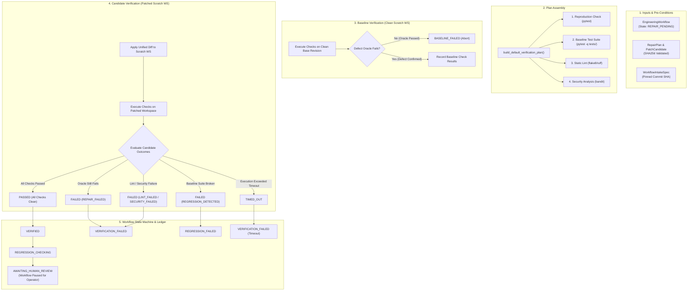

# Phase 5 — Milestone 4: Multi-Check Regression & Safety Verification

**Document ID**: `docs/specs/phase-5-m4-multi-check-verification.md`  
**Status**: APPROVED & IMPLEMENTED  
**Date**: 2026-10-27  
**Author**: FORGE Engineering Team  
**Preceding Milestone**: [Phase 5, Milestone 3: Automated Evidence Chaining from Reproduction to Repair](file:///Users/animeshyadav/Desktop/project/forge/docs/specs/phase-5-m3-evidence-chaining.md)  
**Succeeding Milestone**: Phase 5, Milestone 5: Certified Engineering Dossier & Operator Export  

---

## 1. Executive Summary

Milestone 4 establishes an isolated, bounded multi-check regression and safety verification pipeline for candidate repairs in FORGE Phase 5. Under supervised engineering workflow principles, resolving a defect oracle alone is insufficient to certify a repair; proposed patches must be rigorously evaluated against secondary failure modes, including regressions in existing passing test suites, static style or syntax errors, security vulnerabilities, execution timeouts, and tamper attempts.

Milestone 4 connects the existing `DockerSandbox`, `RepairVerifier`, and `EngineeringWorkflowOrchestrator` through a typed `MultiCheckVerificationPlan` and `MultiCheckVerifier`. Verification executes across both baseline (unpatched) and candidate (patched) disposable scratch workspaces, enabling honest delta comparison. The pipeline strictly enforces target repository immutability, fail-closed container boundaries, command allowlisting, bounded output capture, and automatic secret scrubbing, halting strictly at `AWAITING_HUMAN_REVIEW` before any human decision.

---

## 2. Invariants & Safety Boundaries

1. **Target Repository Immutability**: Verification executes exclusively inside isolated, disposable scratch workspaces created from the pinned commit SHA. The target repository remains bit-for-bit unchanged throughout verification. Zero automated git commits, branch pushes, pull requests, merges, or software deployments are performed.
2. **Fail-Closed Container Boundary**: Any dynamic execution of repository code requires an active container sandbox (`DockerSandbox`). If Docker is unavailable, the pipeline immediately returns `VerificationAggregateOutcome.BLOCKED` with reason `SANDBOX_UNAVAILABLE` and transitions the workflow to `VERIFICATION_BLOCKED`. Target repository code is **strictly forbidden from executing directly on the host machine**.
3. **Honest Baseline Comparison**: Pre-existing failures on the baseline branch are not attributed to candidate patches. A test passing on candidate is only considered fixed if it failed on baseline. If the baseline defect oracle passes on the clean workspace, the check fails with `BASELINE_FAILED`. If baseline test suites pass on baseline but fail on candidate, the outcome is classified as `REGRESSION_DETECTED`.
4. **Command Allowlisting & Shell Injection Defense**: Verification commands are restricted to an approved binary allowlist (`python`, `python3`, `pytest`, `flake8`, `ruff`, `bandit`). Shell operators (`;`, `&&`, `||`, `|`, `>`, `<`, `` ` ``, `$()`) and path escapes are rejected via `validate_verification_check_command`.
5. **Anti-Tampering Integrity**: Candidate unified diff patches are validated against their stored SHA256 cryptographic digest before application. Any discrepancy raises `PatchIntegrityTamperedError` and blocks verification.
6. **Bounded Output & Secret Scrubbing**: All check stdout and stderr streams are truncated to 5,000 characters and filtered through `redact_secrets` before being hashed and persisted into the transactional database.
7. **Mandatory Human Review Gate**: Verification never autonomously transitions a workflow to `APPROVED`. Clean verification progresses the workflow to `AWAITING_HUMAN_REVIEW`, where execution halts until an authorized operator issues an explicit decision (`approve` or `reject`).

---

## 3. Architecture & Data Flow



---

## 4. Verification Check Matrix & Execution Ordering

Checks are executed in strict deterministic order to minimize unnecessary computation:

| Order | Check Type | Default Command | Required? | Expected Baseline Status | Candidate Success Criterion | Action on Failure |
|---|---|---|---|---|---|---|
| **1** | `REPRODUCTION` | `pytest <test_file>` or intake test cmd | **Yes** | `FAILED` (exit code $\ne 0$) | `PASSED` (exit code $0$) | Abort; mark `BASELINE_FAILED` or `REPAIR_FAILED`. |
| **2** | `BASELINE_TESTS` | `pytest -q tests/` | No | `PASSED` (exit code $0$) | `PASSED` (exit code $0$) | Transition to `REGRESSION_FAILED` (`regression_detected=True`). |
| **3** | `LINT` | `flake8 <target_file>` or `ruff` | No | Any | `PASSED` (exit code $0$) | Transition to `VERIFICATION_FAILED` (`lint_failed`). |
| **4** | `SECURITY` | `bandit -r <target_file> -ll` | No | Any | `PASSED` (exit code $0$) | Transition to `VERIFICATION_FAILED` (`security_failed`). |

### Tool Availability & Degradation
- If an optional tool (`flake8`, `ruff`, `bandit`) is not installed in the sandbox image, the check is marked `SKIPPED` with an honest diagnostic recorded in `limitations`.
- If a required tool (`pytest`) is missing, verification is marked `BLOCKED` with `ToolUnavailableError`.
- No fake or fabricated results are generated for missing tools.

---

## 5. Structured Data Contracts

### 5.1 Verification Check Specification & Result
```python
class VerificationCheckType(str, Enum):
    REPRODUCTION = "reproduction"
    BASELINE_TESTS = "baseline_tests"
    LINT = "lint"
    SECURITY = "security"

class CheckStatus(str, Enum):
    PASSED = "passed"
    FAILED = "failed"
    BLOCKED = "blocked"
    TIMED_OUT = "timed_out"
    SKIPPED = "skipped"
    INCONCLUSIVE = "inconclusive"

class VerificationAggregateOutcome(str, Enum):
    PASSED = "passed"
    FAILED = "failed"
    BLOCKED = "blocked"
    TIMED_OUT = "timed_out"
    INCONCLUSIVE = "inconclusive"
    BASELINE_FAILED = "baseline_failed"
```

### 5.2 Multi-Check Verification Record
Every verification attempt produces a persistent `MultiCheckVerificationResult` recorded in SQLite table `multi_check_verifications`:
- `attempt_id`: Deterministic unique identifier (`vatt_<sha256>`).
- `workflow_id`: Associated engineering workflow ID.
- `plan_id`: Verification plan identifier (`vplan_<sha256>`).
- `repair_plan_id`: Associated repair plan identifier.
- `aggregate_outcome`: Verified aggregate classification.
- `baseline_results`: List of individual check executions on clean baseline workspace.
- `candidate_results`: List of individual check executions on patched workspace.
- `regression_detected`: Boolean flag indicating if candidate broke previously passing tests.
- `limitations`: Explicit list of skipped checks or missing tools.
- `total_duration_ms`: Total execution duration in milliseconds.

---

## 6. CLI Usage & Command Reference

### Verify Repair Workflow
```bash
# Execute isolated multi-check verification against repair candidate
forge workflow verify wf_eng_38b1f8ac9210

# Verify with custom repository path and custom scratch directory
forge workflow verify wf_eng_38b1f8ac9210 --repo /path/to/repo --scratch-dir /tmp/scratch

# Verify skipping optional lint or security checks
forge workflow verify wf_eng_38b1f8ac9210 --no-lint --no-security

# Verify with explicit baseline test command override
forge workflow verify wf_eng_38b1f8ac9210 --baseline-test "pytest -q tests/test_core.py"

# Output structured JSON verification report
forge workflow verify wf_eng_38b1f8ac9210 --format json
```

### Sequential Workflow Advance with Verification
```bash
# Advance workflow through intake, reproduction, repair planning, and multi-check verification
forge workflow advance wf_eng_38b1f8ac9210 --repo /path/to/repo --verify
```

---

## 7. Verification & Test Coverage

The Milestone 4 implementation was verified against comprehensive unit, safety, and integration test suites:
- **Unit & Integration Suite**: 24 tests in `tests/unit/test_phase5_milestone4.py` covering:
  - Command allowlisting, argument validation, and shell injection protection.
  - Verification check plan ordering and check construction.
  - Missing optional tool honest skip vs. missing required tool fail-closed blocking.
  - Baseline defect oracle failure detection (`BASELINE_FAILED`).
  - Candidate defect persistence (`FAILED: defect still reproducible`).
  - Baseline test suite regression detection (`REGRESSION_FAILED`).
  - Static lint and security analysis failure classifications.
  - Check timeout handling (`TIMED_OUT`).
  - Secret redaction and output bounding ($\le 5,000$ characters).
  - Docker sandbox unavailability fail-closed enforcement (`VERIFICATION_BLOCKED`).
  - Patch tampering detection via SHA256 digest validation.
  - Target file protection policy enforcement.
  - Target repository bit-for-bit immutability (zero target repository changes).
  - Orchestrator lifecycle state transitions: `REPAIR_PENDING -> VERIFIED -> REGRESSION_CHECKING -> AWAITING_HUMAN_REVIEW` or `REGRESSION_FAILED` / `VERIFICATION_FAILED` / `VERIFICATION_BLOCKED`.
  - Mandatory human review gate enforcement.
  - CLI command parsing, error handling, and help text.
- **Full Regression Test Suite**: 789 passed, 2 skipped across entire repository with zero failures.
- **Repair Acceptance Suite (`forge repair test`)**: 26 of 26 scenarios passed (100.0%).
- **Repair Benchmark Suite (`forge benchmark repair`)**: 11 of 11 benchmark fixtures passed (100.0%).
- **Target Repository Immutability**: Verified clean git working tree and zero repo mutations.
