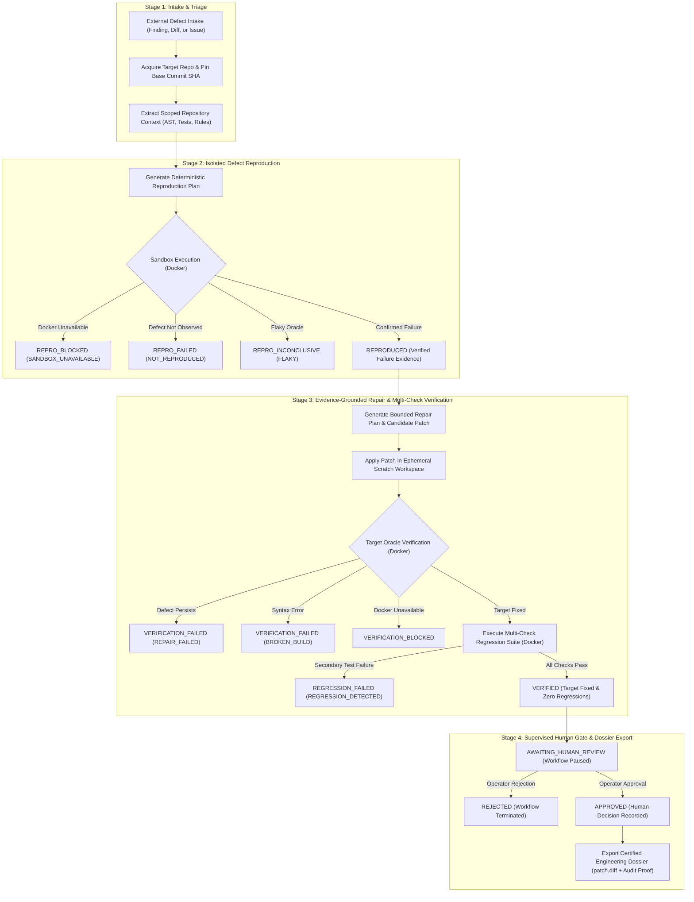

# Phase 5: Supervised End-to-End Engineering Workflow — Architecture & Roadmap

- **Milestone:** Phase 5 Kickoff — Architecture & Roadmap
- **Status:** COMPLETED & VERIFIED (Roadmap & Architectural Gate)
- **Target Repo Immutability:** STRICTLY ENFORCED (Zero automated mutation, zero commits, zero pushes, zero PRs)
- **Commit Message:** `docs(workflow): define phase 5 end-to-end engineering roadmap`
- **Traceability:** Implements Phase 5 specification and release gate per `AGENTS.md` (Sections 1, 2, 3, 4, 5, 7), building directly upon completed Phases 1–4.

---

## 1. Executive Summary & Objective

Phase 5 delivers the **Supervised End-to-End Engineering Workflow** for FORGE. It unifies the standalone capabilities constructed in Phases 1 through 4—repository acquisition and intelligence (Phase 1), diff-aware code review and policy enforcement (Phase 2), isolated defect reproduction (Phase 3), and bounded repair planning and patch verification (Phase 4)—into a cohesive, auditable, and resilient defect-to-verified-fix pipeline.

### Core Architectural Invariants & Safety Contracts
1. **Target Repository Immutability**: FORGE operates under a strict audit-only boundary. FORGE **never modifies target repository files, never creates git commits, never pushes branches, never merges code, and never deploys software**. All investigation, reproduction, and verification occur in ephemeral, disposable scratch workspaces.
2. **Mandatory Human Review Gate**: A verified patch candidate is **never automatically approved or applied**. Every workflow must halt at `AWAITING_HUMAN_REVIEW`. Only an explicit human operator decision (`APPROVED` or `REJECTED`) can close a workflow. The final output of a successful run is a certified, exportable **Engineering Dossier** (`patch.diff`, verification certificate, audit trail) designed for manual operator application.
3. **Fail-Closed Container Sandboxing**: Any dynamic execution of repository code requires containerized isolation (`DockerSandbox`). When Docker is unavailable, the workflow immediately transitions to `BLOCKED` with reason `SANDBOX_UNAVAILABLE`. Target repository code is **strictly forbidden from running on the host machine**.
4. **Honest Outcome Attribution**: An unavailable sandbox or failed execution is **never mislabeled** as a verified defect or verified fix. Unsuccessful reproductions are marked `REPRO_FAILED`, `REPRO_BLOCKED`, or `REPRO_INCONCLUSIVE`. Failed verifications are marked `VERIFICATION_FAILED` (`REPAIR_FAILED`, `BROKEN_BUILD`, or `REGRESSION_DETECTED`).
5. **Cryptographic Revision & Evidence Pinning**: Workflows are pinned to the verified target repository commit SHA. Changes to repository HEAD between stages are intercepted as `REVISION_DRIFT`. Repair planning is strictly prohibited without validated reproduction evidence.
6. **Zero Silent Cloud Fallback**: Provider configuration adheres to explicit selection (`ollama`, `ollama_cloud`, `gemini`, `deepseek`, `groq`, `fake`). Automatic cloud fallback is strictly disabled (`FORGE_ALLOW_CLOUD_FALLBACK=false`). OpenAI remains unsupported.

---

## 2. Codebase Audit: Current State vs. Phase 5 Requirements

An audit of the actual codebase was performed to distinguish completed components, partially integrated modules, and missing abstractions:

| Subsystem | Existing Implementation | Integration Status | Missing for Phase 5 End-to-End Pipeline |
|---|---|---|---|
| **Intake & Acquisition** | `app/forge/repository/` (`acquire_repository`, `validation.py`, `git.py`) | **Exists (Isolated)** | Lacks a unified intake contract (`WorkflowIntakeSpec`) normalizing disparate inputs (review finding, git diff, issue report, failed test) into a pinned target revision. |
| **Repository Intelligence** | `detector.py`, `indexer.py`, `instructions.py`, `architecture.py` | **Exists (Isolated)** | Static intelligence is recomputed independently by different stages. Lacks a unified, token-budgeted repository context pipeline tailored for defect localization. |
| **Diff Review & Detection** | `app/forge/review/` (`ReviewEngine`, `calibration.py`, `policy.py`) | **Exists (Standalone)** | Findings produced by `forge review` are stored/printed, but cannot be automatically chained as intake to reproduction and repair workflows. |
| **Defect Reproduction** | `app/forge/reproduction/` (`ReproductionPlanner`, `manager.py`, `classifier.py`) | **Exists (Phase 3)** | Lacks an automated transition from intake to reproduction case execution; lacks direct evidence forwarding into repair planning. |
| **Repair & Verification** | `app/forge/repair/` (`RepairPlanner`, `verifier.py`, `orchestrator.py`) | **Exists (Phase 4)** | Currently starts at finding validation, assuming reproduction evidence was manually attached in SQLite. Lacks automated intake chaining and multi-check regression verification. |
| **Container Sandboxing** | `app/forge/sandbox/` (`DockerSandbox`, `policy.py`, `runner.py`) | **Exists & Verified** | Verified live with real Docker and fail-closed mocks; ready for integration across both reproduction and verification stages. |
| **Storage & Persistence** | `app/forge/storage/` (`ForgeStore`, `database.py`) | **Exists & Verified** | Tables exist for findings, evidence, runs, repro cases, repair plans, and repair workflows. Needs an overarching `engineering_workflows` schema and ledger. |
| **Regression Verification** | `RepairVerifier` (single check command + baseline check) | **Partial** | Lacks multi-check regression suite runner (running full test suites, static linters `flake8`/`ruff`, and security linters `bandit` to catch secondary side-effects). |
| **Dossier & Patch Export** | `forge repair workflow status` (displays candidate diff) | **Partial** | Lacks a formal exportable **Engineering Dossier** (signed `patch.diff`, pre/post verification proof, SARIF report, reproduction log, and operator instructions). |

---

## 3. End-to-End Orchestration Architecture & Workflow Flow



---

## 4. Typed Workflow State Machine & Transition Invariants

The end-to-end workflow transitions through strongly typed states with explicit fail-secure guards:

```python
class EngineeringWorkflowState(str, Enum):
    # Intake & Analysis
    CREATED = "created"
    INTAKE_VALIDATED = "intake_validated"
    REPO_ANALYZED = "repo_analyzed"

    # Reproduction
    REPRODUCTION_PENDING = "reproduction_pending"
    REPRODUCED = "reproduced"
    REPRO_FAILED = "repro_failed"          # Terminal failure (oracle did not fail)
    REPRO_BLOCKED = "repro_blocked"        # Resumable (sandbox unavailable, drift)
    REPRO_INCONCLUSIVE = "repro_inconclusive" # Oracle inconsistent or flaky

    # Repair & Validation
    REPAIR_PENDING = "repair_pending"
    REPAIR_FAILED = "repair_failed"        # Model failure, budget exceeded, protected path

    # Verification & Regression
    VERIFICATION_PENDING = "verification_pending"
    VERIFIED = "verified"                  # Target oracle passed
    VERIFICATION_FAILED = "verification_failed" # Broken build, defect unresolved
    VERIFICATION_BLOCKED = "verification_blocked" # Sandbox unavailable during verify
    REGRESSION_CHECKING = "regression_checking"
    REGRESSION_FAILED = "regression_failed" # Secondary test broken or security flaw

    # Human Gate & Release
    AWAITING_HUMAN_REVIEW = "awaiting_human_review"
    APPROVED = "approved"                  # Terminal approval by human
    REJECTED = "rejected"                  # Terminal rejection
```

### Deterministic State Transition Matrix
- `CREATED` $\rightarrow$ `INTAKE_VALIDATED`, `REJECTED`
- `INTAKE_VALIDATED` $\rightarrow$ `REPO_ANALYZED`, `REJECTED`
- `REPO_ANALYZED` $\rightarrow$ `REPRODUCTION_PENDING`, `REPAIR_PENDING` *(if verified repro evidence already exists)*, `REJECTED`
- `REPRODUCTION_PENDING` $\rightarrow$ `REPRODUCED`, `REPRO_FAILED`, `REPRO_BLOCKED`, `REPRO_INCONCLUSIVE`, `REJECTED`
- `REPRO_BLOCKED` $\rightarrow$ `REPRODUCTION_PENDING` *(resumed once unblocked)*, `REJECTED`
- `REPRODUCED` $\rightarrow$ `REPAIR_PENDING`, `REJECTED`
- `REPAIR_PENDING` $\rightarrow$ `VERIFICATION_PENDING`, `REPAIR_FAILED`, `REJECTED`
- `VERIFICATION_PENDING` $\rightarrow$ `VERIFIED`, `VERIFICATION_FAILED`, `VERIFICATION_BLOCKED`, `REJECTED`
- `VERIFICATION_BLOCKED` $\rightarrow$ `VERIFICATION_PENDING` *(resumed once unblocked)*, `REJECTED`
- `VERIFIED` $\rightarrow$ `REGRESSION_CHECKING`, `AWAITING_HUMAN_REVIEW` *(if regression suite omitted)*
- `REGRESSION_CHECKING` $\rightarrow$ `AWAITING_HUMAN_REVIEW`, `REGRESSION_FAILED`, `REJECTED`
- `REGRESSION_FAILED` $\rightarrow$ `REPAIR_PENDING` *(retry repair)*, `REJECTED`
- `AWAITING_HUMAN_REVIEW` $\rightarrow$ `APPROVED`, `REJECTED`
- `APPROVED`, `REJECTED` $\rightarrow$ $\emptyset$ *(Terminal immutable states)*

---

## 5. Milestone Breakdown for Phase 5

Phase 5 is partitioned into 6 small, independently verifiable milestones:

### Milestone 1: Unified Task Intake & Repository Context Pipeline (Implemented & Verified)
- **Status**: COMPLETED & VERIFIED
- **Specification**: [`docs/specs/phase-5-m1-intake-context.md`](file:///Users/animeshyadav/Desktop/project/forge/docs/specs/phase-5-m1-intake-context.md)
- **Implementation**:
  - Typed intake models and contracts in `app/forge/workflow/models.py` (`WorkflowIntakeSpec`, `IntakeSourceType`, `FindingIntakePayload`, `DiffIntakePayload`, `IssueIntakePayload`, `TestSpecIntakePayload`).
  - Revision resolution and pinning in `app/forge/workflow/intake.py` (`resolve_and_pin_revision` with `DirtyRepositoryError` and `RevisionDriftError`).
  - Scoped repository context assembly in `app/forge/workflow/context.py` (`assemble_repository_context`, deterministic AST ranking, bounded line excerpts, untrusted boundary banners, and `ContextBudgetSummary`).
  - CLI commands in `app/forge/cli.py` (`forge workflow intake create/validate/show` and `forge workflow context build/show`).
- **Exit Gate Passed**: 26 unit tests in `tests/unit/test_phase5_milestone1.py` passed; 713 regression tests passed; 100% pass on acceptance and benchmark suites.

### Milestone 2: Supervised Workflow State Machine & Transactional Ledger
- **Objective**: Implement the overarching workflow orchestrator with optimistic concurrency, sequential append-only event auditing, crash resilience, and pause/resume capability.
- **Inputs**: Validated task specification.
- **Outputs**: SQLite-persisted `EngineeringWorkflow`, state transition validator, and secret-scrubbed event ledger.
- **Exit Gate**: State machine invariants verified; illegal transitions and competing version updates rejected; process crash recovery verified.

### Milestone 3: Automated Evidence Chaining from Reproduction to Repair
- **Objective**: Wire Phase 3 defect reproduction directly into Phase 4 repair planning; ensure ungrounded findings or failed reproductions halt the workflow cleanly without fabricating evidence.
- **Inputs**: Pinned repository context and defect hypothesis.
- **Outputs**: Verified reproduction evidence attached to workflow; bounded repair plan and unified diff patch candidate.
- **Exit Gate**: Proved that `REPRO_FAILED` or `REPRO_BLOCKED` prevents repair planning; proved that `REPRODUCED` cleanly generates a valid candidate patch.

### Milestone 4: Multi-Check Regression & Safety Verification
- **Objective**: Execute multi-stage verification in the Docker sandbox: (1) target reproduction test, (2) baseline test suite, (3) static linting (`flake8`/`ruff`), and (4) security analysis (`bandit`).
- **Inputs**: Validated patch candidate diff, target repo, and verification configuration.
- **Outputs**: Structured `MultiCheckVerificationResult` categorizing outcome (`VERIFIED`, `BROKEN_BUILD`, `REGRESSION_DETECTED`, `SECURITY_REGRESSION`, `TIMEOUT`, `SANDBOX_UNAVAILABLE`).
- **Exit Gate**: Synthetic regression fixtures correctly trigger `REGRESSION_FAILED`; clean fixes advance to `AWAITING_HUMAN_REVIEW`.

### Milestone 5: Certified Engineering Dossier & Operator Export
- **Objective**: Generate a certified, structured engineering package upon operator approval, containing the validated patch diff, SHA256 integrity digest, SARIF 2.1.0 review findings, verification certificate, and manual application instructions.
- **Inputs**: Approved workflow record.
- **Outputs**: Exported directory containing `patch.diff`, `verification_certificate.json`, `findings.sarif`, `audit_ledger.json`, and `APPLY.md`.
- **Exit Gate**: Dossier schema validation; cryptographic digest verification; zero target repository mutations verified.

### Milestone 6: End-to-End Workflow Acceptance, Reliability & Release
- **Objective**: Harden the integrated workflow against adversarial inputs, timeout cascades, concurrent workflow operations, and host isolation failure modes across comprehensive acceptance scenarios.
- **Inputs**: Complete Phase 5 pipeline.
- **Outputs**: Quantitative acceptance metrics, benchmark evaluation, and final release readiness documentation.
- **Exit Gate**: 100% pass on acceptance suite; 100% pass on regression suite (unit + security + integration); mandatory release gates satisfied.

---

## 6. Accurate Representation of Sandbox Outcomes

To prevent misleading claims of software correctness or false bug detection:
1. **Docker Missing / Inactive**:
   - Outcome is strictly `SANDBOX_UNAVAILABLE`.
   - Workflow state is `REPRO_BLOCKED` or `VERIFICATION_BLOCKED`.
   - **Never** reported as `REPRODUCED` or `VERIFIED`.
   - Actionable operator guidance output: start Docker or run in offline/dry-run inspection mode.
2. **Defect Not Observed**:
   - If the reproduction test passes unexpectedly (no defect found), outcome is `NOT_REPRODUCED`.
   - Workflow state is `REPRO_FAILED`.
   - Repair planning is **strictly forbidden**.
3. **Flaky / Inconsistent Test Oracles**:
   - If repeated attempts produce alternating pass/fail results, outcome is `FLAKY`.
   - Workflow state is `REPRO_INCONCLUSIVE`.
4. **Broken Build / Syntax Error**:
   - If a candidate patch introduces syntax errors or compilation failure, outcome is `BROKEN_BUILD`.
   - Workflow state is `VERIFICATION_FAILED`.

---

## 7. Residual Risks & Operational Prerequisites

1. **Host Docker Requirement**: Real dynamic verification and reproduction require Docker running on the host. Without Docker, workflows remain functional in static inspection and dry-run modes, but dynamic execution fails closed.
2. **Untrusted Code Execution**: All target repository code executed during reproduction and verification runs within `--network none`, `--read-only`, non-root (`1000:1000`), and dropped capabilities. Host machine execution is never permitted.
3. **Model Non-Determinism**: LLM-generated repair plans are treated as untrusted proposals. Strict static validation ($\le 100$ lines, protected file immunity, SHA256 locking) and sandboxed verification must pass before a human ever reviews the patch.
4. **Mandatory Human Oversight**: FORGE is an intelligence and repair proposal platform, not an automated deployment bot. Human operator review is mandatory before any patch can be released.

---

## 8. Recommendation for Milestone 2

With Milestone 1 completed and verified, the recommended next implementation step is **Phase 5 Milestone 2: Supervised Workflow State Machine & Transactional Ledger**:
- Implement `EngineeringWorkflow` state machine in `app/forge/workflow/state.py` and `orchestrator.py`.
- Define database migrations and SQLite store tables (`engineering_workflows`, `workflow_events`).
- Support pause/resume semantics, crash recovery, and optimistic concurrency versioning.
- Implement CLI workflow lifecycle commands (`forge workflow start/status/list/resume/review`).
