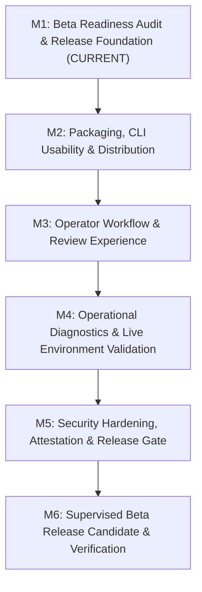

# Phase 6: Supervised Beta Packaging & Operational Readiness — Architecture & Roadmap

- **Phase:** Phase 6 — Supervised Beta Packaging & Operational Readiness
- **Status:** IN PROGRESS (Milestone 1 Complete)
- **Target Repo Immutability:** STRICTLY ENFORCED (Zero automated mutation, zero commits, zero pushes, zero PRs)
- **Traceability:** Implements Phase 6 specification and release gate per `AGENTS.md` (Sections 1, 2, 3, 4, 5, 7), synthesizing all findings from Supervised Pilots 01–08.

---

## 1. Executive Summary & Objective

Phase 6 transitions FORGE from empirical pilot validation into a **hardened, limited, human-supervised developer beta**.

The eight supervised pilots (Pilots 01 through 08) proved that FORGE's foundational architecture—container sandboxing, evidence-chaining state machine, deterministic coordinate ownership, and AST semantic verification—operates with 100% fail-closed reliability. In all trials, invalid or regressive candidate patches were trapped before human review, target repositories remained bit-for-bit immutable, and target code never escaped the Docker boundary.

Phase 6 packages these capabilities into a predictable, auditable, and production-ready supervised beta platform for software engineering teams.

---

## 2. Core Architectural Invariants & Beta Contract

1. **Target Repository Immutability:** FORGE operates strictly as an investigative intelligence system. It never modifies target source code, creates git commits, pushes branches, opens PRs, merges code, or deploys software.
2. **Mandatory Human Approval Gate:** Candidate patches halt at `AWAITING_HUMAN_REVIEW`. Only explicit operator decisions (`approve` / `reject`) can conclude a workflow.
3. **Fail-Closed Container Sandboxing:** Dynamic execution of untrusted repository code requires isolated Docker containers (`--network none`, dropped capabilities, non-root user). Host execution fallback is strictly refused.
4. **Local-Only Inference by Default:** Standard execution uses local Ollama (`http://localhost:11434/v1`). Automatic cloud fallback is strictly disabled (`FORGE_ALLOW_CLOUD_FALLBACK=false`).
5. **Honest Outcome Attribution & Auditability:** All findings, evidence, and state transitions are cryptographically chained and recorded in SQLite. Rejections provide clear diagnostic explanations without fabrication.

---

## 3. Phase 6 Milestone Breakdown

### Milestone 1: Beta Readiness Audit & Release Foundation (Completed)
- **Objective:** Audit repository, CLI, tests, and pilot findings; establish the Beta Contract, known limitations, and operator quickstart documentation; update versioning to `0.1.0b1`.
- **Deliverables:**
  - Full codebase and security audit.
  - Official Beta Contract (`docs/BETA_CONTRACT.md`).
  - Empirical known issues and model boundary disclosure (`docs/BETA_KNOWN_ISSUES.md`).
  - Operator Quickstart and Administration Guide (`docs/OPERATOR_GUIDE.md`).
  - M1 Specification (`docs/specs/phase-6-m1-beta-readiness.md`).
  - Version bump to `0.1.0b1` and CLI description alignment.
  - 100% pass on offline test suite (958 unit/integration tests) and live Docker validation.

### Milestone 2: Packaging, CLI Usability & Distribution (Planned)
- **Objective:** Package FORGE for simplified operator installation via wheel/sdist and standalone entrypoints.
- **Scope:**
  - Build and validate standard distribution wheels.
  - Streamline CLI command ergonomics, tab completions, and interactive prompts.
  - Ensure zero runtime dependency bloat.

### Milestone 3: Operator Workflow & Review Experience (Planned)
- **Objective:** Enhance the operator review gate with rich terminal diff formatting, syntax highlighting, and interactive decision prompts.
- **Scope:**
  - Side-by-side terminal unified diff rendering.
  - Interactive CLI review commands (`forge workflow review --interactive`).
  - Improved export formats for the Engineering Dossier (HTML, Markdown, SARIF).

### Milestone 4: Operational Diagnostics & Live Environment Validation (Planned)
- **Objective:** Expand `forge doctor` and preflight verification for diverse host configurations.
- **Scope:**
  - Automatic detection of Docker socket variations (macOS, Linux systemd, rootless Docker).
  - Ollama model inventory and GPU/CPU capability checks.
  - Automatic recommendation of model quantization based on available host RAM.

### Milestone 5: Security Hardening, Attestation & Release Gate (Planned)
- **Objective:** Finalize supply chain security, dependency auditing, and release provenance.
- **Scope:**
  - Automated dependency vulnerability scanning (`pip-audit` / safety).
  - Cryptographic artifact checksums and SBOM generation.
  - Release security review checklist.

### Milestone 6: Supervised Beta Release Candidate & Operational Verification (Planned)
- **Objective:** End-to-end acceptance testing of the packaged beta across real-world Python repositories under operator supervision.
- **Scope:**
  - Full acceptance test suite across clean virtual environments.
  - Release candidate tagging (`v0.1.0-beta.1`).
  - Final operational sign-off and publication verification.
