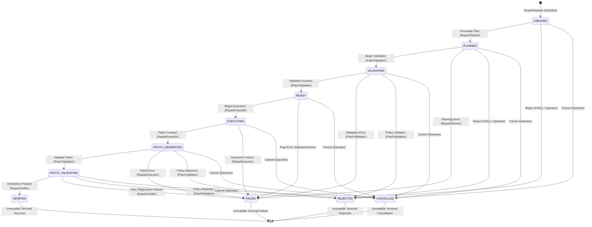

# Phase 8, Milestone 1: Repair Execution Architecture Specification

- **Milestone:** Phase 8, Milestone 1 — Repair Execution Architecture
- **Status:** COMPLETED & VERIFIED
- **Target Repo Immutability:** STRICTLY ENFORCED (Zero target mutation, zero git commits, zero pushes, zero PRs)
- **Commit Message:** `feat(phase8): implement repair execution architecture foundation (M1)`
- **Traceability:** Implements Phase 8, Milestone 1 specification per `AGENTS.md` (Sections 1, 2, 3, 4, 5, 6, 7).

---

## 1. Executive Summary & Objective

Phase 8 establishes the production-grade architectural foundation for controlled, evidence-grounded software repair and patch verification in FORGE.

Building upon Phase 1 repository acquisition, Phase 2 code review, Phase 3 defect reproduction, Phase 4 targeted repair planning, Phase 5 engineering workflows, Phase 6 beta operational readiness, and Phase 7 evidence-driven investigation, Milestone 1 provides the core execution domain models, guarded state machine, strict safety boundaries, component protocols, and SQLite audit event ledgers.

> [!IMPORTANT]
> **Milestone 1 Scope Boundary**: This milestone delivers foundational architecture, domain models, guarded state machines, and component interfaces only. Actual candidate source-code patch generation is intentionally deferred to Milestone 3. Automated Git commits, pushes, branches, pull requests, and software deployments are strictly forbidden.

---

## 2. Repair Execution Lifecycle & State Machine

The repair execution lifecycle is governed by an explicit, deterministic state machine with strict transition gating and component authorization:



### Actor Authorization Matrix

| Transition | Authorized Actors | Required Context & Invariants |
|---|---|---|
| `CREATED` $\to$ `PLANNED` | `PLANNER`, `ORCHESTRATOR` | Valid `RepairExecutionPlan` in context |
| `CREATED` $\to$ `REJECTED` | `VALIDATOR`, `OPERATOR`, `ORCHESTRATOR` | Rejection rationale |
| `CREATED` $\to$ `CANCELLED` | `OPERATOR` | Operator cancellation decision |
| `PLANNED` $\to$ `VALIDATING` | `VALIDATOR`, `ORCHESTRATOR` | — |
| `PLANNED` $\to$ `FAILED` | `PLANNER`, `ORCHESTRATOR` | Failure classification / error message |
| `VALIDATING` $\to$ `READY` | `VALIDATOR`, `ORCHESTRATOR` | Passed `ValidationResult` (`is_valid=True`) |
| `VALIDATING` $\to$ `REJECTED` | `VALIDATOR`, `OPERATOR`, `ORCHESTRATOR` | Validation violation details |
| `READY` $\to$ `EXECUTING` | `EXECUTOR`, `ORCHESTRATOR` | Workspace isolation confirmed |
| `EXECUTING` $\to$ `PATCH_GENERATED` | `EXECUTOR`, `ORCHESTRATOR` | Valid `PatchArtifact` with SHA-256 digest |
| `EXECUTING` $\to$ `FAILED` | `EXECUTOR`, `ORCHESTRATOR` | Execution diagnostic |
| `PATCH_GENERATED` $\to$ `PATCH_VALIDATING` | `VALIDATOR`, `ORCHESTRATOR` | — |
| `PATCH_VALIDATING` $\to$ `VERIFIED` | `VERIFIER`, `ORCHESTRATOR` | **Zero Fabrication**: Verified proof (`verification_passed=True`) |
| `PATCH_VALIDATING` $\to$ `FAILED` | `VERIFIER`, `ORCHESTRATOR` | Test failure or regression diagnostics |
| `*` $\to$ `CANCELLED` | `OPERATOR` | Non-terminal states only |

### Terminal States & Immutability
States `VERIFIED`, `FAILED`, `REJECTED`, and `CANCELLED` are strictly terminal. Attempting any transition out of a terminal state raises `IllegalStateModificationError`.

---

## 3. Strict Safety Boundaries & Execution Policies

`RepairExecutionPolicy` enforces ten mandatory safety invariants:

1. **Target Repository Immutability**: `target_repo_read_only = True` is non-configurable. Any attempt to use the target repository directory as a repair workspace raises `TargetRepoImmutabilityViolationError`.
2. **Isolated Workspace**: Repair preparation and candidate application occur strictly within disposable scratch workspaces managed by `RepairWorkspace`.
3. **No Arbitrary Shell Execution**: Commands are validated against a pre-approved whitelist (`pytest`, `python`, `unittest`, `flake8`, `ruff`, `mypy`). Commands must be structured argument lists `List[str]`; raw shell execution (`shell=True`) and shell injection tokens (`;`, `|`, `&`, `$`, backticks, `<`, `>`, `\n`) are rejected with `ArbitraryExecutionForbiddenError`.
4. **No Unrestricted Network Access**: `allow_network = False` is enforced fail-closed across all repair tasks.
5. **Environment Variable Sanitization**: Only pre-approved non-sensitive variables (`PATH`, `PYTHONPATH`, `LANG`, `TMPDIR`, etc.) are forwarded. Secrets, tokens, and cloud keys are strictly stripped and redacted.
6. **No Path Traversal or Symlink Escape**: All paths are resolved and verified with `validate_containment()`. Any attempt to escape workspace boundaries via `..` or external symlinks raises `ScopeContainmentViolationError`.
7. **No Modifications Outside Authorized Workspace**: Only files explicitly declared in `allowed_files` may be targeted for modification. Protected paths (`AGENTS.md`, `README.md`, `LICENSE`, `pyproject.toml`, `.git/*`, `.github/*`, `.env*`) are rejected with `ProtectedPathViolationError`.
8. **Evidence-Grounded Traceability**: Every `RepairRequest` strictly requires non-empty `evidence_ids` linking to verified `EvidenceRecord`s.
9. **Bounded Patch Resource Quotas**: Enforces hard limits: `max_lines_changed` ($\le 100$), `max_hunks` ($\le 5$), `max_files_modified` ($\le 1$), `max_patch_bytes` ($\le 20\text{ KB}$).
10. **Honest Outcome Attribution**: Incomplete or failed verifications strictly transition to `FAILED` with explicit `FailureClassification`. Transition to `VERIFIED` requires observed, passing verification checks.

---

## 4. Component Interfaces (Protocols)

The architecture defines runtime-checkable typing `Protocol` contracts in `forge.repair.execution.interfaces`:

- `RepairPlannerProtocol`: Formulates grounded `RepairExecutionPlan`s from validated requests.
- `RepairExecutorProtocol`: Executes patch construction inside isolated workspaces.
- `RepairWorkspaceProtocol`: Manages isolated scratch directories, checks path containment, and validates target repository immutability.
- `PatchValidatorProtocol`: Validates candidate patches against scope, budget, and syntax constraints.
- `RepairVerifierProtocol`: Executes isolated verification checks against candidate patches.
- `RepairEventStoreProtocol`: Persists requests, patch artifacts, and sequential audit event trails.

---

## 5. Storage Schema & Audit Event Integration

Phase 8 integrates directly into SQLite via `app/forge/storage/database.py` with three new tables:

```sql
CREATE TABLE IF NOT EXISTS repair_executions (
    repair_id TEXT PRIMARY KEY,
    finding_id TEXT NOT NULL,
    run_id TEXT,
    target_repo TEXT NOT NULL,
    base_commit_sha TEXT NOT NULL,
    state TEXT NOT NULL,
    evidence_ids_json TEXT NOT NULL DEFAULT '[]',
    allowed_files_json TEXT NOT NULL DEFAULT '[]',
    workspace_id TEXT,
    patch_artifact_id TEXT,
    validation_status TEXT,
    verification_status TEXT,
    failure_json TEXT,
    created_at TEXT NOT NULL,
    updated_at TEXT NOT NULL,
    FOREIGN KEY(finding_id) REFERENCES findings(finding_id) ON DELETE CASCADE
);

CREATE TABLE IF NOT EXISTS repair_execution_events (
    event_id TEXT PRIMARY KEY,
    repair_id TEXT NOT NULL,
    sequence INTEGER NOT NULL,
    from_state TEXT,
    to_state TEXT NOT NULL,
    actor TEXT NOT NULL,
    payload_json TEXT NOT NULL DEFAULT '{}',
    timestamp TEXT NOT NULL,
    FOREIGN KEY(repair_id) REFERENCES repair_executions(repair_id) ON DELETE CASCADE
);

CREATE TABLE IF NOT EXISTS patch_artifacts (
    artifact_id TEXT PRIMARY KEY,
    repair_id TEXT NOT NULL,
    finding_id TEXT NOT NULL,
    base_commit_sha TEXT NOT NULL,
    target_file TEXT NOT NULL,
    diff_content TEXT NOT NULL,
    content_hash TEXT NOT NULL,
    lines_added INTEGER NOT NULL DEFAULT 0,
    lines_deleted INTEGER NOT NULL DEFAULT 0,
    hunks_count INTEGER NOT NULL DEFAULT 0,
    affected_paths_json TEXT NOT NULL DEFAULT '[]',
    created_at TEXT NOT NULL,
    FOREIGN KEY(repair_id) REFERENCES repair_executions(repair_id) ON DELETE CASCADE
);
```

`RepairExecutionStore` manages transactional updates and ensures that every state transition records an immutable, secret-redacted audit event in `repair_execution_events`.

---

## 6. Verification & Regression Suite

Verified by 16 targeted unit tests in `tests/unit/test_phase8_m1_repair_execution_architecture.py`:
1. `test_repair_request_model_validation`: Verifies SHA-256 checks, evidence grounding, and relative path validation.
2. `test_patch_artifact_creation_and_metrics`: Verifies diff hash computation, line counting, hunk metrics, and path tracking.
3. `test_state_machine_legal_lifecycle_path`: Validates complete lifecycle progression from `CREATED` to `VERIFIED`.
4. `test_state_machine_illegal_transition_rejected`: Tests state skipping and idempotent transition rejection.
5. `test_state_machine_unauthorized_actor_rejected`: Enforces role-based transition access control.
6. `test_state_machine_terminal_states_immutable`: Confirms terminal state immutability.
7. `test_state_machine_verified_requires_proof`: Verifies zero-fabrication invariant on `VERIFIED` state.
8. `test_policy_target_file_validation`: Validates scope containment and protected path defenses.
9. `test_policy_command_validation_and_injection_defense`: Enforces binary whitelisting and injection token blocking.
10. `test_policy_budget_limits_enforced`: Verifies line, hunk, file, and byte budget caps.
11. `test_policy_immutable_safety_invariants`: Tests refusal to disable mandatory safety flags.
12. `test_policy_environment_sanitization`: Verifies secret redaction and environment variable filtering.
13. `test_repair_workspace_isolation_and_containment`: Verifies directory isolation and containment resolution.
14. `test_repair_workspace_rejects_target_repo_collision`: Tests refusal to collide with target repository.
15. `test_repair_execution_store_persistence_and_events`: Verifies SQLite CRUD and sequential audit event logging.
16. `test_component_interfaces_runtime_checkable`: Tests runtime `Protocol` conformance.

**Full Test Suite**: **1,166 passed, 1 skipped** in 83.61s with zero regressions.
