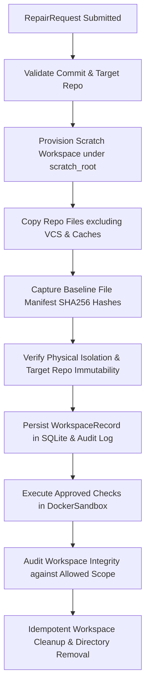

# Phase 8, Milestone 2: Isolated Workspace Management & Sandbox Integration Specification

- **Milestone:** Phase 8, Milestone 2 — Isolated Workspace Management & Sandbox Integration
- **Status:** COMPLETED & VERIFIED
- **Target Repo Immutability:** STRICTLY ENFORCED (Zero target mutation, zero git commits, zero pushes, zero PRs)
- **Commit Message:** `feat(phase8): implement isolated workspace management and sandbox integration (M2)`
- **Traceability:** Implements Phase 8, Milestone 2 specification per `AGENTS.md` (Sections 1, 2, 3, 4, 5, 6, 7).

---

## 1. Executive Summary & Objective

Phase 8 builds the controlled, evidence-grounded software repair and patch verification engine in FORGE.

Milestone 2 operationalizes secure, disposable scratch workspace management and integrates it with FORGE's isolated Docker sandbox infrastructure. It guarantees:
1. Physical directory separation: Isolated scratch workspaces are provisioned strictly outside the target repository root.
2. Pinned commit identity verification: The target repository commit SHA is verified via `git rev-parse HEAD`, preventing directory name or stale branch assumptions.
3. Path containment and symlink escape defenses: Path traversal (`..`), absolute paths, and external symlinks are detected and rejected.
4. Baseline file manifest hashing: All workspace files are fingerprinted with SHA256 hashes upon provisioning.
5. Workspace filesystem integrity auditing: Modifications, additions, deletions, and symlink attacks are detected and compared against declared `allowed_files`.
6. Docker sandbox execution: Container execution uses dropped capabilities (`--cap-drop ALL`), non-root execution (`1000:1000`), network isolation (`--network none`), strict resource limits, environment sanitization, command whitelisting, and configurable read-only vs writable bind mounts.
7. Fail-closed guarantees: When Docker is unavailable, command execution is skipped/refused (`SandboxUnavailableError`), never falling back to running untrusted code on the host.
8. Persistence & audit event ledger: Workspace metadata and execution history are stored in SQLite (`repair_workspaces` and `repair_execution_events`).

> [!IMPORTANT]
> **Scope Boundary**: Actual LLM-generated source-code patch generation remains deferred to Milestone 3. Automated Git commits, pushes, pull requests, merges, and deployments on target repositories are strictly forbidden.

---

## 2. Workspace Lifecycle Architecture



---

## 3. Core Components & Failure Hierarchy

### 3.1 Failure Hierarchy (`app/forge/repair/execution/failures.py`)
- `WorkspaceExecutionError` (Base exception)
  - `WorkspaceProvisioningError`: Provisioning, disk allocation, or copy failure.
  - `RepositoryAcquisitionError`: Target repository missing, corrupted, or query failed.
  - `CommitMismatchError`: Target repository commit SHA does not match pinned `base_commit_sha`.
  - `WorkspaceCollisionError`: Workspace path collides with target repo or existing workspace.
  - `WorkspaceReuseForbiddenError`: Attempt to reuse a cleaned workspace or duplicate active workspace.
  - `WorkspaceIntegrityViolationError`: Unauthorized modifications, additions, deletions, or symlink attacks.
  - `SandboxUnavailableError`: Docker daemon unavailable (fail closed).
  - `SandboxInitializationError`: Container initialization failed.
  - `ResourceLimitViolationError`: Container execution timed out or exceeded resource caps.
  - `WorkspaceCleanupError`: Teardown failure.

### 3.2 Isolated Workspace Implementation (`app/forge/repair/execution/workspace.py`)
`RepairWorkspace` implements `RepairWorkspaceProtocol` and provides:
- Pinned commit verification (`_verify_target_git_commit`).
- Baseline file hashing (`_hash_workspace_files`).
- Scope containment and symlink escape rejection (`validate_containment`).
- Baseline integrity diffing (`check_integrity`).
- Target repository immutability checks (`check_target_immutability`).
- Docker sandbox execution (`run_command_in_sandbox`).
- Idempotent cleanup (`cleanup`).

### 3.3 Workspace Manager Orchestration (`app/forge/repair/execution/manager.py`)
`RepairWorkspaceManager` coordinates:
- `provision_workspace(request, scratch_root, policy)`: Provisions workspace, records `WorkspaceRecord` in SQLite, and logs audit event.
- `validate_workspace_integrity(workspace, request)`: Runs integrity check against `allowed_files` and logs audit event.
- `execute_in_workspace(workspace, request, command, args, ...)`: Dispatches command to Docker sandbox and logs audit event.
- `cleanup_workspace(workspace, repair_id)`: Tears down workspace directory and updates SQLite record to `cleaned`.

---

## 4. SQLite Schema Integration (`app/forge/storage/database.py`)

Added `repair_workspaces` table:
```sql
CREATE TABLE IF NOT EXISTS repair_workspaces (
    workspace_id TEXT PRIMARY KEY,
    repair_id TEXT NOT NULL,
    target_repo TEXT NOT NULL,
    base_commit_sha TEXT NOT NULL,
    workspace_path TEXT NOT NULL,
    provisioning_status TEXT NOT NULL,
    isolation_verified INTEGER NOT NULL DEFAULT 0,
    cleanup_status TEXT NOT NULL DEFAULT 'active',
    metadata_json TEXT NOT NULL DEFAULT '{}',
    created_at TEXT NOT NULL,
    updated_at TEXT NOT NULL,
    FOREIGN KEY(repair_id) REFERENCES repair_executions(repair_id) ON DELETE CASCADE
);
CREATE INDEX IF NOT EXISTS idx_repair_workspaces_repair ON repair_workspaces(repair_id);
```

---

## 5. Verification Suite

The comprehensive Milestone 2 unit test suite is located at:
`tests/unit/test_phase8_m2_workspace_sandbox_integration.py`

Covered areas (25 tests):
1. Workspace provisioning & unique ID generation.
2. Commit identity verification (`git rev-parse HEAD` exact and prefix matching).
3. Commit mismatch detection (`CommitMismatchError`).
4. Target repository immutability verification.
5. Workspace collision prevention (target repo collision, nesting inside target repo).
6. Scope containment & symlink escape defense.
7. Workspace reuse prevention (`WorkspaceReuseForbiddenError`).
8. Filesystem integrity checking (authorized vs unauthorized modifications, additions, deletions, symlink attacks).
9. Docker sandbox execution (read-only vs writable mount, non-root, network isolation, env sanitization).
10. Fail-closed behavior when Docker daemon is unavailable (`SandboxUnavailableError`).
11. Timeout and resource limit enforcement (`ResourceLimitViolationError`).
12. SQLite persistence of `WorkspaceRecord`.
13. End-to-end `RepairWorkspaceManager` lifecycle and duplicate active workspace rejection.

Full regression suite:
- **1,191 passed, 1 skipped, 0 failures across all phases (Phases 1–8)**.
