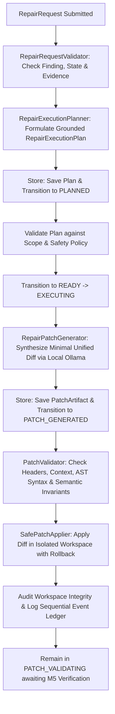

# Phase 8, Milestone 3: Evidence-Grounded Candidate Patch Generation Specification

- **Milestone:** Phase 8, Milestone 3 — Evidence-Grounded Candidate Patch Generation
- **Status:** COMPLETED & VERIFIED
- **Target Repo Immutability:** STRICTLY ENFORCED (Zero target mutation, zero git commits, zero pushes, zero PRs)
- **Commit Message:** `feat(phase8): implement evidence-grounded candidate patch generation (M3)`
- **Traceability:** Implements Phase 8, Milestone 3 specification per `AGENTS.md` (Sections 1, 2, 3, 4, 5, 6, 7).

---

## 1. Executive Summary & Objective

Phase 8 builds the controlled, evidence-grounded software repair and patch verification engine in FORGE.

Milestone 3 implements the first phase where FORGE is permitted to generate and apply candidate source-code patches, but strictly inside its isolated scratch repair workspace. It guarantees:
1. **Precondition and Provenance Validation**: Verifies finding existence, eligible lifecycle state (`SUSPECTED`, `REPRODUCED`, `ROOT_CAUSED`), commit SHA matching, evidence records provenance, workspace containment, authorized files compliance, and baseline integrity prior to generation.
2. **Evidence-Grounded Planning**: Formulates a typed `RepairExecutionPlan` with verified facts separated from hypotheses, identifying target files, root cause explanations, proposed changes, and scope boundaries.
3. **Local Candidate Patch Generation**: Uses local Ollama model inference (`qwen2.5-coder:1.5b`) with zero cloud fallback, strict prompt bounding, single-file scope, minimal diff synthesis, and budget caps.
4. **Strict Patch Parsing and Validation**: Multi-layer patch validation verifying unified diff headers, hunk marker consistency, exact context matching against isolated workspace files at the base commit, Python AST syntax validation, and semantic invariant defenses (no dead unreachable statements, no bypassed validation guards, no displaced docstrings).
5. **Safe In-Workspace Patch Application**: In-memory backup and atomic rollback on patch failure; verifies target repository immutability and workspace integrity post-application.
6. **Persistence & Guarded Lifecycle Progression**: Persists execution plans in SQLite (`repair_execution_plans`), manages guarded state machine transitions (`CREATED -> PLANNED -> VALIDATING -> READY -> EXECUTING -> PATCH_GENERATED -> PATCH_VALIDATING`), and records sequential audit events with secret redaction.
7. **Strict Milestone Boundaries**: Never transitions to `VERIFIED` state (patch verification is reserved for Milestone 5). Never creates automated Git commits, branches, PRs, pushes, merges, or deployments on target repositories.

---

## 2. Architecture & Data Flow



---

## 3. Core Components & Failure Hierarchy

### 3.1 Failure Hierarchy (`app/forge/repair/execution/failures.py`)
- `RepairExecutionError` (Base exception)
  - `RepairRequestValidationError`: Finding missing, ineligible state, commit mismatch, or ghost files.
  - `InsufficientEvidenceError`: Required evidence records missing or empty.
  - `StaleBaseRevisionError`: Target file or workspace has drifted from pinned commit SHA.
  - `PatchGenerationError`: Model generation failure, timeout, or malformed diff.
  - `PatchValidationError`: Diff syntax error, context mismatch, AST syntax error, or semantic invariant violation.
  - `PatchApplicationError`: In-workspace patch application failure.
  - `RepairPolicyViolationError`: Scope containment, protected path, or budget violation.

### 3.2 Precondition Validation (`app/forge/repair/execution/validator.py`)
`RepairRequestValidator` enforces ten strict precondition checks before patch generation:
1. Finding exists in persistent SQLite store.
2. Finding is in eligible repair state (`SUSPECTED`, `REPRODUCED`, `ROOT_CAUSED`); terminal states (`FIXED`, `VERIFIED`) are rejected.
3. Referenced evidence IDs exist in persistent SQLite store.
4. Referenced evidence has at least one valid record with substantive content.
5. Evidence commit SHA matches workspace pinned `base_commit_sha`.
6. Target files exist within isolated workspace boundaries.
7. Target files comply with declared `allowed_files` whitelist.
8. Target files do not collide with protected paths (`AGENTS.md`, `README.md`, `LICENSE`, `.git/`, `.env`).
9. Workspace ID matches request.
10. Workspace baseline filesystem integrity is intact.

### 3.3 Evidence-Grounded Planning (`app/forge/repair/execution/planner.py`)
`RepairExecutionPlanner` formulates typed `RepairExecutionPlan`:
- Extracts verified facts from linked `EvidenceRecord`s.
- Synthesizes root-cause explanation and bounded repair strategy.
- Locks target file to verified scope.
- Injects explicit boundaries: minimal changes, single file, preservation of docstrings and guards.

### 3.4 Local Candidate Patch Generator (`app/forge/repair/execution/generator.py`)
`RepairPatchGenerator` implements `RepairExecutorProtocol`:
- Invokes local Ollama provider (`qwen2.5-coder:1.5b`), strictly prohibiting cloud fallback.
- Enforces strict token context limits and secret redaction.
- Generates standard unified diff format (`--- a/...`, `+++ b/...`, `@@ ... @@`).
- Validates touched files: strictly single-file modification matching plan.
- Enforces patch budget caps: $\le 100$ lines added/deleted, $\le 5$ hunks, $\le 1$ file, $\le 20$ KB.
- Supports deterministic replacement synthesis for reproducible unit testing.

### 3.5 Multi-Layer Patch Validator (`app/forge/repair/execution/validator.py`)
`PatchValidator` enforces five layers of safety verification:
1. **Scope and Containment**: Rejects path traversal, absolute paths, protected files, and multi-file diffs.
2. **Unified Diff Syntax**: Verifies valid `---` and `+++` file headers and `@@ -l,s +l,s @@` hunk markers.
3. **Workspace Context Matching**: Verifies that diff context lines match workspace target file content at the base revision verbatim.
4. **AST Syntax Verification**: Applies candidate patch in memory and verifies that Python files parse cleanly with `ast.parse`.
5. **Static Semantic Invariants**: Uses `analyze_python_ast_semantics` to detect unreachable statements, removed/bypassed validation guards, and displaced docstrings.

### 3.6 Safe Workspace Patch Applier (`app/forge/repair/execution/applier.py`)
`SafePatchApplier` applies candidate patches inside isolated workspaces:
- Pre-application target repository immutability check.
- In-memory backup of target file before modification.
- Atomic rollback on patch application failure.
- Post-application workspace integrity verification against baseline manifest.
- Post-application target repository immutability verification.

### 3.7 Repair Execution Coordinator (`app/forge/repair/execution/coordinator.py`)
`RepairExecutionCoordinator` orchestrates the full end-to-end flow:
- Validates request (`VALIDATING` -> `READY`).
- Formulates plan (`PLANNED`).
- Generates patch (`EXECUTING` -> `PATCH_GENERATED`).
- Validates patch and applies cleanly in workspace (`PATCH_VALIDATING`).
- Remains in `PATCH_VALIDATING` awaiting human verification in Milestone 5.
- On any validation failure, transitions cleanly to `FAILED` with structured `FailureClassification`.

---

## 4. SQLite Schema Integration (`app/forge/storage/database.py`)

Added `repair_execution_plans` table:
```sql
CREATE TABLE IF NOT EXISTS repair_execution_plans (
    plan_id TEXT PRIMARY KEY,
    repair_id TEXT NOT NULL,
    target_file TEXT NOT NULL,
    root_cause TEXT NOT NULL,
    proposed_change TEXT NOT NULL,
    scope_boundary TEXT NOT NULL,
    metadata_json TEXT NOT NULL DEFAULT '{}',
    created_at TEXT NOT NULL,
    FOREIGN KEY(repair_id) REFERENCES repair_executions(repair_id) ON DELETE CASCADE
);
CREATE INDEX IF NOT EXISTS idx_repair_exec_plans_repair ON repair_execution_plans(repair_id);
```

---

## 5. Verification Suite

### 5.1 Milestone 3 Unit Tests (`tests/unit/test_phase8_m3_patch_generation.py`)
23 dedicated unit tests verifying all core requirements:
- `test_request_validation_succeeds_on_valid_inputs`: Valid request accepted.
- `test_request_validation_rejects_nonexistent_finding`: Missing finding rejected.
- `test_request_validation_rejects_ineligible_finding_state`: Terminal state `fixed` rejected.
- `test_request_validation_rejects_missing_evidence`: Missing evidence ID rejected.
- `test_request_validation_rejects_stale_commit_in_evidence`: Commit SHA mismatch rejected.
- `test_request_validation_rejects_missing_evidence_file_in_workspace`: Ghost file rejected.
- `test_request_validation_rejects_workspace_id_mismatch`: Mismatched workspace rejected.
- `test_planner_formulates_grounded_plan`: Plan formulated with evidence facts.
- `test_planner_rejects_unauthorized_target_file`: Unauthorized target file rejected.
- `test_patch_generator_deterministic_replacement`: Deterministic diff synthesis.
- `test_patch_generator_with_mock_provider`: Mock LLM response parsing and artifact creation.
- `test_patch_generator_rejects_unauthorized_touched_file`: Multi-file / out-of-scope diff rejected.
- `test_patch_generator_rejects_malformed_model_output`: Malformed diff rejected.
- `test_patch_validator_accepts_clean_patch`: Clean patch accepted.
- `test_patch_validator_rejects_path_traversal`: Path traversal rejected.
- `test_patch_validator_rejects_protected_file_target`: Protected file target rejected.
- `test_patch_validator_rejects_context_mismatch`: Stale context lines rejected.
- `test_patch_validator_rejects_syntax_error_introduction`: Python syntax error rejected.
- `test_patch_validator_enforces_budget_caps`: Budget overflow rejected.
- `test_safe_patch_applier_applies_cleanly`: Clean application in isolated workspace.
- `test_safe_patch_applier_atomic_rollback_on_failure`: Rollback to original content on error.
- `test_coordinator_end_to_end_candidate_generation`: Complete pipeline execution.
- `test_coordinator_transitions_to_failed_on_invalid_patch`: Fails closed and updates state machine on bad patch.

### 5.2 Full Regression Suite
- Total unit tests: 1,215 tests.
- 1,214 passed, 1 skipped (live Docker opt-in), 0 failed.
- Clean working tree with zero regressions.
