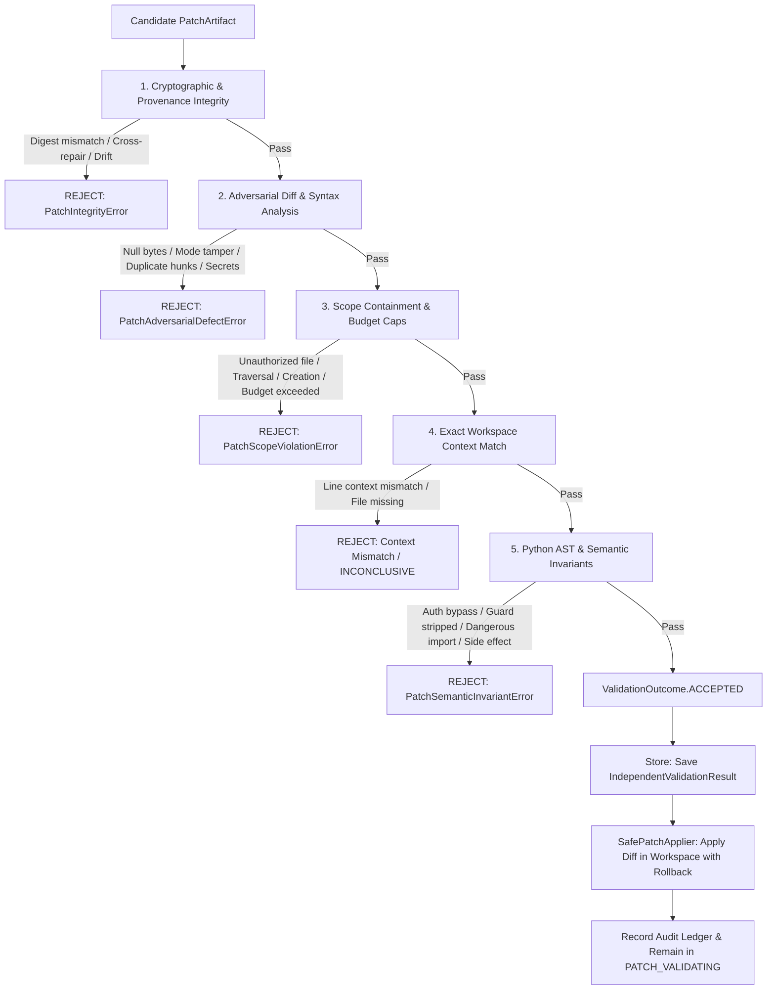

# Phase 8, Milestone 4: Independent Patch Validation & Scope Enforcement Specification

- **Milestone:** Phase 8, Milestone 4 — Independent Patch Validation & Scope Enforcement
- **Status:** COMPLETED & VERIFIED
- **Target Repo Immutability:** STRICTLY ENFORCED (Zero target mutation, zero git commits, zero pushes, zero PRs)
- **Commit Message:** `feat(phase8): implement independent patch validation and scope enforcement (M4)`
- **Traceability:** Implements Phase 8, Milestone 4 specification per `AGENTS.md` (Sections 1, 2, 3, 4, 5, 6, 7).

---

## 1. Executive Summary & Objective

In Phase 8, FORGE builds controlled, evidence-grounded software repair and patch verification.

Milestone 4 establishes an independent, defense-in-depth patch validation and scope enforcement layer. The core requirement: **a candidate patch must never be accepted merely because the model generated it, the unified diff parses, or the Python file compiles.**

Every accepted patch must undergo rigorous, independent verification against the original repair authorization, evidence chain of custody, isolated workspace baseline, and exact patch bytes before it is permitted to be applied.

Milestone 4 guarantees:
1. **Cryptographic & Provenance Integrity**: Recalculates exact SHA-256 patch bytes, verifies artifact ID determinism (`patch_<sha256[:12]>`), verifies repair ID and finding ID associations, verifies base commit SHA consistency across patch/request/workspace, verifies workspace identity, and detects workspace baseline manifest drift.
2. **Strict Scope Containment & Safety Boundaries**: Restricts patch modifications to authorized files explicitly specified in the repair request; rejects path traversal (`..`), absolute paths, symlink escapes, protected files (`.git/`, `.env`, `AGENTS.md`, `pyproject.toml`), file creation (`/dev/null`), file deletion, and enforces hard caps on files modified, lines changed, hunks, and byte sizes.
3. **Adversarial Diff & Syntax Invariants**: Rejects null bytes (`\x00`), disallowed ASCII control characters, binary patches (`GIT binary patch`), Git file mode modifications (`new file mode`), file renames/copies, non-positive line offsets ($\le 0$), duplicate hunks, overlapping hunks, and secrets or credential introduction in additions (`sk-`, `ghp_`, AWS keys, passwords).
4. **Python AST & Semantic Invariants**: Strengthens structural Python semantic checks to catch stripped/bypassed validation guards, weakened authorization (replacing conditionals with `True` or `1`), stripped exception handling or silenced `except: pass` blocks, dangerous imported modules (`subprocess`, `socket`, `pty`, `ctypes`, `pickle`), dynamic execution calls (`eval`, `exec`, `os.system`), public API deletions, public parameter removals, and top-level module side effects executed upon import.
5. **Typed Persistence & Audit Trail**: Persists structured `IndependentValidationResult` objects in SQLite table `repair_validation_results`, records sequential audit events with secret redaction, updates full execution snapshots, and enforces guarded state progression (`PATCH_GENERATED -> PATCH_VALIDATING`).
6. **Milestone Boundaries**: Stays strictly in `PATCH_VALIDATING`. Never transitions to `VERIFIED` (verification remains deferred to Milestone 5). Never creates automated Git commits, branches, PRs, pushes, merges, or deployments on target repositories.

---

## 2. Architecture & Defense-in-Depth Pipeline

---

## 3. Data Models & SQLite Schema

### 3.1 Failure Hierarchy (`app/forge/repair/execution/failures.py`)
- `PatchValidationError(WorkspaceExecutionError)`
  - `PatchIntegrityError`: Digest mismatch, artifact identity failure, commit mismatch, workspace mismatch, or baseline drift.
  - `PatchScopeViolationError`: Unauthorized files, path traversal, absolute paths, file creation/deletion, or budget caps exceeded.
  - `PatchAdversarialDefectError`: Null bytes, control characters, binary patches, duplicate/overlapping hunks, mode changes, or credentials.
  - `PatchSemanticInvariantError`: Stripped guards, weakened auth, silenced exceptions, dangerous imports, dynamic execution, or public API breaking changes.

### 3.2 Diagnostic Models (`app/forge/repair/execution/models.py`)
- `ValidationOutcome`: Enum with values `ACCEPTED`, `REJECTED`, `INCONCLUSIVE`, `ERROR`.
- `FailureCategory`: Extended with `INTEGRITY_ERROR`, `ADVERSARIAL_DEFECT`, `SEMANTIC_VIOLATION`.
- `IndependentValidationResult`: Complete diagnostic entity subclassing `ValidationResult`, recording:
  - `validation_id`: Deterministic validation ID (`val_indep_...`).
  - `patch_artifact_id`, `repair_id`, `finding_id`, `repository_target`, `base_commit_sha`, `workspace_id`.
  - `patch_sha256`, `validated_file_paths`, `validated_hunk_count`, `lines_added`, `lines_deleted`, `patch_bytes`.
  - `scope_result`, `integrity_result`, `semantic_result`: Structured diagnostic dictionaries.
  - `overall_status`: `ValidationOutcome`.
  - `rejection_reasons`, `policy_version`, `is_valid`, `violations`, `checks_passed`, `validated_at`.

### 3.3 SQLite Persistence (`app/forge/storage/database.py`)
Table `repair_validation_results`:
- `validation_id` (PRIMARY KEY)
- `patch_artifact_id` (FOREIGN KEY -> `patch_artifacts(artifact_id)`)
- `repair_id` (FOREIGN KEY -> `repair_executions(repair_id)`)
- `finding_id`, `repository_target`, `base_commit_sha`, `workspace_id`, `patch_sha256`
- `validated_file_paths_json`, `validated_hunk_count`, `lines_added`, `lines_deleted`, `patch_bytes`
- `scope_result_json`, `integrity_result_json`, `semantic_result_json`
- `overall_status`, `rejection_reasons_json`, `policy_version`, `is_valid`
- `violations_json`, `checks_passed_json`, `validated_at`
- Indices: `idx_repair_val_results_repair`, `idx_repair_val_results_patch`.

---

## 4. Multi-Layer Enforcement Specification

### Layer 1: Cryptographic & Baseline Integrity
1. Recalculates `hashlib.sha256(diff_bytes).hexdigest()` and verifies it matches `patch.content_hash`.
2. Verifies artifact ID format and value: `patch.artifact_id == f"patch_{patch.content_hash[:12]}"`.
3. Verifies repair ID and finding ID association matches the authorizing `RepairRequest`.
4. Verifies `base_commit_sha` matches across patch, request, and isolated workspace.
5. Verifies workspace ID match between request and target workspace.
6. Baseline drift detection: inspects workspace baseline file hashes (`workspace.baseline_manifest`) and verifies target files have not been modified prior to validation.

### Layer 2: Adversarial Diff Checks
1. Rejects null bytes (`\x00`) in unified diff content.
2. Rejects disallowed ASCII control characters (preserving standard `\n`, `\r`, `\t`).
3. Rejects Git binary diff headers (`GIT binary patch`, `Binary files`).
4. Rejects file mode tampering (`new file mode`, `old file mode`, `deleted file mode`).
5. Rejects file rename/copy headers (`rename from`, `rename to`, `similarity index`).
6. Rejects secret/credential additions via regex detection (`sk-`, `ghp_`, `AKIA`, private keys, passwords).
7. Rejects non-positive line offsets (`old_start <= 0`, `new_start <= 0`).
8. Detects duplicate hunks and overlapping hunk ranges.

### Layer 3: Scope & Budget Containment
1. Validates that every touched file belongs to `request.allowed_files`.
2. Rejects path traversal (`..`) and absolute paths (`/etc/passwd`).
3. Rejects file creation (`--- /dev/null`) and file deletion (`+++ /dev/null`).
4. Enforces budget caps: $\le 1$ file, $\le 100$ lines changed, $\le 5$ hunks, $\le 20$ KB.

### Layer 4: Workspace Context Matching
1. Resolves target file on disk within the isolated scratch workspace.
2. Parses hunk line markers and extracts expected context lines.
3. Performs windowed exact matching of context lines against original file lines.

### Layer 5: Python AST & Semantic Invariants
1. Verifies that patched Python code parses without syntax errors via `ast.parse`.
2. Enforces semantic invariants via `analyze_python_ast_semantics`:
   - Detects stripped validation guards (`BypassedGuardInfo`).
   - Detects weakened auth (replacing conditional logic with constant `True` or `1`).
   - Detects removed `try/except` blocks or silenced exception handlers (`except: pass`).
   - Detects forbidden imports (`subprocess`, `socket`, `pty`, `ctypes`, `pickle`, `shutil`, `importlib`).
   - Detects dynamic execution calls (`eval`, `exec`, `compile`, `__import__`, `os.system`, `os.popen`).
   - Detects removed public functions or deleted classes.
   - Detects altered public function signatures (removed parameters) or dropped type annotations.
   - Detects module-level side effects (new top-level function calls executed on import).

---

## 5. Verification & Test Evidence

Test suite: `tests/unit/test_phase8_m4_patch_validation.py` (33 unit tests):
- **Cryptographic & Provenance Integrity**: 8 tests covering digest match, tampered bytes, artifact ID, cross-repair reuse, finding mismatch, commit mismatch, workspace mismatch, baseline drift.
- **Scope Containment**: 6 tests covering unauthorized file, traversal, absolute path, file creation, file deletion, budget caps.
- **Adversarial Diff Checks**: 9 tests covering null bytes, control characters, binary diffs, duplicate hunks, overlapping hunks, negative offsets, mode changes, renames, secrets.
- **Semantic Invariants**: 8 tests covering stripped guards, weakened auth, dangerous imports, dynamic execution, signature alterations, annotation removals, module side effects.
- **Persistence & Audit Integration**: 2 tests covering SQLite storage, retrieval, conclusive/inconclusive outcomes, and full execution record assembly.
- **Controlled End-to-End Demonstration**: 1 test proving clean valid patch passes and is applied, while 3 adversarial patches fail with appropriate classifications, and target repository immutability is preserved.

Full regression suite: **1,247 passed, 1 skipped, 0 failed** across all FORGE modules.
Whitespace validation: `git diff --check` passed with 0 errors.
