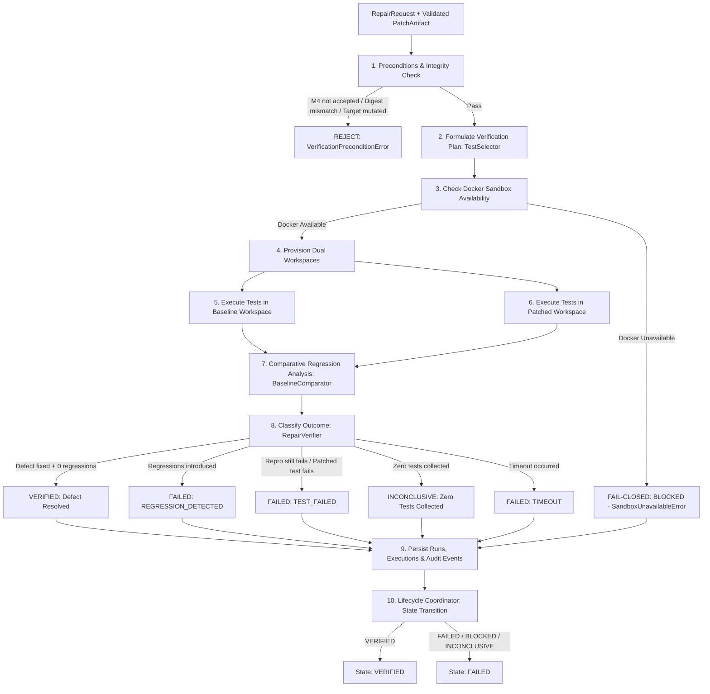

# Phase 8, Milestone 5: Sandbox Repair Verification & Regression Testing Specification

- **Milestone:** Phase 8, Milestone 5 — Sandbox Repair Verification & Regression Testing
- **Status:** COMPLETED & VERIFIED
- **Target Repo Immutability:** STRICTLY ENFORCED (Zero target mutation, zero git commits, zero pushes, zero PRs)
- **Commit Message:** `feat(phase8): implement sandbox repair verification and regression testing (M5)`
- **Traceability:** Implements Phase 8, Milestone 5 specification per `AGENTS.md` (Sections 1, 2, 3, 4, 5, 6, 7).

---

## 1. Executive Summary & Objective

In Phase 8, FORGE develops controlled, evidence-grounded software repair and patch verification.

Milestone 5 establishes a production-quality sandbox verification and regression testing engine. The central requirement: **a candidate patch must never be declared verified merely because it compiles, passes AST checks, or exits with code 0 without running tests.**

Verification must execute inside an isolated scratch workspace through the existing Docker sandbox infrastructure. Every verification run executes a dual-workspace comparative analysis: running selected tests on both the baseline (unpatched) workspace and the patched workspace to prove that the original defect is genuinely resolved without introducing new test failures or regressions.

Milestone 5 guarantees:
1. **Strict Fail-Closed Sandbox Execution**: All test runner processes execute exclusively within isolated Docker containers (non-root `1000:1000`, `--network none`, dropped capabilities, memory/CPU caps). If Docker is unavailable or encounters initialization errors, verification marks the run `BLOCKED` with `FailureCategory.SANDBOX_UNAVAILABLE`. Under no circumstances does FORGE fall back to executing untrusted repository code on the host.
2. **Mandatory M4 Validation Precondition**: Verification strictly requires an independent Milestone 4 validation result with status `ACCEPTED`. Tampered patches, digest mismatches, unaccepted patches, or mutated target repositories are rejected immediately with `VerificationPreconditionError`.
3. **Dual-Workspace Comparative Regression Analysis**: Provisions a clean baseline workspace at the exact target commit alongside the patched workspace. Executes selected test suites across both environments to categorize each test as `FIXED`, `STABLE_PASS`, `PRE_EXISTING_FAILURE`, `NEW_REGRESSION`, `NEW_ERROR`, or `INCONCLUSIVE`.
4. **Zero-Fabrication Outcome Determination**: A candidate patch is granted `VerificationOutcome.VERIFIED` **only** when all preconditions pass, independent M4 validation was accepted, relevant tests genuinely executed, required defect reproduction checks passed, and zero new regressions or timeouts occurred. Zero-test collections or empty outputs are classified as `INCONCLUSIVE`, never success.
5. **Deterministic Test Discovery & Shell Injection Defense**: `TestSelector` discovers defect reproduction tests from verified `EvidenceRecord`s and module unit tests corresponding to modified files. Any proposed commands in repair plans are vetted strictly against binary whitelists (`pytest`, `python`, `unittest`); arbitrary shell strings, chaining (`&&`, `||`, `;`), backticks, and substitutions are rejected with `ArbitraryExecutionForbiddenError`.
6. **Structured Evidence Generation & Report Synthesis**: Generates concrete `EvidenceRecord`s for reproduction and regression test outputs, attaching them to the finding. Produces structured Markdown and JSON verification summaries detailing baseline vs. patched comparisons, failure diagnostics, and duration metrics.
7. **Typed SQLite Persistence & Audit Trail**: Persists verification runs in `repair_verification_runs` and itemized test executions in `repair_test_executions`. Emits sequential, secret-redacted audit events (`sandbox_verification_completed`) in the `repair_execution_events` ledger.
8. **Guarded Lifecycle Progression**: Updates `RepairExecutionState` from `PATCH_VALIDATING` to `VERIFIED` on complete verification success, or transitions to `FAILED` with categorized failure classifications (`FailureCategory.REGRESSION_DETECTED`, `FailureCategory.TEST_FAILED`, `FailureCategory.TIMEOUT`, `FailureCategory.SANDBOX_UNAVAILABLE`).
9. **Milestone Boundaries**: Review and approval workflows, interactive human sign-off, PR generation, Git commits, and code merging remain strictly deferred to Milestone 6.

---

## 2. Architecture & Verification Workflow



---

## 3. Data Models & SQLite Schema

### 3.1 Domain Models (`app/forge/repair/execution/models.py`)

- `VerificationOutcome` (Enum):
  - `VERIFIED`: Defect demonstrably resolved, required tests executed, zero regressions.
  - `FAILED`: Test failure, regression introduced, or defect reproduction check failed on patched code.
  - `INCONCLUSIVE`: Execution occurred but yielded zero tests, missing test targets, or indeterminate outcomes.
  - `BLOCKED`: Verification could not proceed safely (e.g., Docker sandbox unavailable).

- `TestSelectionCategory` (Enum, `__test__ = False`):
  - `REPRODUCTION`: Test specifically verifying resolution of the identified defect.
  - `MODULE`: Unit tests covering modified source files.
  - `REGRESSION_SUITE`: Repository-level regression or integration test suites.
  - `CUSTOM`: Validated test commands specified in the authorized repair plan.

- `ComparisonStatus` (Enum):
  - `FIXED`: Failed on baseline revision, passed on patched revision.
  - `STABLE_PASS`: Passed on both baseline and patched revisions.
  - `PRE_EXISTING_FAILURE`: Failed on both baseline and patched revisions (pre-existing defect).
  - `NEW_REGRESSION`: Passed on baseline revision, failed on patched revision.
  - `NEW_ERROR`: Succeeded or skipped on baseline revision, produced runtime error/timeout on patched revision.
  - `INCONCLUSIVE`: Test ran on one revision without valid counterpart for comparison.

- `SelectedTest`:
  - `test_id`, `test_name`, `category`, `command` (List[str]), `relative_cwd`, `target_file`, `rationale`, `expected_to_fail_on_baseline`.

- `VerificationPlan`:
  - `plan_id`, `repair_id`, `patch_artifact_id`, `selected_tests`, `timeout_seconds`, `created_at`.

- `TestExecutionRecord` (`__test__ = False`):
  - `execution_id`, `verification_id`, `repair_id`, `workspace_id`, `target_type` ("baseline" | "patched"), `test_name`, `command`, `selection_rationale`, `exit_code`, `status` ("passed" | "failed" | "error" | "timeout" | "skipped"), `passed`, `timed_out`, `duration_ms`, `stdout_excerpt`, `stderr_excerpt`, `tests_collected`, `tests_executed`, `tests_passed`, `tests_failed`, `tests_skipped`, `tests_errored`, `failure_message`, `started_at`, `completed_at`.

- `TestComparisonResult` (`__test__ = False`):
  - `test_name`, `status`, `baseline_passed`, `patched_passed`, `details`.

- `RegressionAnalysisRecord`:
  - `regression_detected`, `defect_resolved`, `comparisons`, `new_failures_count`, `fixed_tests_count`, `stable_tests_count`, `pre_existing_failures_count`, `summary`.

- `VerificationRunRecord`:
  - `verification_id`, `repair_id`, `patch_artifact_id`, `validation_id`, `repository_target`, `base_commit_sha`, `workspace_id`, `baseline_workspace_id`, `patch_sha256`, `plan`, `baseline_executions`, `patched_executions`, `regression_analysis`, `overall_outcome`, `failure_category`, `failure_message`, `evidence_ids`, `logs_excerpt`, `started_at`, `completed_at`, `duration_ms`.

### 3.2 SQLite Storage Schema (`app/forge/storage/database.py`)

```sql
CREATE TABLE IF NOT EXISTS repair_verification_runs (
    verification_id TEXT PRIMARY KEY,
    repair_id TEXT NOT NULL REFERENCES repair_executions(repair_id),
    patch_artifact_id TEXT NOT NULL REFERENCES patch_artifacts(artifact_id),
    validation_id TEXT NOT NULL,
    repository_target TEXT NOT NULL,
    base_commit_sha TEXT NOT NULL,
    workspace_id TEXT NOT NULL,
    baseline_workspace_id TEXT,
    patch_sha256 TEXT NOT NULL,
    plan_json TEXT NOT NULL,
    regression_analysis_json TEXT NOT NULL,
    overall_outcome TEXT NOT NULL,
    failure_category TEXT,
    failure_message TEXT,
    evidence_ids_json TEXT NOT NULL,
    logs_excerpt TEXT,
    started_at TEXT NOT NULL,
    completed_at TEXT NOT NULL,
    duration_ms REAL NOT NULL
);

CREATE TABLE IF NOT EXISTS repair_test_executions (
    execution_id TEXT PRIMARY KEY,
    verification_id TEXT NOT NULL REFERENCES repair_verification_runs(verification_id),
    repair_id TEXT NOT NULL REFERENCES repair_executions(repair_id),
    workspace_id TEXT NOT NULL,
    target_type TEXT NOT NULL,
    test_name TEXT NOT NULL,
    command_json TEXT NOT NULL,
    selection_rationale TEXT NOT NULL,
    exit_code INTEGER NOT NULL,
    status TEXT NOT NULL,
    passed INTEGER NOT NULL,
    timed_out INTEGER NOT NULL,
    duration_ms REAL NOT NULL,
    stdout_excerpt TEXT NOT NULL,
    stderr_excerpt TEXT NOT NULL,
    tests_collected INTEGER NOT NULL,
    tests_executed INTEGER NOT NULL,
    tests_passed INTEGER NOT NULL,
    tests_failed INTEGER NOT NULL,
    tests_skipped INTEGER NOT NULL,
    tests_errored INTEGER NOT NULL,
    failure_message TEXT,
    started_at TEXT NOT NULL,
    completed_at TEXT NOT NULL
);
```

---

## 4. Verification Engine Architecture (`app/forge/repair/execution/verifier.py`)

The sandbox verification architecture comprises modular, decoupled components:

1. **`parse_test_runner_output(stdout, stderr)`**:
   - Parses stdout and stderr from `pytest` and Python `unittest` test runners using strict regular expressions.
   - Extracts explicit metrics: `tests_collected`, `tests_executed`, `tests_passed`, `tests_failed`, `tests_skipped`, `tests_errored`.
   - Never fabricates test pass counts when outputs are empty or unparseable.

2. **`TestSelector` (`__test__ = False`)**:
   - Identifies candidate reproduction tests from finding evidence records (looking for reproduction commands, test files, or error traces).
   - Inspects target repository test directories (`tests/`, `test/`) to discover existing module unit tests covering modified source files (e.g., `tests/test_calculator.py` for `src/calculator.py`).
   - Vets custom test commands from repair plans against strict binary whitelists (`pytest`, `python -m pytest`, `unittest`), rejecting arbitrary shell commands or chained pipelines.

3. **`TestExecutor` (`__test__ = False`)**:
   - Executes commands inside the isolated scratch workspace via `DockerSandbox`.
   - Strictly enforces fail-closed behavior: checks `DockerSandbox.is_available()` before invocation; raises `SandboxUnavailableError` if unavailable.
   - Sanitizes command output through `redact_secrets()` and truncates excerpts exceeding 30,000 characters.
   - Categorizes runs with 0 collected tests as `inconclusive`.

4. **`BaselineComparator` & `RegressionAnalyzer`**:
   - Matches test results across baseline and patched workspace executions.
   - Identifies whether baseline failures were fixed (`FIXED`) or pre-existing (`PRE_EXISTING_FAILURE`).
   - Identifies new failures introduced by the patch (`NEW_REGRESSION`).
   - Detects execution errors and timeouts (`NEW_ERROR`).
   - Summarizes net regression delta.

5. **`VerificationEvidenceCollector`**:
   - Generates structured `EvidenceRecord`s for verification runs, referencing the specific `run_id` and `finding_id`.
   - Records verification command, execution outcomes, duration, and test counts.
   - Attaches evidence directly to the FORGE evidence store.

6. **`VerificationReportBuilder`**:
   - Renders comprehensive human-readable Markdown verification reports with baseline vs. patched summary tables, regression analysis, failure diagnostics, and execution duration.
   - Exports raw JSON summaries for programmatic ingestion.

7. **`RepairVerifier` (Implements `RepairVerifierProtocol`)**:
   - Orchestrates the complete end-to-end sandbox verification workflow:
     1. Validates preconditions (finding, commit SHA, M4 validation acceptance, target repository immutability).
     2. Formulates the verification plan via `TestSelector`.
     3. Validates Docker sandbox availability (fail-closed).
     4. Provisions a clean baseline workspace at the base commit revision.
     5. Executes tests in baseline workspace.
     6. Executes tests in patched workspace.
     7. Analyzes comparative results via `BaselineComparator`.
     8. Determines final outcome via `_classify_verification_outcome`.
     9. Persists `VerificationRunRecord` and `TestExecutionRecord`s.
     10. Records sequential audit events with secret redaction.

8. **`RepairExecutionCoordinator.execute_repair_verification`**:
   - Bridges the verifier and the repair state machine.
   - Transitions `RepairRequest` from `PATCH_VALIDATING` to `VERIFIED` on successful verification.
   - Transitions `RepairRequest` to `FAILED` with categorized failure classification on regression, test failure, timeout, or blocked execution.

---

## 5. Verification Rules & Outcome Matrix

| Baseline Status | Patched Status | Comparison Status | Contribution to Outcome |
| :--- | :--- | :--- | :--- |
| **FAILED** | **PASSED** | `FIXED` | Satisfies defect resolution requirement. |
| **PASSED** | **PASSED** | `STABLE_PASS` | Confirms non-regression on existing test. |
| **FAILED** | **FAILED** | `PRE_EXISTING_FAILURE` | Pre-existing failure; not a regression, but defect unresolved if this was the repro test. |
| **PASSED** | **FAILED** | `NEW_REGRESSION` | Triggers immediate outcome `FAILED` with `REGRESSION_DETECTED`. |
| Any | **TIMEOUT** | `NEW_ERROR` | Triggers immediate outcome `FAILED` with `TIMEOUT`. |
| Missing | Missing / 0 tests | `INCONCLUSIVE` | Triggers outcome `INCONCLUSIVE` (or `FAILED`). Never marked `VERIFIED`. |

### Strict Conditions for `VERIFIED` State
1. All preconditions validated (finding exists, commit SHA matches, M4 validation was `ACCEPTED`).
2. Docker sandbox is available and operational.
3. Relevant tests were selected and genuinely executed.
4. Total tests collected on patched code $> 0$.
5. Zero timeouts occurred.
6. Zero new regressions occurred (`new_failures_count == 0`).
7. Required defect reproduction check passed on patched code.
8. Target repository remains byte-for-byte identical to origin (immutability check passed).

---

## 6. Verification and Regression Test Suite

The verification engine was validated using a 26-test suite in `tests/unit/test_phase8_m5_verification.py`:

- **Precondition & Integrity Tests** (5 tests):
  - Rejection when patch was not validated by M4.
  - Rejection when M4 validation was rejected.
  - Rejection when patch SHA-256 hash was tampered with.
  - Rejection when base commit SHA is mismatched.
  - Rejection when target repository was modified.

- **Test Selection & Vetting Tests** (3 tests):
  - Discovery of defect reproduction tests from `EvidenceRecord`s.
  - Discovery of module test files from repository structure.
  - Strict rejection of arbitrary shell injection strings and commands.

- **Output Parsing & Secret Redaction Tests** (5 tests):
  - Pytest output parsing accuracy (collected, passed, failed, skipped).
  - Unittest output parsing accuracy.
  - Zero collected tests classified as inconclusive.
  - Secret and token redaction from test stdout/stderr.
  - Fail-closed execution when Docker is unavailable.

- **Baseline Comparison & Regression Tests** (4 tests):
  - Detection of resolved defect (`FIXED`).
  - Detection of newly failing test (`NEW_REGRESSION`).
  - Detection of stable pass (`STABLE_PASS`).
  - Detection of pre-existing failure (`PRE_EXISTING_FAILURE`).

- **End-to-End Verifier Tests** (4 tests):
  - Fail-closed handling when Docker is unavailable (`BLOCKED`).
  - Successful repair verification with clean regression checks (`VERIFIED`).
  - Verification failure when regression is introduced (`FAILED`).
  - Verification failure when reproduction check still fails on patched code (`FAILED`).

- **Persistence & Reporting Tests** (2 tests):
  - SQLite round-trip persistence of `VerificationRunRecord` and `TestExecutionRecord`s.
  - Verification report markdown generation and formatting.

- **Coordinator State Machine & Immutability Tests** (3 tests):
  - Coordinator transitions request from `PATCH_VALIDATING` to `VERIFIED` upon success.
  - Coordinator transitions request to `FAILED` with `REGRESSION_DETECTED` on regression.
  - Target repository remains strictly immutable throughout the entire verification lifecycle.

---

## 7. Operational Boundaries & Deferred Capabilities

- **Strict Fail-Closed Policy**: Under no circumstances will FORGE execute target repository code directly on the host machine.
- **Strict Target Repository Immutability**: All verification runs execute inside ephemeral scratch workspaces. The target repository is never modified, committed to, or pushed.
- **Zero Fabrication**: Exit code 0 without test execution or with 0 tests collected is strictly rejected as proof of fix.
- **Milestone 6 Deferral**: Review and approval workflows, interactive human sign-off, PR opening, Git commits, and code merging remain strictly deferred to Milestone 6.
