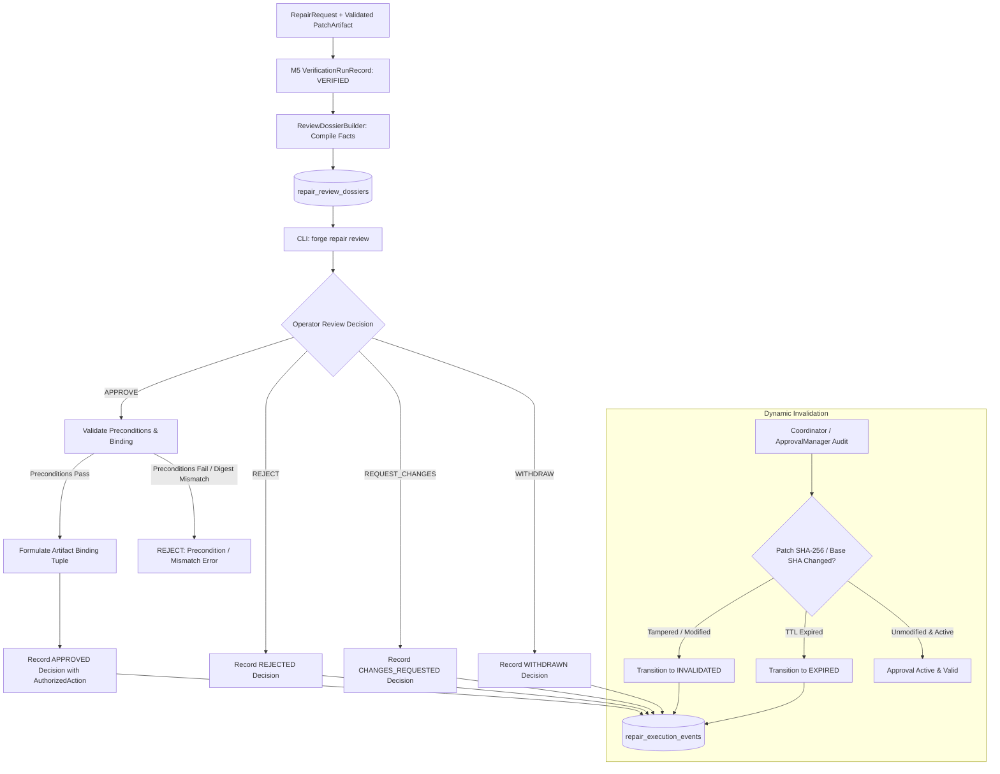

# Phase 8, Milestone 6: Operator Review, Approval & Authorization Workflows Specification

- **Milestone:** Phase 8, Milestone 6 — Operator Review, Approval & Authorization Workflows
- **Phase Status:** Phase 8 (Controlled Software Repair Execution) — 100% COMPLETE & VERIFIED
- **Target Repo Immutability:** STRICTLY ENFORCED (Zero target mutation, zero git commits, zero git pushes, zero PR creation, zero code merges, zero production deployment)
- **Traceability:** Implements Phase 8, Milestone 6 specification per `AGENTS.md` (Sections 1, 2, 3, 4, 5, 6, 7).

---

## 1. Executive Summary & Objective

In Phase 8, FORGE develops controlled, evidence-grounded software repair and patch verification.

Milestone 6 implements the final architectural governance layer: an explicit, operator-in-the-loop review, approval, and authorization workflow for candidate repairs that have completed independent patch validation (M4) and sandbox regression verification (M5).

The core principle: **FORGE must never automatically commit code, push branches, open pull requests, merge changes, or deploy software to target repositories. Every candidate repair requires explicit human review and cryptographically bound operator authorization before any downstream action may proceed.**

Milestone 6 guarantees:
1. **Fact-Based Review Dossier**: Synthesizes verified audit records into an immutable `ReviewDossier` containing repository target, pinned base commit, finding details, candidate patch diff, size metrics, M4 validation outcomes, M5 sandbox verification outcomes, dual-workspace comparative regression results, and traceable audit facts. AI-generated explanations are strictly segregated from verified facts.
2. **Artifact-Bound Authorization**: Approvals are bound to an exact 11-tuple: `(repair_id, finding_id, repository_target, base_commit_sha, patch_artifact_id, patch_sha256, validation_id, verification_id, dossier_id, dossier_version, policy_version)`. Approvals are never generic or transferable across candidate revisions.
3. **Dynamic Invalidation on Drift**: Any mutation to the underlying patch artifact, workspace content, base commit revision, or expiration of the configured time-to-live (TTL) immediately invalidates the approval (`ApprovalState.INVALIDATED` or `ApprovalState.EXPIRED`).
4. **Typed Lifecycle State Machine**: Governs approval lifecycle states (`PENDING_REVIEW`, `APPROVED`, `REJECTED`, `CHANGES_REQUESTED`, `WITHDRAWN`, `EXPIRED`, `INVALIDATED`) with strict transition matrices, preventing duplicate approvals or transitions out of terminal review states.
5. **Strict Approval Preconditions**: An approval decision is refused unless the repair is in `VERIFIED` state, M4 validation is `ACCEPTED`, M5 sandbox verification is `VERIFIED`, patch SHA-256 matches all validation/verification records, pinned base commit SHA matches, 0 regressions are detected, the defect is demonstrably resolved, operator identity is authenticated, and a non-empty justification reason is supplied.
6. **Explicit Authorized Downstream Actions**: Approved repairs record an explicit `AuthorizedAction` (`EXPORT_PATCH`, `STAGE_FOR_PR`, or `MANUAL_INTEGRATION`). FORGE does not execute target repository mutations; it merely certifies that the operator has authorized that specific action.
7. **Typed SQLite Persistence & Audit Ledger**: Persists review dossiers in `repair_review_dossiers` and decisions in `repair_approval_decisions`. Emits immutable, secret-redacted audit events (`operator_decision_submitted`, `approval_invalidated`) to `repair_execution_events`.
8. **CLI Operator Experience**: Provides human-friendly and automation-ready CLI commands: `forge repair review`, `forge repair approve`, `forge repair reject`, `forge repair request-changes`, and `forge repair approval-history`.

---

## 2. Architecture & Invalidation Workflow



---

## 3. Data Models & SQLite Schema

### 3.1 Domain Models (`app/forge/repair/execution/models.py`)

- `ApprovalState` (Enum):
  - `PENDING_REVIEW`: Candidate repair dossier compiled, awaiting operator review.
  - `APPROVED`: Explicit operator sign-off with authorized downstream action.
  - `REJECTED`: Candidate repair rejected by operator.
  - `CHANGES_REQUESTED`: Operator requested specific revisions/adjustments.
  - `WITHDRAWN`: Operator revoked prior approval.
  - `EXPIRED`: Approval validity window exceeded configured TTL.
  - `INVALIDATED`: Bound artifacts modified or tampered with after approval.

- `OperatorDecisionType` (Enum):
  - `APPROVE`, `REJECT`, `REQUEST_CHANGES`, `WITHDRAW`.

- `AuthorizedAction` (Enum):
  - `EXPORT_PATCH`: Export validated patch as `.patch` / `.diff` artifact for external application.
  - `STAGE_FOR_PR`: Prepare metadata and artifacts for operator-controlled PR opening.
  - `MANUAL_INTEGRATION`: Authorized for manual developer integration.

- `ApprovalBinding`:
  - `repair_id`: Target repair execution ID.
  - `finding_id`: Target defect finding ID.
  - `repository_target`: Pinned repository path or HTTPS URL.
  - `base_commit_sha`: Git commit hash at which candidate patch was anchored and verified.
  - `patch_artifact_id`: Patch artifact identifier.
  - `patch_sha256`: Cryptographic content hash of the candidate diff.
  - `validation_id`: Milestone 4 independent validation result ID.
  - `verification_id`: Milestone 5 sandbox verification run ID.
  - `dossier_id`: Associated review dossier identifier.
  - `dossier_version`: Review dossier schema version.
  - `policy_version`: Active repair policy version at time of approval.

- `ReviewDossier`:
  - `dossier_id`, `dossier_version`, `repair_id`, `finding_id`, `finding_title`, `finding_severity`.
  - `repository_target`, `base_commit_sha`, `evidence_ids`.
  - `patch_artifact_id`, `patch_sha256`, `target_files`, `lines_added`, `lines_removed`, `hunk_count`, `unified_diff`.
  - `validation_id`, `validation_outcome`, `verification_id`, `verification_outcome`.
  - `baseline_test_summary`, `patched_test_summary`, `regression_analysis_summary`.
  - `regression_detected`, `defect_resolved`, `workspace_integrity_confirmed`, `workspace_id`.
  - `security_findings`, `limitations`, `recommended_decision`.
  - `facts` (traceable to storage), `model_explanations` (clearly separated), `unresolved_uncertainties`.
  - `generated_at`.

- `ApprovalDecisionRecord`:
  - `decision_id`, `repair_id`, `binding` (`ApprovalBinding`), `state` (`ApprovalState`), `decision` (`OperatorDecisionType`).
  - `authorized_action`, `actor`, `reason`, `feedback`, `expires_at`, `created_at`.

### 3.2 SQLite Database Tables (`app/forge/storage/database.py`)

```sql
CREATE TABLE IF NOT EXISTS repair_review_dossiers (
    dossier_id TEXT PRIMARY KEY,
    repair_id TEXT NOT NULL,
    patch_artifact_id TEXT NOT NULL,
    validation_id TEXT,
    verification_id TEXT,
    dossier_version TEXT NOT NULL,
    recommended_decision TEXT NOT NULL,
    dossier_json TEXT NOT NULL,
    created_at TEXT NOT NULL
);

CREATE TABLE IF NOT EXISTS repair_approval_decisions (
    decision_id TEXT PRIMARY KEY,
    repair_id TEXT NOT NULL,
    state TEXT NOT NULL,
    decision TEXT NOT NULL,
    authorized_action TEXT,
    actor TEXT NOT NULL,
    reason TEXT NOT NULL,
    feedback TEXT,
    binding_json TEXT NOT NULL,
    expires_at TEXT,
    created_at TEXT NOT NULL
);

CREATE INDEX IF NOT EXISTS idx_repair_dossiers_repair ON repair_review_dossiers(repair_id);
CREATE INDEX IF NOT EXISTS idx_repair_dossiers_patch ON repair_review_dossiers(patch_artifact_id);
CREATE INDEX IF NOT EXISTS idx_repair_approval_repair ON repair_approval_decisions(repair_id);
CREATE INDEX IF NOT EXISTS idx_repair_approval_state ON repair_approval_decisions(state);
```

---

## 4. State Transitions & Authorization Matrix

### 4.1 Approval Lifecycle Transitions

| From State | Allowed Target States | Permitted Actors | Conditions |
|---|---|---|---|
| `PENDING_REVIEW` | `APPROVED` | `OPERATOR` | All 10 approval preconditions satisfied |
| `PENDING_REVIEW` | `REJECTED` | `OPERATOR` | Non-empty operator justification |
| `PENDING_REVIEW` | `CHANGES_REQUESTED`| `OPERATOR` | Actionable feedback supplied |
| `APPROVED` | `WITHDRAWN` | `OPERATOR` | Valid revocation reason |
| `APPROVED` | `EXPIRED` | `SYSTEM` / `OPERATOR` | `now > expires_at` |
| `APPROVED` | `INVALIDATED` | `SYSTEM` / `OPERATOR` | Artifact SHA-256, base SHA, or repo mismatch |
| `CHANGES_REQUESTED`| `PENDING_REVIEW` | `SYSTEM` / `ORCHESTRATOR` | Re-submitted revision |
| `CHANGES_REQUESTED`| `REJECTED` | `OPERATOR` | Defect unfixable / abandoned |
| `CHANGES_REQUESTED`| `WITHDRAWN` | `OPERATOR` | Review cycle withdrawn |
| `REJECTED` | *(Terminal)* | None | Immutable terminal review state |
| `WITHDRAWN` | *(Terminal)* | None | Immutable terminal review state |
| `EXPIRED` | *(Terminal)* | None | Immutable terminal review state |
| `INVALIDATED` | *(Terminal)* | None | Immutable terminal review state |

---

## 5. Preconditions for Approval Sign-Off

An approval request (`decision = APPROVE`) is strictly refused unless all of the following hold:
1. **Target Repair Exists**: The referenced `RepairRequest` exists in the SQLite execution store.
2. **Patch Artifact Bound**: The request is linked to a valid `PatchArtifact`.
3. **M4 Validation Accepted**: An `IndependentValidationResult` exists with `overall_status == ACCEPTED` and `is_valid == True`.
4. **M5 Verification Verified**: A `VerificationRunRecord` exists with `overall_outcome == VERIFIED`.
5. **Patch Hash Equality**: `val_res.patch_sha256 == patch.content_hash == verif_run.patch_sha256`.
6. **Pinned Base Commit Equality**: `req.base_commit_sha == patch.base_commit_sha == verif_run.base_commit_sha`.
7. **Zero Regressions**: `verif_run.regression_analysis.regression_detected == False`.
8. **Defect Resolved**: `verif_run.regression_analysis.defect_resolved == True`.
9. **Operator Identity Authenticated**: `actor` is non-empty and non-whitespace.
10. **Mandatory Justification**: `reason` is non-empty and non-whitespace.
11. **Explicit Authorized Action**: `authorized_action` is one of `EXPORT_PATCH`, `STAGE_FOR_PR`, or `MANUAL_INTEGRATION`.

---

## 6. CLI Commands & Usage

### 6.1 Review Command (`forge repair review`)
```bash
# Display formatted Markdown review dossier
forge repair review rep_12345

# Output raw JSON dossier for scripting/automation
forge repair review rep_12345 --format json

# Export dossier Markdown to a file
forge repair review rep_12345 --output dossier.md
```

### 6.2 Approve Command (`forge repair approve`)
```bash
# Approve repair candidate with authorized patch export
forge repair approve rep_12345 \
  --actor "lead_engineer@company.com" \
  --reason "Reviewed defect resolution and regression tests; verified clean." \
  --action export_patch \
  --ttl 48.0
```

### 6.3 Reject Command (`forge repair reject`)
```bash
# Explicitly reject repair candidate
forge repair reject rep_12345 \
  --actor "lead_engineer@company.com" \
  --reason "Refactor alters public API signature in an unacceptable manner."
```

### 6.4 Request Changes Command (`forge repair request-changes`)
```bash
# Request modifications with actionable feedback
forge repair request-changes rep_12345 \
  --actor "lead_engineer@company.com" \
  --reason "Guard logic correct, but exception message needs clarification." \
  --feedback "Change 'Rate too high' to 'Discount rate must be between 0.0 and 1.0'."
```

### 6.5 Approval History Command (`forge repair approval-history`)
```bash
# Inspect all recorded operator approval decisions and audit trail for a repair
forge repair approval-history rep_12345
```

---

## 7. Security & Human Authorization Boundaries

1. **Audit-Only / Non-Modifying Operation**:
   FORGE operates strictly as an investigative and verification engine. Under no circumstances will FORGE:
   - Run `git commit` on the target repository.
   - Run `git push` to any remote.
   - Call GitHub/GitLab APIs to create or merge pull requests.
   - Execute deployment scripts or modify production branches.
2. **Fail-Closed on Tampering**:
   If a patch file or workspace is tampered with after operator approval, any subsequent validation or export audit immediately invalidates the approval and blocks downstream processes.
3. **Secret Redaction**:
   All operator feedback, dossier diffs, reasons, and audit event payloads are passed through `redact_secrets()` prior to serialization and persistence.
4. **Local Execution**:
   All models, tests, AST checks, and verifications run locally without outbound data leakage.

---

## 8. Verification & Test Suite Coverage

Milestone 6 implementation is accompanied by a dedicated, comprehensive test suite in `tests/unit/test_phase8_m6_operator_approval.py` covering:
- Factual dossier compilation from database records (`test_dossier_builder_compiles_complete_factual_dossier`).
- Rejection recommendations when regressions occur or validation fails (`test_dossier_builder_recommends_reject_on_regression`, `test_dossier_builder_recommends_reject_on_validation_failure`).
- Markdown dossier rendering (`test_dossier_render_markdown_contains_required_sections`).
- Clean approval submission with artifact binding (`test_approval_manager_submits_clean_approval`).
- Rejection of approval when M4 validation or M5 verification is missing or unverified (`test_approval_rejected_if_m4_validation_missing`, `test_approval_rejected_if_m5_verification_not_verified`).
- Rejection of approval on regression detection (`test_approval_rejected_if_regressions_detected`).
- Refusal of approval on tampered patch digests or mismatched base commit SHAs (`test_approval_rejected_if_patch_digest_tampered`, `test_approval_rejected_if_base_commit_mismatched`).
- Rejection of empty operator identity (`test_approval_rejected_if_empty_operator_identity`).
- Explicit operator rejection and changes-requested decisions (`test_operator_reject_decision`, `test_operator_reject_decision_on_verified_request`, `test_operator_request_changes_decision`).
- Operator decision withdrawal (`test_operator_withdraw_pending_decision`).
- State machine prevention of illegal transitions out of terminal review states and duplicate decisions (`test_state_machine_blocks_illegal_transition_from_rejected`, `test_state_machine_blocks_duplicate_decision_in_same_state`).
- Dynamic invalidation on patch tampering, commit SHA changes, and TTL expiration (`test_approval_binding_invalidated_when_patch_content_tampered`, `test_approval_binding_invalidated_when_commit_sha_changes`, `test_approval_binding_invalidated_when_ttl_expires`).
- Prevention of cross-repair approval reuse (`test_cross_repair_approval_reuse_rejected`).
- Persistence roundtrip of dossiers and decisions (`test_persistence_roundtrip_dossier_and_approval`).
- Immutable sequential audit events in ledger (`test_audit_event_logged_on_decision`).
- CLI commands (`test_cli_repair_review_command`, `test_cli_repair_review_json_flag`, `test_cli_repair_approve_command`, `test_cli_repair_reject_command`, `test_cli_repair_request_changes_command`, `test_cli_repair_approval_history_command`).
- Full end-to-end controlled repair with tamper invalidation and zero repository mutation (`test_end_to_end_repair_approval_and_tamper_invalidation`).

**Results:**
- `tests/unit/test_phase8_m6_operator_approval.py`: 33 / 33 passed (100%).
- Full Phase 8 test suite (`test_phase8_*.py`): 156 / 156 passed (100%).
- Complete repository unit test suite: 1,306 passed, 1 skipped, 0 failed.
- Python 3.11, 3.12, 3.13 syntax validation: 100% clean.
