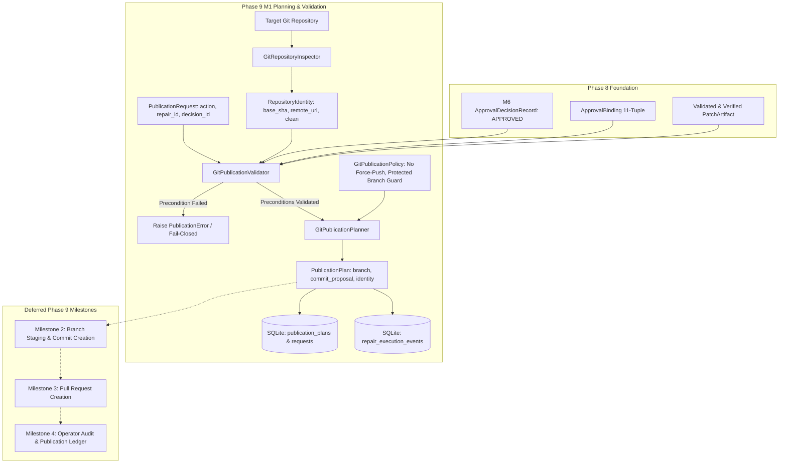

# Phase 9, Milestone 1: Git Integration Architecture & Publication Policy Specification

- **Milestone:** Phase 9, Milestone 1 — Git Integration Architecture & Publication Policy
- **Phase Status:** Phase 9 (Safe Git Publication & Upstream Integration) — In Progress (Milestone 1 Complete)
- **Target Repo Immutability:** STRICTLY PRESERVED in Milestone 1 (Zero target repository mutation, zero commits, zero branch pushes, zero pull requests, zero merges)
- **Traceability:** Implements Phase 9, Milestone 1 specification per `AGENTS.md` (Sections 1, 2, 3, 4, 5, 6, 7).

---

## 1. Executive Summary & Objective

In Phase 8, FORGE established controlled, evidence-grounded repair execution, independent patch validation, isolated sandbox verification, and artifact-bound human operator approval.

Phase 9 builds the architectural foundation and execution pipeline for safe Git publication of verified, operator-authorized candidate repairs.

Milestone 1 implements the core governance and planning architecture:
1. **Separation of Planning and Execution**: Milestone 1 defines the contracts, models, policies, validators, and planners that formulate deterministic publication plans. It strictly forbids executing mutations on the target repository or creating remote branches.
2. **Defensive Git Architecture**: All Git repository inspections and queries run through safe wrappers with hooks disabled (`-c core.hooksPath=/dev/null`), read-only operations, and strict validation of branch names, commit hashes, and remote URLs.
3. **Artifact-Bound Authorization Preconditions**: No publication plan can be formulated or validated without an existing, active, non-expired `APPROVED` decision record from Phase 8 Milestone 6.
4. **Action Privilege Escalation Prevention**: An approval granting `EXPORT_PATCH` cannot be escalated to stage a branch (`STAGE_BRANCH`) or create a pull request (`CREATE_PR`).
5. **Multi-Point Verification & Tamper Detection**: Pinned base commit SHA, patch SHA-256, and canonical repository identity must match exactly across the repair request, validation record, verification record, review dossier, and approval binding.
6. **Outbound Secret Scanning**: Commit messages, branch names, and metadata are scanned for exposed API keys, bearer tokens, and private material prior to plan formulation.
7. **Clean Working Tree Requirement**: Publication cannot proceed against a target repository with uncommitted or staged changes.
8. **Protected Branch Defenses**: Protected branches (`main`, `master`, `release/*`, etc.) are unconditionally rejected as target publication branches. Force pushes and history rewrites are structurally forbidden.
9. **SQLite Persistence & Audit Trail**: Publication requests and plans are persisted in dedicated SQLite tables (`publication_requests`, `publication_plans`), and all lifecycle events are recorded in the sequential audit ledger (`repair_execution_events`).

---

## 2. Threat Model & Security Boundaries

| Threat / Risk Vector | Mitigating Architectural Defense |
|---|---|
| **Unauthorized Code Publication** | Default-deny policy. Precondition validator checks for valid, active, non-expired M6 `APPROVED` decision. Unapproved or rejected repairs fail closed with `PublicationAuthorizationError`. |
| **Privilege Escalation** | `AuthorizedAction` in approval binding dictates allowed `PublicationAction`. `EXPORT_PATCH` cannot authorize `STAGE_BRANCH` or `CREATE_PR`. Mismatches raise `PublicationActionMismatchError`. |
| **Artifact Tampering / Workspace Drift** | Approval binds exact cryptographic tuple `(repair_id, finding_id, patch_sha256, base_commit_sha, validation_id, verification_id)`. Tampered patch or repository drift raises `ArtifactBindingMismatchError`. |
| **Target Repository Corruption** | Target repository inspection uses safe directory settings and disabled hooks (`-c core.hooksPath=/dev/null`). M1 planner never mutates target repo or executes write operations. |
| **Working Tree Collisions** | Target repository must be clean (`git status --porcelain`). Dirty working tree raises `RepositoryDirtyError`. |
| **Protected Branch Overwrite** | Branch name validation rejects protected patterns (`main`, `master`, `release/*`, `production/*`, `stable/*`). `allow_force_push=False` and `allow_history_rewrite=False` are enforced invariants. |
| **Malicious Branch Names / Injection** | Branch names must conform to `^[a-zA-Z0-9._/-]+$` and begin with `forge/`. Ref characters (`..`, `~`, `^`, `:`, `?`, `*`, `\`, control chars) are rejected. |
| **Secret / Token Leakage** | Outbound scanner inspects commit message, branch name, and metadata against secret patterns (`sk-`, `ghp_`, `AKIA`, private keys). Detected secrets raise `SecretDetectedError`. |
| **Cross-Repair Approval Reuse** | Approval decisions are bound to a single `repair_id`. Reusing an approval decision for another repair raises `PublicationAuthorizationError`. |

---

## 3. Architecture & Data Flow



---

## 4. Interfaces & Protocols (`app/forge/publication/interfaces.py`)

```python
@runtime_checkable
class GitRepositoryInspectorProtocol(Protocol):
    def inspect_repository(self, repository_path: Path) -> RepositoryIdentity: ...
    def verify_clean_working_tree(self, repository_path: Path) -> bool: ...
    def resolve_head_commit(self, repository_path: Path) -> str: ...
    def get_remote_url(self, repository_path: Path, remote_name: str = "origin") -> Optional[str]: ...

@runtime_checkable
class GitPublicationValidatorProtocol(Protocol):
    def validate_publication_request(
        self,
        publication_request: PublicationRequest,
        repository_identity: RepositoryIdentity,
    ) -> PublicationValidationResult: ...

@runtime_checkable
class PublicationAuditStoreProtocol(Protocol):
    def save_publication_request(self, request: PublicationRequest) -> None: ...
    def get_publication_request(self, publication_id: str) -> Optional[PublicationRequest]: ...
    def save_publication_plan(self, plan: PublicationPlan) -> None: ...
    def get_publication_plan(self, plan_id: str) -> Optional[PublicationPlan]: ...
    def record_publication_event(
        self,
        repair_id: str,
        action: str,
        actor: RepairActor,
        payload: Dict[str, Any],
        from_state: Optional[RepairExecutionState] = None,
        to_state: Optional[RepairExecutionState] = None,
    ) -> None: ...
```

---

## 5. Domain Models & SQLite Schema

### 5.1 Enums & Models (`app/forge/publication/models.py`)

- `PublicationAction`: `EXPORT_PATCH`, `STAGE_BRANCH`, `CREATE_PR`.
- `PublicationStatus`: `PLANNED`, `VALIDATED`, `PENDING_AUTHORIZATION`, `STAGED`, `PUBLISHED`, `FAILED`, `ABORTED`.
- `RepositoryIdentity`: Canonical path, base commit SHA, current branch, remote URL, cleanliness flag, tags.
- `CommitAuthor`: Name and email for commit author and committer.
- `CommitProposal`: Structured commit message, author, committer, touched files, patch SHA-256, dossier reference.
- `PublicationPlan`: Complete deterministic plan binding repair ID, decision ID, base commit SHA, branch name, commit proposal, and repository identity.
- `PublicationRequest`: Intake request binding repair ID, decision ID, and requested publication action.
- `PublicationValidationResult`: Check outcomes, valid flag, and diagnostics.

### 5.2 SQLite Schema (`app/forge/storage/database.py`)

- `publication_requests`:
  - `publication_id` (PK), `repair_id`, `decision_id`, `action`, `status`, `plan_id`, `error_message`, `created_at`, `updated_at`.
- `publication_plans`:
  - `plan_id` (PK), `publication_id`, `repair_id`, `decision_id`, `finding_id`, `repository_target`, `base_commit_sha`, `proposed_branch_name`, `commit_proposal_json`, `patch_artifact_id`, `patch_sha256`, `authorized_action`, `policy_version`, `repository_identity_json`, `created_at`.

---

## 6. CLI Commands Reference

- `forge repair publish plan <repair-id>`: Formulate and persist a deterministic publication plan for an approved repair.
- `forge repair publish validate <repair-id>`: Independently validate publication preconditions without generating a plan.
- `forge repair publish show <repair-id>`: Display publication requests and plans for a repair.
- `forge repair publish list`: List recent publication plans across all repairs.
- `forge publish ...`: Top-level alias group providing identical subcommands.

---

## 7. Deferred Milestones

- **Milestone 2 (Publication Staging)**: Staging candidate repair commits onto isolated local Git branches with hook bypass protection and signature attestation.
- **Milestone 3 (Pull Request Integration)**: Remote provider integration (GitHub / GitLab / local git bundles) for automated pull-request proposal generation.
- **Milestone 4 (Operator Audit & History)**: Full publication ledger audit, verification attestation, and lifecycle retirement.
