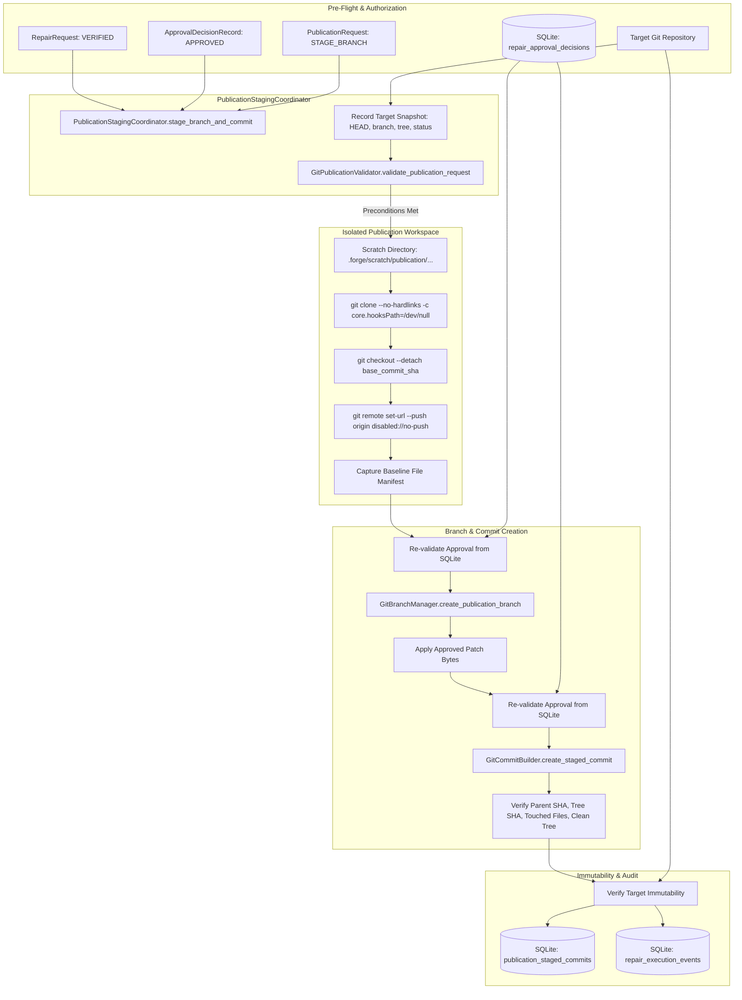

# Phase 9, Milestone 2: Isolated Branch Staging & Commit Creation Specification

- **Milestone:** Phase 9, Milestone 2 — Isolated Branch Staging & Commit Creation
- **Phase Status:** Phase 9 (Safe Git Publication & Upstream Integration) — In Progress (Milestone 2 Complete)
- **Target Repo Immutability:** STRICTLY PRESERVED (Zero target repository mutation, zero commits on target repo, zero branch creation on target repo, zero working-tree modifications, zero remote pushes, zero pull requests, zero merges)
- **Traceability:** Implements Phase 9, Milestone 2 specification per `AGENTS.md` (Sections 1, 2, 3, 4, 5, 6, 7).

---

## 1. Executive Summary & Objective

In Phase 9 Milestone 1, FORGE established the governance and planning architecture for safe Git publication of verified, operator-authorized candidate repairs, enforcing strict preconditions, anti-escalation mappings, secret scanning, and deterministic publication plans.

Milestone 2 implements the safe, isolated local Git execution pipeline that provisions dedicated publication scratch workspaces, creates deterministic branch references, stages approved candidate patches, and constructs verified Git commits.

Milestone 2 enforces the following core architectural guarantees:
1. **Target Repository Byte-for-Byte Immutability**: The target repository is treated as strictly read-only and immutable. An initial cryptographic snapshot (`HEAD` SHA, current branch, git status, tree SHA, remote URL) is recorded at intake and re-verified before and after every staging, branch creation, patch application, and commit operation. Any mutation fails closed with `TargetRepoMutationError`.
2. **Physical Workspace Isolation**: All staging and commit operations execute strictly inside an isolated scratch directory outside the target repository. The workspace is created via `git clone --no-hardlinks`, configured with `core.hooksPath=/dev/null`, origin push URL set to `disabled://no-push`, and checked out in detached HEAD state at the exact approved `base_commit_sha`.
3. **Symlink & Path Traversal Containment**: All file operations inside the publication workspace are verified against realpath containment within the scratch directory. Symlink creation, symlink traversal, directory escapes, and absolute path targets are strictly rejected.
4. **Deterministic Branch Management**: Branch names are deterministically derived as `forge/fix-<finding-id>-<patch-hash[:8]>` (or custom names validated against strict syntax and prefix rules). Collisions are proactively detected across both the target repository and the isolated workspace. Protected branches (`main`, `master`, `release/*`, `production/*`, `stable/*`) are unconditionally rejected.
5. **Real-Time Operator Approval Re-Validation**: Authoritative Phase 8 Milestone 6 approval decision records are retrieved directly from SQLite storage and re-validated immediately before branch creation and immediately before commit creation. Any state transition out of `APPROVED`, expiration of TTL, or artifact binding mismatch aborts execution immediately.
6. **Strict Patch Staging & Commit Construction**: Only approved patch bytes are staged. Touched files are checked against `allowed_files`. Binary changes, file mode modifications, and unexpected staged files are rejected. Commit messages are constructed with normal descriptive prose without conventional commit prefixes (`feat:`, `fix:`, `docs:`, etc.) and scanned for exposed secrets.
7. **Post-Commit Cryptographic Verification**: After commit creation, the commit is verified against required invariants: parent commit equals the approved base commit SHA, commit tree SHA matches the patched workspace tree, `git diff-tree` touched files match `allowed_files`, and working tree is clean.
8. **Persistent Audit Trail & Storage**: Staged commits are persisted in the `publication_staged_commits` SQLite table (`StagedCommitRecord`). Every lifecycle action records sequential, secret-redacted audit events in `repair_execution_events`.

---

## 2. Threat Model & Security Boundaries

| Threat / Risk Vector | Mitigating Architectural Defense |
|---|---|
| **Target Repository Corruption** | Target repository is never modified. Baseline snapshot (`HEAD`, branch, tree SHA, status) is verified before and after each phase. If target repository changes, `TargetRepoMutationError` is raised. |
| **Untrusted Git Hook Execution** | All Git commands in target inspection and publication scratch workspaces are invoked with `-c core.hooksPath=/dev/null`, preventing repository-controlled hooks from executing. |
| **Accidental Remote Push** | Remote pushing is disabled at multiple layers: `PublicationWorkspace` sets remote push URL to `disabled://no-push`. No `git push` command exists in M2 execution. |
| **Stale or Revoked Approval Exploitation** | Pre-operation validation queries the database immediately prior to branch creation and commit creation. If the approval was revoked, expired, or invalidated, staging aborts immediately. |
| **Privilege Escalation** | `AuthorizedAction` of the approval is checked: `EXPORT_PATCH` and `MANUAL_INTEGRATION` are rejected for branch/commit staging. Only `STAGE_FOR_PR`, `STAGE_BRANCH`, or `CREATE_PR` approvals may proceed. |
| **Path Traversal / Symlink Escape** | `validate_containment` enforces `Path.resolve()` containment within the publication workspace. Symlinks pointing outside the workspace raise `SymlinkEscapeError`. |
| **Overwriting Protected Branches** | `GitBranchManager` rejects branch names matching `main`, `master`, `release/*`, `production/*`, `stable/*` or any configured protected pattern. Force-pushes and history rewrites are impossible. |
| **Branch Reference Injection** | Branch names must conform to `^[a-zA-Z0-9._/-]+$` and start with `forge/`. Dangerous characters (`..`, `~`, `^`, `:`, `?`, `*`, `\`, control chars) are rejected with `BranchCreationError`. |
| **Unapproved File Modification** | Only files specified in `allowed_files` may be touched by the patch. Any discrepancy between diff-tree touched files and `allowed_files` raises `CommitVerificationError`. |
| **Secret / Credential Leakage in Commit** | Outbound secret scanning inspects author identity, committer identity, and commit message for exposed credentials (`sk-`, `ghp_`, `AKIA`, private keys). |
| **Workspace Tampering / Drift** | Workspace baseline file hash manifest is computed upon creation and compared during integrity checks. Unauthorized file additions, modifications, or deletions raise `WorkspaceIntegrityError`. |

---

## 3. Architecture & Data Flow



---

## 4. Component Design & Protocols

### 4.1 PublicationWorkspace (`app/forge/publication/workspace.py`)
- **Purpose**: Manages isolated scratch Git clones outside the target repository.
- **Initialization**:
  - Validates that the target repository exists, has a valid Git directory, and has a clean working tree (`git status --porcelain`).
  - Records an immutable snapshot of target repository state (`HEAD` SHA, current branch, git status, tree SHA, remote URL).
  - Creates a dedicated scratch directory with `0700` permissions.
- **Preparation (`prepare()`)**:
  - Clones the target repository using `git clone --no-hardlinks -c core.hooksPath=/dev/null`.
  - Disables remote push: `git remote set-url --push origin disabled://no-push`.
  - Checks out the approved base commit in detached HEAD mode: `git checkout --detach <base_commit_sha>`.
  - Computes baseline SHA-256 hashes of all tracked files.
- **Integrity & Containment (`validate_containment()`, `check_integrity()`)**:
  - Ensures every referenced file path resolves strictly within the scratch directory root.
  - Rejects symlinks pointing outside the workspace root (`SymlinkEscapeError`).
  - Detects modifications to files outside the declared `allowed_files`.
- **Target Immutability Verification (`verify_target_immutability()`)**:
  - Queries current target repository state and compares against the initial snapshot.
  - Any drift in `HEAD` SHA, active branch, git status, or tree SHA raises `TargetRepoMutationError`.
- **Cleanup (`cleanup()`)**:
  - Safely deletes the scratch directory upon completion or abort.

### 4.2 GitBranchManager (`app/forge/publication/branch.py`)
- **Purpose**: Generates and checks out deterministic publication branches in the workspace.
- **Deterministic Naming**:
  - Pattern: `forge/fix-<finding-id>-<patch-hash[:8]>`.
  - Example: `forge/fix-find_c818816c7cf6-a1b2c3d4`.
- **Syntax Validation**:
  - Must match `^[a-zA-Z0-9._/-]+$`.
  - Must begin with `forge/`.
  - Rejects double dots (`..`), tildes (`~`), carets (`^`), colons (`:`), question marks (`?`), asterisks (`*`), backslashes (`\`), `@`, `@{`, and control characters.
- **Protected Branch Defense**:
  - Rejects any branch matching `main`, `master`, `release/*`, `production/*`, `stable/*`, `develop`, etc.
- **Collision Detection**:
  - Checks branch existence in both target repository (`refs/heads/<name>`) and publication workspace.
  - Existing branches raise `BranchCollisionError`.
- **Workspace Branch Creation**:
  - Executes `git checkout -b <branch_name> <base_commit_sha>` strictly within the publication workspace.

### 4.3 GitCommitBuilder (`app/forge/publication/commit.py`)
- **Purpose**: Applies approved patch bytes, stages modified files, and creates verified Git commits.
- **Commit Message Policy**:
  - Generates normal descriptive commit messages without conventional commit prefixes (`feat:`, `fix:`, `docs:`, etc.).
  - Strips any accidental conventional prefix if provided.
  - Format:
    ```
    Resolve <finding_title>

    Repair finding <finding_id> (<severity>).
    Base commit: <base_commit_sha[:12]>
    Patch SHA-256: <patch_sha256[:12]>

    Signed-off-by: <operator_identity>
    ```
- **Outbound Secret Scanning**:
  - Rejects commit message or identities containing API keys, private keys, or bearer tokens.
- **Patch Application & Staging**:
  - Verifies that patch bytes SHA-256 matches the approved `patch_sha256`.
  - Applies patch using `git apply --check` followed by `git apply`.
  - Stages strictly the touched files (`git add <allowed_files>`).
  - Verifies that no unstaged or untracked files remain in the index.
- **Commit Execution**:
  - Executes `git commit` inside the workspace with explicit author and committer environment variables (`GIT_AUTHOR_NAME`, `GIT_AUTHOR_EMAIL`, `GIT_COMMITTER_NAME`, `GIT_COMMITTER_EMAIL`).
- **Post-Commit Verification**:
  - Asserts commit parent SHA equals approved `base_commit_sha`.
  - Asserts commit tree SHA equals workspace tree SHA.
  - Asserts `git diff-tree --no-commit-id --name-only -r <commit_sha>` matches `allowed_files`.
  - Asserts workspace working tree is completely clean.

### 4.4 PublicationStagingCoordinator (`app/forge/publication/staging.py`)
- **Purpose**: Orchestrates the complete end-to-end staging workflow.
- **Execution Flow**:
  1. Record target repository snapshot and verify clean working tree.
  2. Validate publication request and authorization preconditions (`GitPublicationValidator`).
  3. Provision isolated `PublicationWorkspace`.
  4. Query authoritative `ApprovalDecisionRecord` from SQLite and re-validate before branch creation.
  5. Create deterministic publication branch via `GitBranchManager`.
  6. Stage approved patch bytes via `GitCommitBuilder`.
  7. Query authoritative `ApprovalDecisionRecord` from SQLite and re-validate before commit creation.
  8. Create and cryptographically verify staged commit.
  9. Verify target repository immutability against initial snapshot.
  10. Persist `StagedCommitRecord` in `publication_staged_commits`.
  11. Record sequential audit events (`workspace_provisioned`, `branch_created`, `patch_applied`, `commit_created`, `commit_verified`) with `RepairActor.ORCHESTRATOR`.
  12. Clean up scratch workspace.

---

## 5. Data Models & Database Schema

### 5.1 Domain Models (`app/forge/publication/models.py`)

```python
class PublicationExecutionState(str, Enum):
    INITIALIZED = "initialized"
    WORKSPACE_PROVISIONED = "workspace_provisioned"
    BRANCH_CREATED = "branch_created"
    PATCH_APPLIED = "patch_applied"
    COMMITTED = "committed"
    VERIFIED = "verified"
    FAILED = "failed"
    ABORTED = "aborted"
    CLEANED = "cleaned"

class WorkspaceIntegritySnapshot(BaseModel):
    workspace_id: str
    target_repo_path: str
    workspace_path: str
    base_commit_sha: str
    target_head_sha: str
    target_branch: Optional[str]
    target_clean: bool
    target_tree_sha: str
    file_manifest_sha256: Dict[str, str]
    created_at: datetime

class StagedCommitRecord(BaseModel):
    staged_commit_id: str = Field(default_factory=lambda: f"sc_{uuid.uuid4().hex[:12]}")
    repair_id: str
    publication_id: str
    finding_id: str
    branch_name: str
    commit_sha: str
    parent_commit_sha: str
    tree_sha: str
    patch_sha256: str
    commit_message: str
    author_name: str
    author_email: str
    committer_name: str
    committer_email: str
    touched_files: List[str]
    execution_state: PublicationExecutionState = PublicationExecutionState.VERIFIED
    created_at: datetime = Field(default_factory=lambda: datetime.now(timezone.utc))
    verified_at: Optional[datetime] = None
```

### 5.2 SQLite Schema (`app/forge/storage/database.py`, Version 3)

```sql
CREATE TABLE IF NOT EXISTS publication_staged_commits (
    staged_commit_id TEXT PRIMARY KEY,
    repair_id TEXT NOT NULL,
    publication_id TEXT NOT NULL,
    finding_id TEXT NOT NULL,
    branch_name TEXT NOT NULL,
    commit_sha TEXT NOT NULL,
    parent_commit_sha TEXT NOT NULL,
    tree_sha TEXT NOT NULL,
    patch_sha256 TEXT NOT NULL,
    commit_message TEXT NOT NULL,
    author_name TEXT NOT NULL,
    author_email TEXT NOT NULL,
    committer_name TEXT NOT NULL,
    committer_email TEXT NOT NULL,
    touched_files TEXT NOT NULL,
    execution_state TEXT NOT NULL,
    created_at TEXT NOT NULL,
    verified_at TEXT,
    FOREIGN KEY(repair_id) REFERENCES repair_executions(repair_id),
    FOREIGN KEY(publication_id) REFERENCES publication_requests(publication_id)
);

CREATE INDEX IF NOT EXISTS idx_pub_staged_commits_repair ON publication_staged_commits(repair_id);
CREATE INDEX IF NOT EXISTS idx_pub_staged_commits_branch ON publication_staged_commits(branch_name);
CREATE INDEX IF NOT EXISTS idx_pub_staged_commits_state ON publication_staged_commits(execution_state);
```

---

## 6. CLI Commands Reference

All commands are available under both `forge repair publish <subcommand>` and top-level alias `forge publish <subcommand>`:

| Command | Arguments / Flags | Description |
|---|---|---|
| `stage` | `<repair_id>` `[--branch <name>]` `[--target-dir <path>]` `[--keep-workspace]` | Stage an approved repair branch and commit inside an isolated scratch workspace. |
| `commit` | `<repair_id>` `[--branch <name>]` `[--target-dir <path>]` `[--keep-workspace]` | Explicit alias for staging and commit creation. |
| `status` | `<repair_id>` `[--format table\|json]` | View current publication and staged commit status for a repair. |
| `inspect` | `<staged_commit_id>` `[--format table\|json]` | Inspect detailed metadata, touched files, and commit hashes for a staged commit. |

---

## 7. Verification & Test Coverage

The test suite in `tests/unit/test_phase9_m2_branch_staging.py` validates all Milestone 2 requirements across 25 unit and integration tests:

1. `test_workspace_rejects_dirty_target_repository`: Confirms dirty target repositories are rejected upon initialization.
2. `test_workspace_provisions_isolated_detached_clone`: Confirms isolated clone is created with push disabled and detached at base commit.
3. `test_workspace_detects_target_repo_mutation`: Confirms mutations on target repo are immediately caught.
4. `test_workspace_rejects_symlink_escape`: Confirms symlink escapes outside the scratch directory are blocked.
5. `test_branch_deterministic_naming`: Confirms deterministic naming `forge/fix-<finding>-<hash[:8]>`.
6. `test_branch_rejects_invalid_syntax`: Confirms syntax validation rejects invalid ref characters.
7. `test_branch_rejects_protected_branches`: Confirms protected branches (`main`, `master`, `release/*`) are rejected.
8. `test_branch_detects_collision_in_target`: Confirms collisions in target repo are rejected.
9. `test_branch_creates_and_checks_out_in_workspace`: Confirms safe branch checkout inside workspace.
10. `test_commit_builder_normal_descriptive_message`: Confirms descriptive commit messages without conventional prefixes.
11. `test_commit_builder_strips_conventional_prefix`: Confirms conventional commit prefixes (`fix:`, `feat:`) are stripped.
12. `test_commit_builder_rejects_secrets`: Confirms outbound secret scanner catches exposed credentials.
13. `test_commit_builder_applies_patch_and_creates_commit`: Confirms patch application and commit creation.
14. `test_commit_builder_verifies_touched_files`: Confirms touches outside `allowed_files` are rejected.
15. `test_coordinator_stage_branch_and_commit_e2e`: Complete end-to-end execution of staging, branch, commit, verification, and audit.
16. `test_coordinator_revalidates_approval_before_branch`: Confirms unapproved repair is blocked before branch creation.
17. `test_coordinator_revalidates_approval_before_commit`: Confirms invalidated approval is blocked before commit creation.
18. `test_coordinator_rejects_unauthorized_action`: Confirms `MANUAL_INTEGRATION` cannot authorize branch staging.
19. `test_coordinator_target_repo_remains_strictly_immutable`: Proves target repo commits, branches, and status are 100% unchanged.
20. `test_store_save_and_retrieve_staged_commit`: Confirms SQLite persistence and retrieval of `StagedCommitRecord`.
21. `test_cli_publish_stage_command`: Verifies `forge repair publish stage` CLI output and exit code.
22. `test_cli_publish_status_command`: Verifies `forge repair publish status` CLI output.
23. `test_cli_publish_inspect_command`: Verifies `forge repair publish inspect` CLI output.
24. `test_cli_publish_top_level_alias`: Verifies `forge publish stage` top-level CLI alias.
25. `test_coordinator_recovers_and_cleans_on_failure`: Verifies scratch workspace cleanup on failure.

All 25 tests pass in ~10 seconds. All 77 Phase 9 tests pass in ~17 seconds. All 1,331 tests in the full regression suite pass with zero regressions.
