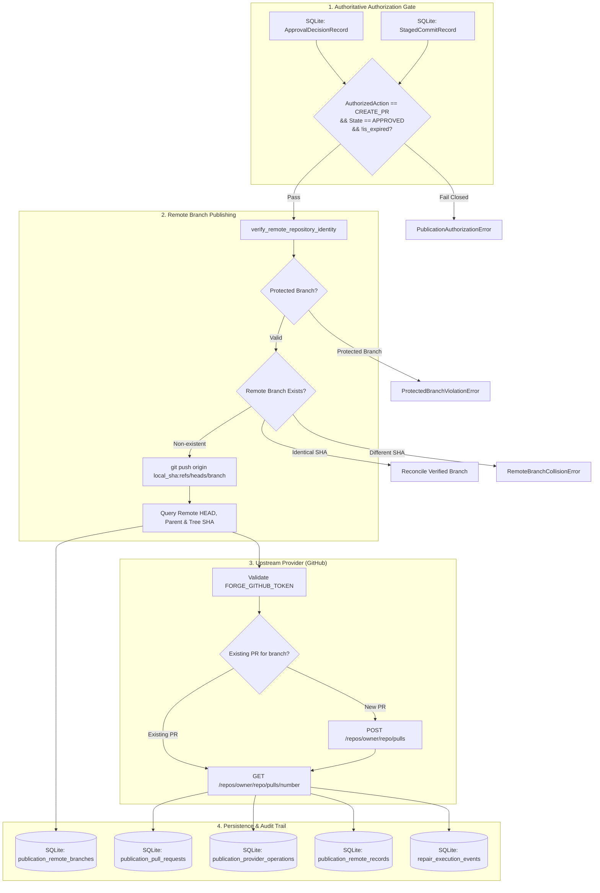

# Phase 9, Milestone 3: Remote Pull Request Creation & Upstream Integration Specification

- **Milestone:** Phase 9, Milestone 3 — Remote Pull Request Creation & Upstream Integration
- **Phase Status:** Phase 9 (Safe Git Publication & Upstream Integration) — In Progress (Milestones 1, 2, & 3 Completed)
- **Target Repo Immutability:** STRICTLY PRESERVED (Zero target repository mutation, zero direct commits, zero branch creation on target repo, zero working-tree modifications, zero automated merges, zero software deployment)
- **Traceability:** Implements Phase 9, Milestone 3 specification per `AGENTS.md` (Sections 1, 2, 3, 4, 5, 6, 7).

---

## 1. Executive Summary & Objective

In Phase 9 Milestone 2, FORGE established safe, isolated local Git branch staging and commit creation, providing verifiable `StagedCommitRecord` artifacts bound to authoritative operator review decisions.

Milestone 3 implements the production-quality remote Git publication and pull request creation engine, enabling FORGE to publish approved, verified repairs to upstream Git hosting providers (starting with GitHub) under strict operator authorization.

Milestone 3 enforces the following core architectural guarantees:
1. **Target Repository Immutability**: The target repository remains completely untouched and unmodified. All remote operations reference verified commits and branches created in isolated workspaces.
2. **Strict Operator Authorization Invariant (`CREATE_PR`)**: Remote publication strictly requires an authoritative operator review decision with `AuthorizedAction.CREATE_PR`. Approvals for `EXPORT_PATCH`, `MANUAL_INTEGRATION`, `STAGE_FOR_PR`, and `STAGE_BRANCH` fail closed and are forbidden from pushing branches or creating PRs.
3. **No Force Pushes / No History Rewriting**: Pushes are executed using safe, standard `git push origin <local_commit>:refs/heads/<branch>` without `--force`, `+`, `--mirror`, or `--delete`. Protected branches (`main`, `master`, `release/*`, `production/*`, `stable/*`) are unconditionally rejected.
4. **Independent Post-Push Remote Verification**: After pushing, FORGE independently queries the remote repository ref to verify that the remote branch points to the expected commit SHA, that the commit parent matches the base commit SHA, and that the tree SHA matches the verified candidate patch tree.
5. **Collision Detection & Safe Idempotency**: If a remote branch already exists with the exact same commit SHA, the push is reconciled idempotently. If a remote branch exists with a different commit SHA, publication is aborted with `RemoteBranchCollisionError`.
6. **Evidence-Grounded Pull Request Template**: PR descriptions are generated deterministically, strictly separating verified empirical facts (finding ID, base commit SHA, patch SHA-256, test outcomes, regression results, touched files) from automated model explanations, and including clear operator authorization notices and operational limitations.
7. **Extensible Hosting Provider Architecture**: A typed `PullRequestProviderProtocol` defines provider contracts (`validate_credentials`, `verify_repository`, `check_branch_exists`, `create_pull_request`, `get_pull_request`, `list_pull_requests`). The production `GitHubPullRequestProvider` implements exponential backoff, rate-limit recovery, lost-response reconciliation, and strict secret scrubbing (zero token leaks in logs, errors, or reprs).
8. **Immutable SQLite Audit Ledger**: Remote branch metadata, PR metadata, provider API interactions, and lifecycle state changes are persisted in dedicated SQLite tables (`publication_remote_branches`, `publication_pull_requests`, `publication_provider_operations`, `publication_remote_records`) and recorded sequentially in `repair_execution_events`.

---

## 2. Threat Model & Security Boundaries

| Threat / Risk Vector | Mitigating Architectural Defense |
|---|---|
| **Unauthorized Remote Publication** | Authoritative operator approval is queried directly from SQLite immediately before push and immediately before PR creation. Only `AuthorizedAction.CREATE_PR` in state `APPROVED` can proceed. Any other action or state raises `PublicationActionMismatchError` or `PublicationAuthorizationError`. |
| **Target Repository Mutation** | Target repository working tree, index, and branches remain completely unmodified. Branch publication pushes the commit created in the isolated workspace directly to the remote repository refspec. |
| **Overwriting Upstream History** | Force pushes (`--force`, `-f`, `+ref`) are strictly forbidden by `GitPublicationPolicy` and rejected at CLI, planner, and executor levels. Pushes are normal fast-forward branch additions. |
| **Protected Branch Overwrite** | Pushing to or targeting protected branches (`main`, `master`, `release/*`, `production/*`, `stable/*`) as the publication head branch is strictly prohibited with `ProtectedBranchViolationError`. |
| **Credential & Token Leakage** | Tokens from `FORGE_GITHUB_TOKEN` or `GITHUB_TOKEN` are masked in memory (`token='present'` in repr), redacted from all exceptions, never logged in SQLite audit tables, and never output in CLI error messages. |
| **Remote Branch Collision** | Remote ref is inspected prior to push. If the remote branch exists with differing commit SHA, push aborts with `RemoteBranchCollisionError`. If identical, idempotent reconciliation is recorded. |
| **Duplicate Pull Request Spam** | Provider queries existing open pull requests matching head branch and base branch. If a PR already exists, it is linked and returned without creating duplicates (`DuplicatePullRequestError` handled safely). |
| **Hallucinated or AI-Generated PR Claims** | `PullRequestFormatter` segregates content into distinct sections: "Verified Empirical Facts" (derived strictly from cryptographic hashes and test results) vs. "Automated Analysis" (labeled AI explanations). |
| **Automatic Merging or Deployment** | FORGE strictly creates pull requests only. Automatic merging, branch deletion, or CI/CD triggering beyond GitHub's default PR hooks is strictly forbidden. |

---

## 3. Architecture & Component Interaction



---

## 4. SQLite Schema Version 4

The database schema has been bumped to version 4 with the addition of four dedicated publication tables:

```sql
CREATE TABLE IF NOT EXISTS publication_remote_branches (
    remote_branch_id TEXT PRIMARY KEY,
    repair_id TEXT NOT NULL,
    publication_id TEXT NOT NULL,
    plan_id TEXT NOT NULL,
    staged_commit_id TEXT NOT NULL,
    decision_id TEXT NOT NULL,
    remote_name TEXT NOT NULL,
    remote_url TEXT NOT NULL,
    branch_name TEXT NOT NULL,
    commit_sha TEXT NOT NULL,
    parent_commit_sha TEXT NOT NULL,
    tree_sha TEXT NOT NULL,
    patch_sha256 TEXT NOT NULL,
    pushed_at TEXT NOT NULL,
    verified_at TEXT,
    status TEXT NOT NULL,
    verification_details_json TEXT NOT NULL DEFAULT '{}',
    FOREIGN KEY(repair_id) REFERENCES repair_executions(repair_id) ON DELETE CASCADE,
    FOREIGN KEY(publication_id) REFERENCES publication_requests(publication_id) ON DELETE CASCADE,
    FOREIGN KEY(decision_id) REFERENCES repair_approval_decisions(decision_id) ON DELETE CASCADE
);

CREATE TABLE IF NOT EXISTS publication_pull_requests (
    pr_record_id TEXT PRIMARY KEY,
    repair_id TEXT NOT NULL,
    publication_id TEXT NOT NULL,
    plan_id TEXT NOT NULL,
    decision_id TEXT NOT NULL,
    staged_commit_id TEXT NOT NULL,
    remote_branch_id TEXT NOT NULL,
    provider TEXT NOT NULL,
    repository_owner TEXT NOT NULL,
    repository_name TEXT NOT NULL,
    target_branch TEXT NOT NULL,
    source_branch TEXT NOT NULL,
    pr_number INTEGER NOT NULL,
    pr_url TEXT NOT NULL,
    pr_title TEXT NOT NULL,
    pr_body TEXT NOT NULL,
    pr_state TEXT NOT NULL,
    is_draft INTEGER NOT NULL DEFAULT 0,
    created_at TEXT NOT NULL,
    verified_at TEXT,
    status TEXT NOT NULL,
    error_message TEXT,
    metadata_json TEXT NOT NULL DEFAULT '{}',
    FOREIGN KEY(repair_id) REFERENCES repair_executions(repair_id) ON DELETE CASCADE,
    FOREIGN KEY(publication_id) REFERENCES publication_requests(publication_id) ON DELETE CASCADE,
    FOREIGN KEY(remote_branch_id) REFERENCES publication_remote_branches(remote_branch_id) ON DELETE CASCADE,
    FOREIGN KEY(decision_id) REFERENCES repair_approval_decisions(decision_id) ON DELETE CASCADE
);

CREATE TABLE IF NOT EXISTS publication_provider_operations (
    operation_id TEXT PRIMARY KEY,
    repair_id TEXT NOT NULL,
    provider TEXT NOT NULL,
    operation_type TEXT NOT NULL,
    idempotency_key TEXT NOT NULL,
    request_summary_json TEXT NOT NULL DEFAULT '{}',
    response_summary_json TEXT NOT NULL DEFAULT '{}',
    status TEXT NOT NULL,
    attempts INTEGER NOT NULL DEFAULT 1,
    error_message TEXT,
    created_at TEXT NOT NULL,
    completed_at TEXT,
    FOREIGN KEY(repair_id) REFERENCES repair_executions(repair_id) ON DELETE CASCADE
);

CREATE TABLE IF NOT EXISTS publication_remote_records (
    record_id TEXT PRIMARY KEY,
    repair_id TEXT NOT NULL,
    publication_id TEXT NOT NULL,
    plan_id TEXT NOT NULL,
    remote_branch_id TEXT,
    pr_record_id TEXT,
    status TEXT NOT NULL,
    created_at TEXT NOT NULL,
    completed_at TEXT,
    error_message TEXT,
    FOREIGN KEY(repair_id) REFERENCES repair_executions(repair_id) ON DELETE CASCADE,
    FOREIGN KEY(publication_id) REFERENCES publication_requests(publication_id) ON DELETE CASCADE
);
```

---

## 5. CLI Command Reference

All Milestone 3 publication commands are accessible under `forge repair publish <subcommand>` and through the top-level alias `forge publish <subcommand>`:

| Command | Arguments / Flags | Description |
|---|---|---|
| `remote-validate` | `<repair_id>` `[--repo <dir>]` `[--remote <name>]` `[--json]` | Read-only validation of operator authorization, local staged commit binding, provider credentials, and remote repository identity. |
| `push` | `<repair_id>` `[--repo <dir>]` `[--remote <name>]` `[--json]` | Pushes verified staged commit to authorized remote branch without force flags and performs independent post-push verification. |
| `pr` | `<repair_id>` `[--repo <dir>]` `[--remote <name>]` `[--base <branch>]` `[--draft]` `[--json]` | Creates an evidence-grounded pull request on the upstream hosting provider and records verified PR metadata. |
| `remote-status` | `<repair_id>` `[--json]` | Displays high-level remote publication status including push and PR state. |
| `pr-status` | `<repair_id>` `[--json]` | Queries upstream hosting provider for real-time pull request state (open, closed, merged). |
| `remote-inspect` | `<repair_id>` `[--json]` | Displays comprehensive audit details including remote branch records, PR metadata, provider operations, and audit trail. |

---

## 6. Real Provider Acceptance Instructions

To test FORGE remote publication against a live GitHub repository with a personal access token:

1. **Configure Environment Token**:
   ```bash
   export FORGE_GITHUB_TOKEN="ghp_yourPersonalAccessTokenHere"
   ```
   *Note: Token requires `repo` scope permissions for public or private target repositories.*

2. **Verify Target Repository Readiness**:
   Ensure you have a completed Phase 8 repair with an authoritative `CREATE_PR` approval and a staged commit from Phase 9 M2:
   ```bash
   forge repair publish stage <repair_id>
   ```

3. **Validate Remote Prerequisites (Zero Mutation)**:
   ```bash
   forge repair publish remote-validate <repair_id> --remote origin
   ```
   *Expected output: `[VALID] Remote publication authorized for repair '<repair_id>'.`*

4. **Publish Remote Branch**:
   ```bash
   forge repair publish push <repair_id> --remote origin
   ```
   *Expected output: `[PUBLISHED] Branch 'forge/fix-...' published and verified on remote.`*

5. **Create Upstream Pull Request**:
   ```bash
   forge repair publish pr <repair_id> --base main --draft
   ```
   *Expected output: `[SUCCESS] Pull request created and verified: https://github.com/owner/repo/pull/<number>`*

6. **Inspect Audit History**:
   ```bash
   forge repair publish remote-inspect <repair_id>
   ```
   *Shows full cryptographically bound audit trail, including remote commit verification, PR verification, and provider API records.*
