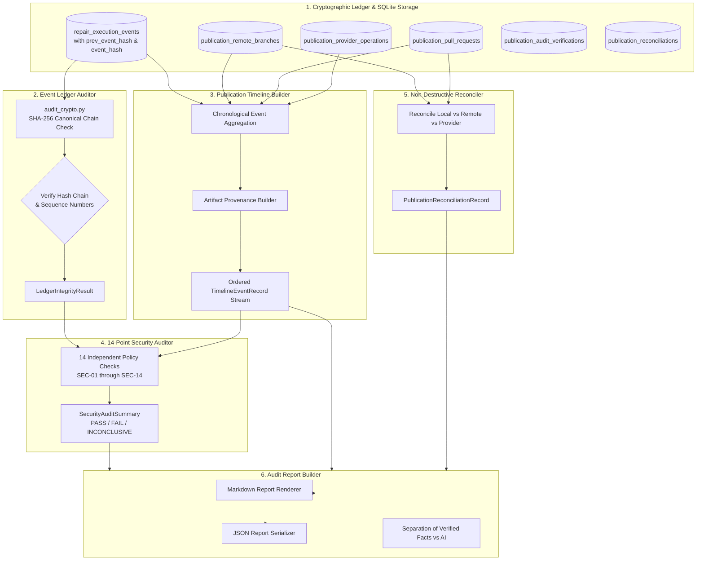

# Phase 9, Milestone 4: Operator Audit, Publication Ledger & End-to-End Governance Specification

- **Milestone:** Phase 9, Milestone 4 — Operator Audit, Publication Ledger & End-to-End Governance
- **Phase Status:** Phase 9 (Safe Git Publication & Upstream Integration) — Completed (Milestones 1, 2, 3, & 4 Completed)
- **Target Repo Immutability:** STRICTLY PRESERVED (Zero target repository mutation, zero direct commits, zero branch creation on target repo, zero working-tree modifications, zero automated merges, zero software deployment)
- **Traceability:** Implements Phase 9, Milestone 4 specification per `AGENTS.md` (Sections 1, 2, 3, 4, 5, 6, 7).

---

## 1. Executive Summary & Objective

Phase 9 Milestone 4 establishes the end-to-end operator audit, publication ledger, and security governance system for FORGE. It completes Phase 9 by providing a complete, trustworthy, queryable, and reconstructable record of the entire repair-to-pull-request lifecycle.

Milestone 4 answers the core governance questions:
- Which defect was investigated?
- Which evidence supported it?
- Which candidate patch was generated, validated, and verified?
- Which review dossier was compiled and presented?
- Which operator approved the action, and with what exact scope and expiration?
- Which publication plan was formulated?
- Which local commit was staged, on what base, and with what tree SHA?
- Which remote branch was published, to which remote repository, and when?
- Which pull request was created, with what number and URL?
- What provider operations took place, and what were their exact responses?
- Has any event in the audit ledger been altered, deleted, reordered, or tampered with?

Milestone 4 enforces the following architectural guarantees:
1. **Target Repository Immutability**: The target repository remains completely untouched.
2. **Cryptographically Hash-Chained Audit Ledger**: Every repair execution event is linked using SHA-256 hash chaining (`prev_event_hash`, `event_hash`) computed over deterministically formatted canonical JSON representations (RFC 8785 principles). Any tampering, insertion, deletion, reordering, duplicate sequence, or sequence gap is detected immediately. Backward compatibility preserves legacy unsealed records (`AuditIntegrityStatus.LEGACY_UNSEALED`).
3. **Unified Publication Ledger & Chronological Timeline**: Reconstructs the complete lifecycle across 22 stages (defect investigation, evidence collection, candidate patch generation, validation, verification, review dossier compilation, operator approval, publication planning, local commit staging, remote branch push, PR creation, provider operations) without fabricating missing events.
4. **14-Point Publication Security Auditor**: 14 independent security and invariant checks evaluating authorization binding, action match (`CREATE_PR` required for remote PRs), non-expiration, non-invalidation, patch hash alignment, base commit SHA match, target repo immutability, branch name alignment, remote commit SHA verification, non-destructive fast-forward push enforcement, target branch validity, audit ledger cryptographic integrity, and zero credential leakage.
5. **Non-Destructive State Reconciliation**: Reconciles observed repository and provider states with persisted records. Confirms publication status, distinguishes partial progress, identifies external modifications, and detects authorization invalidations—strictly guaranteeing zero branch deletions and zero PR closures.
6. **Fact-Segregated Audit Reporting**: Generates Markdown and JSON audit reports strictly separating verified empirical facts from automated AI explanations, with complete secret redaction.

---

## 2. Threat Model & Security Governance

| Threat / Risk Vector | Mitigating Architectural Defense |
|---|---|
| **Audit Ledger Tampering / History Rewriting** | Cryptographic hash chaining (`compute_event_hash`) links each event to its predecessor via SHA-256 over canonical deterministic JSON. `EventLedgerAuditor.audit_repair_ledger` detects modifications, reordering, duplicate sequences, and sequence gaps, raising `TAMPERED` or `BROKEN_CHAIN`. |
| **Unauthorized Action Elevation** | Check `SEC-02` verifies that remote pull requests were authorized strictly by an operator review record with `AuthorizedAction.CREATE_PR`. Historical `STAGE_FOR_PR` or `STAGE_BRANCH` records fail closed. |
| **Use of Expired or Revoked Approvals** | Check `SEC-03` verifies that approval decisions were active and unexpired at execution time and have not been invalidated. Reconciler flags invalidated approvals with `ReconciliationStatus.AUTHORIZATION_INVALIDATED`. |
| **Patch or Commit Substitution** | Checks `SEC-04`, `SEC-05`, `SEC-06`, `SEC-09` verify that the patch SHA-256, base commit SHA, staged commit SHA, and remote commit SHA match identically across all artifacts (patch artifact, review dossier, approval binding, staged commit, remote branch ref). |
| **Protected Branch Destruction** | Check `SEC-10` and `SEC-12` ensure no force pushes were executed and PR target branch matches authorized base branch while publication branch is distinct. |
| **Host / Target Repository Mutation** | Check `SEC-07` confirms target repository remained read-only and all staging occurred in isolated scratch directories. |
| **Credential / Secret Exposure in Audit Reports** | Check `SEC-14` and `redact_secrets` verify that tokens (`ghp_*`, `github_pat_*`, `sk-*`, etc.) are scrubbed from all payloads, timelines, and audit reports before display or persistence. |
| **Destructive Reconciliations** | The reconciler is strictly non-destructive: it inspects and records divergence but never deletes remote branches, merges code, or closes pull requests. |

---

## 3. Architecture & Component Interaction



---

## 4. Cryptographic Hash-Chained Event Ledger

### 4.1 Canonical Serialization
To ensure cross-platform deterministic serialization:
1. Keys are sorted alphabetically at all nesting levels.
2. Compact separators `(',', ':')` without trailing or superfluous whitespace are used.
3. String representations enforce UTF-8 encoding.
4. Floats are formatted deterministically.

```python
def canonical_event_bytes(prev_hash: Optional[str], event_dict: Dict[str, Any]) -> bytes:
    canonical_obj = {
        "prev_hash": prev_hash or "",
        "event": event_dict,
    }
    return json.dumps(canonical_obj, sort_keys=True, separators=(",", ":"), ensure_ascii=True).encode("utf-8")
```

### 4.2 Hash Chain Computation & Verification
The SHA-256 digest of canonical bytes forms `event_hash`:
```python
def compute_event_hash(prev_hash: Optional[str], event_dict: Dict[str, Any]) -> str:
    return hashlib.sha256(canonical_event_bytes(prev_hash, event_dict)).hexdigest()
```
The audit ledger verifier walks events in sequence order ($1, 2, \dots, N$):
- For event 1, $prev\_hash$ must be `None` or match the base anchor.
- For event $i$, $prev\_event\_hash$ must equal event $i-1$'s $event\_hash$.
- Recalculated $compute\_event\_hash(prev, event_data)$ must match stored $event\_hash$.
- Sequence numbers must be strictly contiguous ($seq_i = seq_{i-1} + 1$).
- If legacy unsealed events exist with null hashes, status is reported as `LEGACY_UNSEALED` without failing abruptly.
- If hashes do not match, status transitions to `TAMPERED`.
- If links are broken or sequence numbers repeat/skip, status transitions to `BROKEN_CHAIN`, `MISSING_EVENTS`, or `DUPLICATE_SEQUENCE`.

---

## 5. 14-Point Security Auditor Checks

The publication security auditor runs 14 independent invariant checks:

| Check ID | Name | Description & Invariant |
|---|---|---|
| `SEC-01` | **Authoritative Approval Presence** | Verifies an authoritative `ApprovalDecisionRecord` exists for the repair. |
| `SEC-02` | **Authorized Action Scope** | Remote publication strictly requires `AuthorizedAction.CREATE_PR`. Rejects `STAGE_FOR_PR` or `EXPORT_PATCH` attempting remote PR creation. |
| `SEC-03` | **Approval Validity & Expiration** | Verifies approval state is `APPROVED`, `is_expired` is false, and approval was not invalidated. |
| `SEC-04` | **Patch Hash Alignment** | Verifies patch artifact SHA-256 matches approval binding, dossier, publication plan, and commit record. |
| `SEC-05` | **Base Commit Continuity** | Verifies base commit SHA matches repair request, finding, approval binding, and staged commit parent. |
| `SEC-06` | **Target Repository Identity** | Verifies repository target matches the approved target repository URL/path. |
| `SEC-07` | **Target Repository Immutability** | Verifies target repository was not mutated; operations executed in isolated workspaces. |
| `SEC-08` | **Publication Branch Alignment** | Verifies publication branch name matches plan, approval binding, and staged commit record. |
| `SEC-09` | **Remote Commit SHA Verification** | Verifies remote branch points to the exact verified local staged commit SHA. |
| `SEC-10` | **Non-Destructive Push Enforcement** | Verifies push executed without force (`--force` forbidden) and fast-forward invariant held. |
| `SEC-11` | **Pull Request Provider Authenticity** | Verifies pull request was recorded with an authorized provider (GitHub) and authenticated identity. |
| `SEC-12` | **Pull Request Target Branch Safety** | Verifies pull request target branch matches base branch and head branch is not protected. |
| `SEC-13` | **Audit Ledger Cryptographic Integrity** | Verifies the repair execution event ledger hash chain passes with `VERIFIED` or `LEGACY_UNSEALED`. |
| `SEC-14` | **Credential Exposure Prevention** | Verifies zero credentials, authorization headers, or access tokens exist in stored records or reports. |

---

## 6. Non-Destructive State Reconciliation

The `PublicationReconciler` evaluates observed repository and hosting provider states against persisted records:
- `CONFIRMED_SUCCESS`: Local commit staged, remote branch verified pointing to commit SHA, and PR verified open on upstream provider.
- `PARTIAL_SUCCESS`: Intermediate step succeeded (e.g. branch staged locally, or branch pushed but PR not yet created).
- `CONFIRMED_FAILURE`: Upstream provider or staging explicitly failed with recorded error.
- `EXTERNAL_MODIFICATION`: Remote branch commit SHA diverged from staged commit SHA, or PR state was altered externally.
- `AUTHORIZATION_INVALIDATED`: Approval was revoked or invalidated post-staging; remote action halted.

**Non-Destructive Guarantee**: FORGE strictly never issues `git push --delete`, `git branch -D`, or GitHub API PR closure calls during reconciliation.

---

## 7. Verified CLI Commands

Milestone 4 introduces the following verified CLI commands under `forge repair publish`:

```bash
# 1. Inspect comprehensive publication audit & security checks
forge repair publish audit <repair_id>

# 2. View chronological 22-stage publication timeline
forge repair publish timeline <repair_id>

# 3. Verify cryptographic integrity of the event ledger
forge repair publish audit-verify <repair_id>

# 4. Generate audit report in Markdown or JSON format
forge repair publish report <repair_id> [--format markdown|json] [--output <file>]

# 5. List historical publication records and governance statuses
forge repair publish history [--limit 20]
```

---

## 8. Verification & Quality Assurance

- **Unit Test Coverage**: `tests/unit/test_phase9_m4_governance.py` (37 tests) covers deterministic hash serialization, hash chaining, sequence gap/duplicate detection, ledger tampering detection, chronological timeline reconstruction, all 14 security checks, non-destructive reconciliation, report generation, and CLI subcommands.
- **Full Phase 9 Test Suite**: 140 passed tests in `tests/unit/test_phase9*`.
- **Python Compatibility**: Clean compilation under Python 3.11, 3.12, and 3.13.
