# Phase 10: Protected-File Boundary Enforcement Specification

- **Milestone:** Phase 10 — Protected-File Boundary Enforcement
- **Phase Status:** Phase 10 (Protected-File Boundary Enforcement) — Completed
- **Base Commit:** `a1544e6edc452601faef80e959998a64a98760d5`
- **Release:** `0.1.0b1`
- **Target Repo Immutability:** STRICTLY PRESERVED (Zero target repository mutation, zero commits, zero branch pushes, zero pull requests, zero merges)
- **Traceability:** Implements Phase 10 per `AGENTS.md` (Sections 1, 2, 3, 4, 5, 6, 7).

---

## 1. Executive Summary & Objective

During the real-world evaluation of FORGE against the private Friday repository, an essential privacy boundary requirement emerged. While FORGE's secret redaction subsystem reliably catches known credential and token patterns (e.g., `sk-`, `ghp_`, `AKIA`) inside already-extracted strings, certain sensitive repository files should never be opened, indexed, copied to temporary workspaces, hashed, or passed into LLM contexts under any circumstances. Specifically, user databases (`memory.db`), personal contact lists (`contacts.json`), local environment definitions (`.env*`), and debug traces (`*.log`) represent private or stateful data that fall outside software engineering intelligence scopes.

Phase 10 implements centralized **Protected-File Boundary Enforcement** across all FORGE ingestion, static analysis, dynamic verification, and investigation subsystems:

1. **Centralized Protection Authority**: All file path access decisions are governed by `forge.repository.protection`, ensuring consistent pattern matching and path normalization across the entire application.
2. **Metadata-Only Evaluation**: Protection checks operate purely on filesystem metadata and path strings. Files are never opened, read, or hashed to determine whether they are protected.
3. **Multi-Stage Defense-in-Depth**: Protection boundaries are enforced across acquisition, detection, indexing, instruction loading, intake sanitation, LLM context construction, verification, engineering dossier validation, evidence creation, and model investigation tools.
4. **Symlink and Traversal Hardening**: Symlinks targeting protected files or resolving outside base directory roots are rejected. Containment escape attempts fail closed.
5. **Zero Host Execution & Immutability**: All operations preserve FORGE's audit-only invariant and fail-secure principles.

---

## 2. Threat Model & Security Boundaries

| Threat / Risk Vector | Mitigating Architectural Defense |
|---|---|
| **Private Data Ingestion (`contacts.json`, `memory.db`)** | Pattern-based exclusion (`contacts.json`, `*.db*`) enforced upfront across all acquisition, indexing, detection, and context builders. |
| **Credential / Environment Leakage (`.env*`)** | Proactive boundary rejection of `.env`, `.env.local`, `.env.production`, etc., before file opening or SHA-256 calculation. |
| **Log and Runtime Trace Contamination (`*.log`)** | Strict filtering of all log files (`*.log`), preventing verbose diagnostic logs from filling LLM context windows or leaking runtime state. |
| **Symlink Bypass / Containment Escape** | `is_protected_path()` resolves target paths using `Path.resolve()`. If a symlink resolves to a protected file or outside the base workspace directory, it fails closed. |
| **Path Traversal Attacks (`../../.env`)** | Paths are normalized and anchored against `base_dir`. Traversal attempts escaping workspace roots fail closed. |
| **I/O Side Effects During Detection** | All protection determinations are metadata-driven. `open()` and `read_text()` are strictly forbidden within protection evaluators. |
| **LLM Context Budget Exfiltration** | Context builders (`extract_source_excerpts`, `assemble_repository_context`) filter declared affected files and drop protected files before reading or hashing. |
| **Git Metadata / Packfile Leakage** | Isolated trusted mirror architecture (Option C) houses upstream Git object database in a permission-restricted (`0700`) directory outside the analysis workspace. `GitMediator` exports clean sanitized trees, `purge_protected_paths_from_workspace` purges any sensitive files, and `verify_workspace_sanitized` conducts an independent audit to guarantee zero protected paths enter the analysis repository. |

---

## 3. Architecture & Data Flow

```mermaid
flowchart TD
    subgraph Centralized Policy [forge.repository.protection]
        Patterns["Protected Patterns:\n.env*, *.db*, contacts.json, *.log"]
        Matcher["is_protected_path(path, base_dir)\nis_protected_name(name)"]
        Filter["filter_unprotected_paths(paths, base_dir)"]
        Purge["purge_protected_paths_from_workspace(workspace_dir)"]
    end

    subgraph Acquisition Layer [forge.repository.acquisition]
        LocalCopy["shutil.copytree(..., ignore=create_copytree_ignore())"]
        GitClone["git clone / clone_shallow -> purge_protected_paths"]
    end

    subgraph Static Analysis [forge.repository.detector & indexer]
        Detect["detect_repository: os.walk directory pruning & file skip"]
        Index["build_symbol_index / index_python_file upfront check"]
        Instruct["load_instruction_files: reject protected target or symlink"]
    end

    subgraph Workflow & Context [forge.workflow]
        Intake["intake.sanitize_affected_paths: IntakeValidationError"]
        Context["context.extract_source_excerpts: skip read & hash"]
        Prompt["context.render_context_prompt: filter affected files"]
        Verify["verification._run_single_check: reject protected targets"]
        Dossier["dossier.validate_engineering_dossier: reject protected files"]
    end

    subgraph Investigation & Analysis [forge.investigation & analysis]
        ToolsSearch["tools.search: skip protected paths"]
        ToolsRead["tools.read_file: reject protected paths"]
        Validation["validation.validate_repository_path: raise error"]
    end

    Patterns --> Matcher
    Matcher --> Filter
    Matcher --> Purge
    Matcher --> LocalCopy
    Purge --> GitClone
    Matcher --> Detect
    Matcher --> Index
    Matcher --> Instruct
    Matcher --> Intake
    Filter --> Context
    Filter --> Prompt
    Matcher --> Verify
    Matcher --> Dossier
    Matcher --> ToolsSearch
    Matcher --> ToolsRead
    Matcher --> Validation
```



---

## 4. Protected Patterns & Matching Rules

The protected pattern registry in `app/forge/repository/protection.py` specifies:

```python
PROTECTED_PATTERNS: tuple[str, ...] = (
    ".env*",
    "*.db*",
    "contacts.json",
    "*.log",
)
```

### Matching Invariants
1. **Case-Insensitive Matching**: Patterns match case-insensitively (e.g., `Contacts.JSON`, `.ENV`, `DATABASE.DB` are all protected).
2. **Basename and Component Inspection**: Matching applies to the target file name as well as path components (e.g., `config/.env.prod`, `data/contacts.json`, `logs/app.log`).
3. **Symlink Resolution**: If the path is a symlink, both the symlink's nominal path and its canonical target path are evaluated.
4. **Base Directory Anchoring**: When `base_dir` is provided:
   - Relative candidate paths are anchored to `base_dir` prior to resolution: `(Path(base_dir) / path).resolve()`.
   - The resolved path must be contained within `base_dir.resolve()` (`relative_to` check). Any path escaping containment raises `ValueError` and is treated as protected (fail-closed).
5. **No File Reads**: Determining protection status never opens or reads file contents.

---

## 5. Multi-Stage Pipeline Enforcement Details

### 5.1 Repository Acquisition & Sanitization (`app/forge/repository/acquisition.py` & `app/forge/repository/protection.py`)
- **Remote Git Clones (Pathway 1)**: Clones from remote HTTPS targets into an isolated trusted repository mirror (`trusted_<id>.git`, mode `0700`). `GitMediator.export_sanitized_workspace()` extracts non-protected files into `dest_dir` using streaming archive filtering, followed by `purge_protected_paths_from_workspace(dest_dir)` and `verify_workspace_sanitized(dest_dir)`. A clean analysis Git repository is initialized inside `dest_dir`. If clone, export, or sanitization fails, `_cleanup_acquisition_paths(dest_dir, trusted_dir)` safely cleans up without suppressing errors. If cleanup also encounters errors, both the primary error and cleanup failures are visibly reported in `AcquisitionError(f"... Additionally, workspace cleanup failed: ...")`, chaining the original cause.
- **Local Committed Git Repositories (Pathway 2)**: Clones the local repository into an isolated trusted mirror (`trusted_<id>.git`, mode `0700`). `GitMediator.export_sanitized_workspace()` exports non-protected files to `dest_dir`, followed by `purge_protected_paths_from_workspace(dest_dir)` and `verify_workspace_sanitized(dest_dir)`. A clean analysis repository is initialized. On failure, `_cleanup_acquisition_paths` cleans partial directories, raising `AcquisitionError` with two-tier visible reporting if cleanup encounters errors, chaining the original exception.
- **Local Uncommitted / Non-Git Directories (Pathway 3)**: Copies non-protected files via `shutil.copytree(..., ignore=create_copytree_ignore())`. Following copy, any source `.git` directory or gitfile is strictly removed without `ignore_errors=True` or swallowed `OSError` exceptions. If source `.git` removal fails or if `.git` remains on disk post-removal, `GitMetadataProtectionError` is raised immediately, halting execution prior to `git init`. Following `.git` removal, `purge_protected_paths_from_workspace(dest_dir)` and `verify_workspace_sanitized(dest_dir)` execute, followed by initializing a clean analysis Git repository snapshot. If any step fails, `_cleanup_acquisition_paths` deletes `dest_dir` and raises `AcquisitionError` with visible cleanup details, chaining the underlying error.
- **Workspace & Trusted Mirror Cleanup (`cleanup_repository` & `_cleanup_acquisition_paths`)**:
  1. *Complete Elimination of `ignore_errors=True`*: All deletion routines invoke `shutil.rmtree` and `unlink` without suppressing filesystem errors.
  2. *Post-Deletion Absence Assertion*: After deletion attempts, paths are verified absent (`not path.exists() and not path.is_symlink()`). If files or directories remain on disk, explicit error descriptions are collected.
  3. *Visible Two-Tier Error Reporting*: Cleanup failures during acquisition error recovery are attached to the primary error message (`f"{e}. Additionally, workspace cleanup failed: {err_details}"`), preserving both the root cause and notifying operators of orphaned disks or permission locks.
  4. *Fail-Closed Workflow Teardown*: `cleanup_repository()` raises `AcquisitionError` if any workspace or trusted mirror directory fails to delete cleanly.
  5. *Safe Symlink Teardown & Target Protection*: `cleanup_repository()` evaluates candidate paths using `is_symlink()` (correctly capturing dangling symlinks where `exists()` returns False). When a symlink is encountered, cleanup validates parent containment against `base_dir` and directly invokes `unlink()`, never following the symlink or invoking `rmtree()` on its target. External targets and sensitive host directories are strictly preserved.
- **Working-Tree Sanitization Architecture (`purge_protected_paths_from_workspace`)**:
  1. *Bottom-Up Traversal with Error Handler*: Traverses `dest_dir` bottom-up (`topdown=False`, `followlinks=False`) with an `onerror` handler raising `GitMetadataProtectionError` on any directory access or permission failure.
  2. *Strict Root Git Exemption*: Preserves exclusively the root analysis `.git` directory (`ws_path / ".git"`).
  3. *Nested Git Metadata Rejection*: Detects and rejects nested `.git` directories, nested `.git` files (submodule gitfiles), and nested `.git` symlinks, failing closed immediately.
  4. *Fail-Closed Deletion*: Every file and directory deletion handles `PermissionError` and `OSError` by raising `GitMetadataProtectionError` rather than silently suppressing errors.
  5. *Post-Deletion Verification*: Asserts that deleted paths no longer exist on the filesystem.
  6. *Independent Verification*: Immediately invokes `verify_workspace_sanitized(dest_dir)` which walks top-down (`followlinks=False`) with traversal error handling, rejects nested Git metadata, verifies `.git` is not a symlink or regular file, and ensures zero protected paths remain.

### 5.2 Repository Intelligence & Detection (`app/forge/repository/detector.py`)
- `detect_repository` prunes protected directories in-place during `os.walk` (`dirs[:] = [d for d in dirs if not is_protected_name(d)]`).
- Protected files encountered in the walk are skipped without opening, reading, or counting lines.

### 5.3 Symbol Indexing (`app/forge/repository/indexer.py`)
- `build_symbol_index` skips protected paths before parsing AST.
- `index_python_file` validates path upfront and returns an empty `SymbolIndex` without opening the file if protected.

### 5.4 Instruction File Loading (`app/forge/repository/instructions.py`)
- `load_instruction_files` checks both instruction file names and target paths. If an instruction file is a symlink pointing to a protected file or targets a protected path, it is excluded.

### 5.5 Workflow Intake (`app/forge/workflow/intake.py`)
- `sanitize_affected_paths` inspects all caller-declared paths against `is_protected_path`. Encountering any protected path immediately raises `IntakeValidationError`.

### 5.6 Context Assembly & LLM Prompts (`app/forge/workflow/context.py`)
- `extract_source_excerpts` checks each target file before reading. If protected, the file is skipped: no `read_text()` occurs, and no SHA-256 hash is computed.
- `assemble_repository_context` uses `filter_unprotected_paths` to purge protected entries from `declared_affected_files`.
- `render_context_prompt` filters `declared_affected_files` to ensure prompt headers never list protected files.

### 5.7 Verification Execution (`app/forge/workflow/verification.py`)
- In `_run_single_check`, patch target paths are evaluated in Step 1 patch validation.
- In `VerificationCheckType.SEMANTIC`, candidate files and baseline files are verified against `is_protected_path` prior to comparison. Protected targets immediately fail check validation without reading.

### 5.8 Engineering Dossier (`app/forge/workflow/dossier.py`)
- `validate_engineering_dossier` validates that no files referenced in the dossier manifest or found in the dossier directory match protected patterns, raising `DossierValidationError` if detected.

### 5.9 Path Validation (`app/forge/analysis/validation.py`)
- `validate_repository_path` in `validation.py` raises `RepositoryPathValidationError` if `is_protected_path(path)` returns true, protecting analysis flows from operating on sensitive files.

### 5.10 Investigation Model Tools (`app/forge/investigation/tools.py`)
- `search` tool skips all protected files during repository-wide string and regex scans.
- `read_file` tool returns an explicit access error if the model attempts to read a protected path.

---

## 6. Verification & Test Coverage

The enforcement mechanism is validated by a dedicated test suite in `tests/unit/test_repository_protection.py` (77 tests):

1. **Pattern Matching & Case Sensitivity**:
   - Matches `.env`, `.env.local`, `.env.production`, `.env.test`.
   - Matches `memory.db`, `cache.db-journal`, `sqlite.db3`.
   - Matches `contacts.json`, `CONTACTS.JSON`.
   - Matches `app.log`, `DEBUG.LOG`, nested `logs/service.log`.
2. **Containment & Symlinks**:
   - Symlinks to protected files are identified as protected.
   - Symlinks escaping workspace boundaries fail closed.
   - Relative paths anchored to `base_dir` resolve correctly without false positives.
3. **No-Read Invariant Verification**:
   - Monkeypatches `Path.read_text`, `Path.read_bytes`, and built-in `open`.
   - Confirms zero read operations during detection, indexing, context extraction, or verification when protected files exist.
4. **Acquisition & Working-Tree Purge**:
   - Confirms `shutil.copytree` ignore callback excludes protected files.
   - Confirms `purge_protected_paths_from_workspace` deletes protected files from scratch clones.
5. **Option C Acquisition & Isolation Regressions**:
   - Local acquisition with protected files packed in Git objects: trusted mirror isolated, sanitized workspace exported, commit SHA preserved.
   - Historical commit protection: trusted mirror retains history, analysis workspace contains zero protected blobs.
   - Nested directory sanitization: handles nested paths (`subsystem/data/contacts.json`, `logs/audit.log`).
   - Remote Git acquisition: HTTPS target cloned to trusted mirror, sanitized snapshot exported to analysis workspace.
   - Export failure handling: fails closed, scrubs both workspace and trusted mirror, and raises `AcquisitionError`.
6. **Fail-Closed Workspace Sanitization & Independent Verification (19 tests)**:
   - Protected file and directory removal: unlinks sensitive files and directories cleanly.
   - Fail-closed error handling: raises `GitMetadataProtectionError` upon `PermissionError` or `OSError`.
   - Post-purge verification: `verify_workspace_sanitized` detects remaining protected paths or escaping symlinks.
   - Symlink safety: symlinks removed without following targets; symlinks escaping workspace or symlinked `.git` fail closed.
   - Root Git preservation: root analysis `.git` directory preserved and verified functional.
   - Nested Git metadata rejection: nested `.git` directories, nested `.git` files, and symlinked nested `.git` rejected.
   - Nested Git bypass protection: protected files inside nested Git directories cannot bypass verification.
   - Traversal error handling: `os.walk` failure during purge or verification fails closed.
   - Triple-pathway acquisition fail-closed & cleanup: Remote Git, Local committed Git, and Local uncommitted/non-Git scrub partial workspaces and trusted mirrors on sanitization or traversal failure.
   - Preservation of ordinary files and legitimate `.git` metadata in analysis workspace.
7. **Fail-Closed Acquisition Cleanup & Symlink Handling (11 tests)**:
   - Uncommitted source `.git` deletion failure raises `GitMetadataProtectionError` with original exception chained, failing closed without initializing analysis Git repository.
   - Uncommitted source `.git` symlink/file unlinking failure raises `GitMetadataProtectionError` with chained exception.
   - Source `.git` absence verified post-removal; if `.git` remains, raises `GitMetadataProtectionError` before `git init`.
   - Remote acquisition export failure with workspace cleanup failure reports both primary export error and cleanup failure visibly.
   - Local committed acquisition export failure with trusted mirror cleanup failure reports both export error and cleanup failure visibly.
   - Proof that acquisition never returns an `AcquiredRepository` workspace when sanitization or cleanup fails across all 3 pathways.
   - `cleanup_repository` verifies absence after `rmtree` and raises `AcquisitionError` if deletion fails.
   - `cleanup_repository` removes ordinary trusted mirror directories and analysis workspace cleanly.
   - `cleanup_repository` safely unlinks dangling trusted mirror symlinks using `is_symlink()`.
   - `cleanup_repository` unlinks symlinks pointing outside permitted workspace without following them or modifying external targets.
   - `cleanup_repository` preserves allowed-base security check, rejecting symlinks located outside the workspace root with `SecurityError`.
8. **Option C Git Metadata Isolation Tests (`tests/unit/test_git_metadata_isolation.py`, 9 tests)**:
   - Verifies `git fsck --full` on trusted mirror passes with exit code 0 and 0 broken links.
   - Verifies complete historical mirror guarantee across multiple commits and tags.
   - Verifies physical absence of secret bytes and protected blobs in the analysis workspace.
   - Verifies ordinary files remain fully readable and editable.
   - Verifies upstream commit identity is preserved exactly.
   - Verifies `GitMediator` fails closed on protected path queries (`get_file_content_at_ref`, `get_safe_diff`).
   - Verifies directory isolation and containment traversal checks.
   - Verifies Phase 9 publication compatibility using isolated trusted mirror.
   - Verifies Phase 9 publication rejects patches touching protected paths.
9. **Full Regression**:
   - Verified across the full unit test suite (1,517 collected unit tests passed, 1 skipped) and security test suite (19 passed), totaling 1,536 passed tests with zero regressions.

---

## 7. Option C: Safe Git Metadata Isolation Architecture

### 7.1 Architecture & Access Control Boundaries
To reconcile Git cryptographic invariants (commit = hash(tree + parent + metadata); tree = hash(entries: mode + name + blob)) with privacy boundary requirements, FORGE implements **Option C: Safe Git Metadata Isolation**:

1. **Physical & Permission Separation**:
   - The authentic upstream Git repository and complete object database are stored in a dedicated trusted directory (`trusted_<id>.git`) outside the agent-accessible analysis workspace (`repo_<id>`).
   - The trusted repository directory is provisioned with mode `0700` (user-only read/write/execute), preventing unauthorized host user access.
   - The analysis workspace (`repo_<id>`) contains exclusively non-protected files exported from the trusted mirror via a streaming tar filter. Inside `repo_<id>`, a clean, isolated analysis Git repository is initialized with an `analysis_commit_sha`.
2. **Access Control Boundary & Threat Model**:
   - *Docker Sandboxes*: Target code execution, builds, and test reproductions occur exclusively inside isolated Docker containers. Containers mount only `workspace_path` (`repo_<id>`). Mount of `trusted_git_path` or host directories is strictly forbidden.
   - *Model Investigation Tools*: Subagents and model investigation tools (`search`, `read_file`, `list_dir`) accept only paths relative to `workspace_path` and are strictly contained within `repo_<id>`.
   - *Arbitrary Command Isolation*: Even if an agent or repository script executes arbitrary Git commands, it interacts only with the clean analysis Git repository in `repo_<id>`. Zero protected historical blobs or secrets exist in `repo_<id>`.
   - *Mediator Gateway*: The only bridge to `trusted_<id>.git` is the narrow, programmatic `GitMediator` interface.
3. **Narrow Mediated Git Interface (`GitMediator`)**:
   - All Git queries against the trusted mirror (`get_file_content_at_ref`, `get_safe_diff`, `list_tree_paths`) enforce upfront `is_protected_path()` checks.
   - Querying a protected path raises `GitMediatorSecurityError` (fails closed).
   - All output is passed through `redact_secrets()` before being returned.
4. **Complete Historical Mirror Guarantee**:
   - The trusted mirror retains the complete, uncorrupted upstream Git object graph.
   - `git fsck --full` executes cleanly with exit code 0 and 0 broken links.
   - No blobs are deleted; instead, access is structurally isolated.
5. **Commit Identity Preservation**:
   - `AcquiredRepository.resolved_commit_sha` returns `upstream_commit_sha`.
   - 100% compatible with base revision validation, commit drift detection, and Phase 9 PR publication.

---

## 8. Known Architectural Trade-Offs & Security Boundaries

### 8.1 Logical Unlinking vs. Physical Flash Memory Secure Erasure
- **Logical Unlinking & Index Purge**: FORGE unlinks protected files from the filesystem directory index, removes index cache entries, and ensures zero protected bytes enter the analysis workspace. From the perspective of the OS, the filesystem, Git APIs, and application processes, the files and blobs are non-existent in the analysis workspace.
- **Storage Substrate Reality**: Modern SSDs and Flash media employ Flash Translation Layers (FTL), wear-leveling algorithms, write-amplification mitigations, and TRIM queues that decouple logical filesystem blocks from physical NAND cells. In addition, copy-on-write filesystems (such as APFS on macOS) and journaling filesystems do not perform block-level overwriting upon `unlink()`. FORGE guarantees logical absence across all APIs and tools, but does not claim hardware-level physical forensic disk destruction.

### 8.2 External Object Stores (Alternates)
- Git's `objects/info/alternates` mechanism permits borrowing objects from external repositories. FORGE treats any presence of `alternates` or `http-alternates` inside an acquired `.git` as a critical security violation and immediately fails closed with `GitMetadataProtectionError`.

### 8.3 Static Extension Registry
- The protected pattern registry currently targets standard development secrets, databases, logs, and contact lists (`.env*`, `*.db*`, `contacts.json`, `*.log`). Custom repository-specific exclusion rules can be extended in future releases via configuration settings (`ForgeSettings.protected_patterns`).
