# Phase 10: Protected-File Boundary Enforcement Specification

- **Milestone:** Phase 10 — Protected-File Boundary Enforcement
- **Phase Status:** Phase 10 (Protected-File Boundary Enforcement) — Completed
- **Base Commit:** `a1544e6edc452601faef80e959998a64a98760d5`
- **Release:** `0.1.0b1`
- **Target Repo Immutability:** STRICTLY PRESERVED (Zero target repository mutation, zero commits, zero branch pushes, zero pull requests, zero merges)
- **Traceability:** Implements Phase 10 per `AGENTS.md` (Sections 1, 2, 3, 4, 5, 6, 7).

---

## 1. Executive Summary & Objective

During the real-world evaluation of FORGE against the private Friday repository, an essential privacy boundary requirement emerged. While FORGE's secret redaction subsystem reliably catches known credential and token patterns (e.g., `sk-`, `ghp_`, `AKIA`) inside already-extracted strings, certain sensitive repository files should never be opened, indexed, copied to temporary workspaces, hashed, or passed into LLM contexts under any circumstances. Specifically, user databases (`memory.db`), personal contact lists (`contacts.json`), local environment definitions (`.env*`), and debug traces (`*.log`) represent private or stateful data that fall outside software engineering intelligence scopes.

Phase 10 implements centralized **Protected-File Boundary Enforcement** across all FORGE ingestion, static analysis, dynamic verification, and investigation subsystems:

1. **Centralized Protection Authority**: All file path access decisions are governed by `forge.repository.protection`, ensuring consistent pattern matching and path normalization across the entire application.
2. **Metadata-Only Evaluation**: Protection checks operate purely on filesystem metadata and path strings. Files are never opened, read, or hashed to determine whether they are protected.
3. **Multi-Stage Defense-in-Depth**: Protection boundaries are enforced across acquisition, detection, indexing, instruction loading, intake sanitation, LLM context construction, verification, engineering dossier validation, evidence creation, and model investigation tools.
4. **Symlink and Traversal Hardening**: Symlinks targeting protected files or resolving outside base directory roots are rejected. Containment escape attempts fail closed.
5. **Zero Host Execution & Immutability**: All operations preserve FORGE's audit-only invariant and fail-secure principles.

---

## 2. Threat Model & Security Boundaries

| Threat / Risk Vector | Mitigating Architectural Defense |
|---|---|
| **Private Data Ingestion (`contacts.json`, `memory.db`)** | Pattern-based exclusion (`contacts.json`, `*.db*`) enforced upfront across all acquisition, indexing, detection, and context builders. |
| **Credential / Environment Leakage (`.env*`)** | Proactive boundary rejection of `.env`, `.env.local`, `.env.production`, etc., before file opening or SHA-256 calculation. |
| **Log and Runtime Trace Contamination (`*.log`)** | Strict filtering of all log files (`*.log`), preventing verbose diagnostic logs from filling LLM context windows or leaking runtime state. |
| **Symlink Bypass / Containment Escape** | `is_protected_path()` resolves target paths using `Path.resolve()`. If a symlink resolves to a protected file or outside the base workspace directory, it fails closed. |
| **Path Traversal Attacks (`../../.env`)** | Paths are normalized and anchored against `base_dir`. Traversal attempts escaping workspace roots fail closed. |
| **I/O Side Effects During Detection** | All protection determinations are metadata-driven. `open()` and `read_text()` are strictly forbidden within protection evaluators. |
| **LLM Context Budget Exfiltration** | Context builders (`extract_source_excerpts`, `assemble_repository_context`) filter declared affected files and drop protected files before reading or hashing. |
| **Git Metadata / Packfile Leakage** | `purge_protected_git_metadata` audits `.git` object storage across all branches/tags, unpacks packfiles, unlinks loose blob objects matching protected paths, removes index cache entries, and purges reflogs/stashes while strictly preserving commit SHA and branch identity. |

---

## 3. Architecture & Data Flow

```mermaid
flowchart TD
    subgraph Centralized Policy [forge.repository.protection]
        Patterns["Protected Patterns:\n.env*, *.db*, contacts.json, *.log"]
        Matcher["is_protected_path(path, base_dir)\nis_protected_name(name)"]
        Filter["filter_unprotected_paths(paths, base_dir)"]
        Purge["purge_protected_paths_from_workspace(workspace_dir)"]
    end

    subgraph Acquisition Layer [forge.repository.acquisition]
        LocalCopy["shutil.copytree(..., ignore=create_copytree_ignore())"]
        GitClone["git clone / clone_shallow -> purge_protected_paths"]
    end

    subgraph Static Analysis [forge.repository.detector & indexer]
        Detect["detect_repository: os.walk directory pruning & file skip"]
        Index["build_symbol_index / index_python_file upfront check"]
        Instruct["load_instruction_files: reject protected target or symlink"]
    end

    subgraph Workflow & Context [forge.workflow]
        Intake["intake.sanitize_affected_paths: IntakeValidationError"]
        Context["context.extract_source_excerpts: skip read & hash"]
        Prompt["context.render_context_prompt: filter affected files"]
        Verify["verification._run_single_check: reject protected targets"]
        Dossier["dossier.validate_engineering_dossier: reject protected files"]
    end

    subgraph Investigation & Analysis [forge.investigation & analysis]
        ToolsSearch["tools.search: skip protected paths"]
        ToolsRead["tools.read_file: reject protected paths"]
        Validation["validation.validate_repository_path: raise error"]
    end

    Patterns --> Matcher
    Matcher --> Filter
    Matcher --> Purge
    Matcher --> LocalCopy
    Purge --> GitClone
    Matcher --> Detect
    Matcher --> Index
    Matcher --> Instruct
    Matcher --> Intake
    Filter --> Context
    Filter --> Prompt
    Matcher --> Verify
    Matcher --> Dossier
    Matcher --> ToolsSearch
    Matcher --> ToolsRead
    Matcher --> Validation
```



---

## 4. Protected Patterns & Matching Rules

The protected pattern registry in `app/forge/repository/protection.py` specifies:

```python
PROTECTED_PATTERNS: tuple[str, ...] = (
    ".env*",
    "*.db*",
    "contacts.json",
    "*.log",
)
```

### Matching Invariants
1. **Case-Insensitive Matching**: Patterns match case-insensitively (e.g., `Contacts.JSON`, `.ENV`, `DATABASE.DB` are all protected).
2. **Basename and Component Inspection**: Matching applies to the target file name as well as path components (e.g., `config/.env.prod`, `data/contacts.json`, `logs/app.log`).
3. **Symlink Resolution**: If the path is a symlink, both the symlink's nominal path and its canonical target path are evaluated.
4. **Base Directory Anchoring**: When `base_dir` is provided:
   - Relative candidate paths are anchored to `base_dir` prior to resolution: `(Path(base_dir) / path).resolve()`.
   - The resolved path must be contained within `base_dir.resolve()` (`relative_to` check). Any path escaping containment raises `ValueError` and is treated as protected (fail-closed).
5. **No File Reads**: Determining protection status never opens or reads file contents.

---

## 5. Multi-Stage Pipeline Enforcement Details

### 5.1 Repository Acquisition (`app/forge/repository/acquisition.py` & `app/forge/repository/protection.py`)
- **Local Directory Clones**: Uses `create_copytree_ignore()` passed to `shutil.copytree(..., ignore=...)`. Protected files are pruned at copy time and never enter the working tree. Following copy, `purge_protected_git_metadata(workspace_path)` purges protected blobs, packs, reflogs, and index entries from `.git` while preserving `resolved_commit_sha`.
- **Git Remote Clones**: Following `git clone` (shallow or full), `purge_protected_paths_from_workspace(workspace_path)` traverses the workspace and safely unlinks any protected working-tree files or symlinks. In addition, `purge_protected_git_metadata(workspace_path)` purges historical and current protected blobs from `.git` object storage.
- **Git Metadata Purge Architecture (`purge_protected_git_metadata`)**:
  1. *Submodule Discovery*: Discovers all `.git` directories (root and nested/submodules).
  2. *Symlink Hardening*: Fails closed if `.git` or internal Git structures are symlinks or escape containment.
  3. *Blob Discovery*: Finds all protected blobs across all branches, tags, and commits using `git rev-list --objects --all` and `git cat-file --batch-all-objects --batch-check`.
  4. *Packfile Unpacking*: When protected blobs exist, unzips/unpacks packfiles into loose objects (`git unpack-objects -r`) and deletes `.pack`/`.idx` files so individual blobs can be removed.
  5. *Loose Blob Unlinking*: Unlinks loose objects (`.git/objects/xx/yy...`) corresponding to protected files, leaving commit objects intact (preserving commit SHA and history).
  6. *Index and Reflog Hygiene*: Clears cached index entries (`git rm --cached`), reflogs (`.git/logs`), stashes (`.git/refs/stash`), and commit graphs.
  7. *Fail-Closed Verification*: Audits `.git/objects` to confirm zero protected blobs or lingering packfiles remain. If any error occurs or verification fails, raises `GitMetadataProtectionError` and acquisition fails closed, removing `workspace_dir`.

### 5.2 Repository Intelligence & Detection (`app/forge/repository/detector.py`)
- `detect_repository` prunes protected directories in-place during `os.walk` (`dirs[:] = [d for d in dirs if not is_protected_name(d)]`).
- Protected files encountered in the walk are skipped without opening, reading, or counting lines.

### 5.3 Symbol Indexing (`app/forge/repository/indexer.py`)
- `build_symbol_index` skips protected paths before parsing AST.
- `index_python_file` validates path upfront and returns an empty `SymbolIndex` without opening the file if protected.

### 5.4 Instruction File Loading (`app/forge/repository/instructions.py`)
- `load_instruction_files` checks both instruction file names and target paths. If an instruction file is a symlink pointing to a protected file or targets a protected path, it is excluded.

### 5.5 Workflow Intake (`app/forge/workflow/intake.py`)
- `sanitize_affected_paths` inspects all caller-declared paths against `is_protected_path`. Encountering any protected path immediately raises `IntakeValidationError`.

### 5.6 Context Assembly & LLM Prompts (`app/forge/workflow/context.py`)
- `extract_source_excerpts` checks each target file before reading. If protected, the file is skipped: no `read_text()` occurs, and no SHA-256 hash is computed.
- `assemble_repository_context` uses `filter_unprotected_paths` to purge protected entries from `declared_affected_files`.
- `render_context_prompt` filters `declared_affected_files` to ensure prompt headers never list protected files.

### 5.7 Verification Execution (`app/forge/workflow/verification.py`)
- In `_run_single_check`, patch target paths are evaluated in Step 1 patch validation.
- In `VerificationCheckType.SEMANTIC`, candidate files and baseline files are verified against `is_protected_path` prior to comparison. Protected targets immediately fail check validation without reading.

### 5.8 Engineering Dossier (`app/forge/workflow/dossier.py`)
- `validate_engineering_dossier` validates that no files referenced in the dossier manifest or found in the dossier directory match protected patterns, raising `DossierValidationError` if detected.

### 5.9 Path Validation (`app/forge/analysis/validation.py`)
- `validate_repository_path` in `validation.py` raises `RepositoryPathValidationError` if `is_protected_path(path)` returns true, protecting analysis flows from operating on sensitive files.

### 5.10 Investigation Model Tools (`app/forge/investigation/tools.py`)
- `search` tool skips all protected files during repository-wide string and regex scans.
- `read_file` tool returns an explicit access error if the model attempts to read a protected path.

---

## 6. Verification & Test Coverage

The enforcement mechanism is validated by a dedicated test suite in `tests/unit/test_repository_protection.py` (51 tests):

1. **Pattern Matching & Case Sensitivity**:
   - Matches `.env`, `.env.local`, `.env.production`, `.env.test`.
   - Matches `memory.db`, `cache.db-journal`, `sqlite.db3`.
   - Matches `contacts.json`, `CONTACTS.JSON`.
   - Matches `app.log`, `DEBUG.LOG`, nested `logs/service.log`.
2. **Containment & Symlinks**:
   - Symlinks to protected files are identified as protected.
   - Symlinks escaping workspace boundaries fail closed.
   - Relative paths anchored to `base_dir` resolve correctly without false positives.
3. **No-Read Invariant Verification**:
   - Monkeypatches `Path.read_text`, `Path.read_bytes`, and built-in `open`.
   - Confirms zero read operations during detection, indexing, context extraction, or verification when protected files exist.
4. **Acquisition & Working-Tree Purge**:
   - Confirms `shutil.copytree` ignore callback excludes protected files.
   - Confirms `purge_protected_paths_from_workspace` deletes protected files from scratch clones.
5. **Git Metadata Purge & Remediation**:
   - Local acquisition with protected files packed in Git objects: secret bytes unlinked, commit SHA preserved.
   - Historical commit purge: historical protected files unlinked, `git show HEAD~1:<protected>` rejected.
   - Nested directory and packfile unpacking: handles nested paths (`subsystem/data/contacts.json`, `logs/audit.log`).
   - Remote Git acquisition: clone sanitization verified.
   - Symlink containment defenses: symlinked `.git` or symlinked `.git/objects` escape attempts fail closed.
   - Purge failure handling: fails closed, scrubs workspace, and raises `AcquisitionError`.
6. **Git Integrity & Referential Completeness Regressions**:
   - Verifies empirical behavior of missing referenced blobs: commit SHA, status, and ordinary file reads succeed; `git show HEAD:<protected>`, `git diff HEAD`, and `git fsck --full` fail as expected.
   - Verifies rejection of external object stores via `.git/objects/info/alternates`.
   - Verifies pruning of unreachable dangling blobs via `git prune --expire=now`.
7. **Option C Git Metadata Isolation Tests (`tests/unit/test_git_metadata_isolation.py`, 9 tests)**:
   - Verifies `git fsck --full` on trusted mirror passes with exit code 0 and 0 broken links.
   - Verifies complete historical mirror guarantee across multiple commits and tags.
   - Verifies physical absence of secret bytes and protected blobs in the analysis workspace.
   - Verifies ordinary files remain fully readable and editable.
   - Verifies upstream commit identity is preserved exactly.
   - Verifies `GitMediator` fails closed on protected path queries (`get_file_content_at_ref`, `get_safe_diff`).
   - Verifies directory isolation and containment traversal checks.
   - Verifies Phase 9 publication compatibility using isolated trusted mirror.
   - Verifies Phase 9 publication rejects patches touching protected paths.
8. **Full Regression**:
   - Verified across the full unit test suite (1,506 collected unit tests passed, 1 skipped) and security test suite (19 passed), totaling 1,525 passed tests with zero regressions.

---

## 7. Option C: Safe Git Metadata Isolation Architecture

### 7.1 Architecture & Access Control Boundaries
To reconcile Git cryptographic invariants (commit = hash(tree + parent + metadata); tree = hash(entries: mode + name + blob)) with privacy boundary requirements, FORGE implements **Option C: Safe Git Metadata Isolation**:

1. **Physical & Permission Separation**:
   - The authentic upstream Git repository and complete object database are stored in a dedicated trusted directory (`trusted_<id>.git`) outside the agent-accessible analysis workspace (`repo_<id>`).
   - The trusted repository directory is provisioned with mode `0700` (user-only read/write/execute), preventing unauthorized host user access.
   - The analysis workspace (`repo_<id>`) contains exclusively non-protected files exported from the trusted mirror via a streaming tar filter. Inside `repo_<id>`, a clean, isolated analysis Git repository is initialized with an `analysis_commit_sha`.
2. **Access Control Boundary & Threat Model**:
   - *Docker Sandboxes*: Target code execution, builds, and test reproductions occur exclusively inside isolated Docker containers. Containers mount only `workspace_path` (`repo_<id>`). Mount of `trusted_git_path` or host directories is strictly forbidden.
   - *Model Investigation Tools*: Subagents and model investigation tools (`search`, `read_file`, `list_dir`) accept only paths relative to `workspace_path` and are strictly contained within `repo_<id>`.
   - *Arbitrary Command Isolation*: Even if an agent or repository script executes arbitrary Git commands, it interacts only with the clean analysis Git repository in `repo_<id>`. Zero protected historical blobs or secrets exist in `repo_<id>`.
   - *Mediator Gateway*: The only bridge to `trusted_<id>.git` is the narrow, programmatic `GitMediator` interface.
3. **Narrow Mediated Git Interface (`GitMediator`)**:
   - All Git queries against the trusted mirror (`get_file_content_at_ref`, `get_safe_diff`, `list_tree_paths`) enforce upfront `is_protected_path()` checks.
   - Querying a protected path raises `GitMediatorSecurityError` (fails closed).
   - All output is passed through `redact_secrets()` before being returned.
4. **Complete Historical Mirror Guarantee**:
   - The trusted mirror retains the complete, uncorrupted upstream Git object graph.
   - `git fsck --full` executes cleanly with exit code 0 and 0 broken links.
   - No blobs are deleted; instead, access is structurally isolated.
5. **Commit Identity Preservation**:
   - `AcquiredRepository.resolved_commit_sha` returns `upstream_commit_sha`.
   - 100% compatible with base revision validation, commit drift detection, and Phase 9 PR publication.

---

## 8. Known Architectural Trade-Offs & Security Boundaries

### 8.1 Logical Unlinking vs. Physical Flash Memory Secure Erasure
- **Logical Unlinking & Index Purge**: FORGE unlinks protected files from the filesystem directory index, removes index cache entries, and ensures zero protected bytes enter the analysis workspace. From the perspective of the OS, the filesystem, Git APIs, and application processes, the files and blobs are non-existent in the analysis workspace.
- **Storage Substrate Reality**: Modern SSDs and Flash media employ Flash Translation Layers (FTL), wear-leveling algorithms, write-amplification mitigations, and TRIM queues that decouple logical filesystem blocks from physical NAND cells. In addition, copy-on-write filesystems (such as APFS on macOS) and journaling filesystems do not perform block-level overwriting upon `unlink()`. FORGE guarantees logical absence across all APIs and tools, but does not claim hardware-level physical forensic disk destruction.

### 8.2 External Object Stores (Alternates)
- Git's `objects/info/alternates` mechanism permits borrowing objects from external repositories. FORGE treats any presence of `alternates` or `http-alternates` inside an acquired `.git` as a critical security violation and immediately fails closed with `GitMetadataProtectionError`.

### 8.3 Static Extension Registry
- The protected pattern registry currently targets standard development secrets, databases, logs, and contact lists (`.env*`, `*.db*`, `contacts.json`, `*.log`). Custom repository-specific exclusion rules can be extended in future releases via configuration settings (`ForgeSettings.protected_patterns`).
